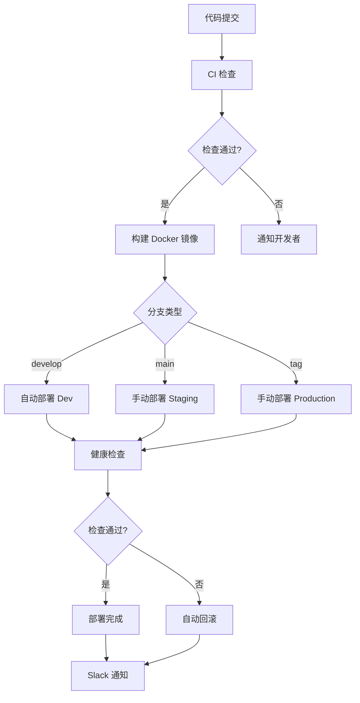

# TOPEMS CI/CD 配置指南

## 目录

- [概述](#概述)
- [项目结构](#项目结构)
- [GitHub Actions 工作流](#github-actions-工作流)
- [GitLab CI 配置](#gitlab-ci-配置)
- [部署脚本](#部署脚本)
- [环境配置](#环境配置)
- [监控系统](#监控系统)
- [质量门禁](#质量门禁)
- [最佳实践](#最佳实践)

## 概述

TOPEMS 系统采用微服务架构，包含以下组件：

- **Rust 后端服务**: backend, notification-service, report-service
- **平台微服务**: topems-doc, topems-flow, topems-iam, topems-lims, topems-qms, topems-rs, topems-ehs, topems-srm, topems-ai
- **前端应用**: React + TypeScript

本 CI/CD 方案支持：

- 多环境部署（dev, staging, production）
- 自动和手动部署策略
- 滚动更新和回滚机制
- Docker 容器化
- 完整的测试覆盖
- 安全扫描和质量门禁

## 项目结构

```
TOPEMS/
├── .github/
│   └── workflows/          # GitHub Actions 工作流
│       ├── ci.yml         # 持续集成流程
│       ├── cd.yml         # 持续部署流程
│       ├── test.yml       # 测试流程
│       └── docker.yml     # Docker 构建和推送
├── .gitlab-ci.yml         # GitLab CI 配置
├── scripts/               # 部署和运维脚本
│   ├── deploy.sh          # 部署脚本
│   ├── rollback.sh        # 回滚脚本
│   ├── health_check.sh    # 健康检查脚本
│   ├── db_migrate.sh      # 数据库迁移脚本
│   ├── service_manager.sh # 服务管理脚本
│   └── monitor.sh         # 监控脚本
├── infrastructure/         # 基础设施配置
│   ├── docker/            # Docker 配置
│   └── systemd/          # systemd 服务文件
└── .env.example          # 环境变量示例
```

## GitHub Actions 工作流

### 1. CI Pipeline (.github/workflows/ci.yml)

持续集成流程包含以下阶段：

#### 代码质量检查 (code-quality)
- Rust 代码格式化检查 (cargo fmt)
- Rust 代码检查 (cargo clippy)
- TypeScript 代码格式检查 (Prettier)
- ESLint 代码检查

#### 构建 (build)
- **后端构建**: 编译所有 Rust 服务
- **前端构建**: 编译 React 应用
- **缓存策略**: 使用 cargo 和 npm 缓存

#### 测试 (test)
- 单元测试 (cargo test)
- 集成测试
- E2E 测试 (Playwright)
- 覆盖率报告 (Codecov)

#### 安全扫描 (security-scan)
- Rust 安全审计 (cargo audit)
- npm 安全审计
- Docker 镜像扫描 (Trivy)

**触发条件**:
- Push 到 main, develop, release/** 分支
- Pull Request 创建或更新

### 2. CD Pipeline (.github/workflows/cd.yml)

持续部署流程支持三个环境：

#### 开发环境 (dev)
- **触发**: 自动部署（develop 分支推送）
- **流程**:
  1. 下载构建产物
  2. 部署到开发服务器
  3. 运行数据库迁移
  4. 健康检查
  5. Slack 通知

#### 测试环境 (staging)
- **触发**: 手动确认
- **流程**: 同开发环境
- **要求**: 开发环境部署成功

#### 生产环境 (production)
- **触发**: 手动触发（发布版本）
- **流程**:
  1. 创建备份
  2. 滚动更新
  3. 健康检查
  4. Slack 通知

### 3. Test Pipeline (.github/workflows/test.yml)

独立的测试流程，包含：

- 单元测试
- 集成测试
- 代码覆盖率检查（阈值 80%）
- 性能基准测试

**触发条件**: 计划任务（每日 2 AM）

### 4. Docker Pipeline (.github/workflows/docker.yml)

Docker 镜像构建和推送：

- 多架构构建（amd64, arm64）
- 镜像标签策略
- 支持手动选择服务构建
- 镜像安全扫描

## GitLab CI 配置

完整的 GitLab CI/CD 流水线配置（.gitlab-ci.yml），包含：

1. **代码质量检查阶段**: Rust 和前端代码检查
2. **构建阶段**: 后端和前端构建
3. **测试阶段**: 单元、集成、E2E 测试
4. **安全扫描阶段**: 依赖审计和镜像扫描
5. **Docker 构建阶段**: 多服务镜像构建
6. **部署阶段**: 环境部署
7. **通知阶段**: Slack 通知

**主要特性**:
- 并行矩阵构建
- 自动和手动部署
- 完整的测试覆盖
- 缓存优化

## 部署脚本

### 1. deploy.sh

部署脚本支持以下命令：

```bash
# 部署
./scripts/deploy.sh deploy dev
./scripts/deploy.sh deploy staging
./scripts/deploy.sh deploy production

# 重启服务
./scripts/deploy.sh restart dev

# 滚动更新
./scripts/deploy.sh rolling-update production

# 查看状态
./scripts/deploy.sh status dev
```

**功能**:
- 前置检查
- 后端服务部署
- 前端部署
- 符号链接更新
- 旧版本清理

### 2. rollback.sh

回滚脚本支持以下命令：

```bash
# 创建备份
./scripts/rollback.sh backup production

# 回滚版本
./scripts/rollback.sh rollback production 20240101120000

# 回滚数据库
./scripts/rollback.sh rollback-database production

# 恢复备份
./scripts/rollback.sh restore production /path/to/backup.tar.gz

# 查看备份
./scripts/rollback.sh list production
```

**功能**:
- 自动备份
- 版本回滚
- 数据库恢复
- 备份管理

### 3. health_check.sh

健康检查脚本：

```bash
# 完整健康检查
./scripts/health_check.sh full dev

# 快速检查
./scripts/health_check.sh quick staging

# 服务状态
./scripts/health_check.sh status production
```

**检查项**:
- 数据库连接
- Redis 连接
- 服务端口可达性
- HTTP 健康端点

### 4. db_migrate.sh

数据库迁移脚本：

```bash
# 运行迁移
./scripts/db_migrate.sh migrate production

# 查看状态
./scripts/db_migrate.sh status staging

# 回滚迁移
./scripts/db_migrate.sh rollback production 20240101120000

# 填充数据
./scripts/db_migrate.sh seed dev

# 重置数据库
./scripts/db_migrate.sh reset dev
```

**功能**:
- 自动创建迁移表
- 版本跟踪
- 迁移历史记录
- 种子数据填充

### 5. service_manager.sh

服务管理脚本：

```bash
# 安装 systemd 服务
./scripts/service_manager.sh install dev

# 启用开机自启
./scripts/service_manager.sh enable dev

# 启动服务
./scripts/service_manager.sh start dev

# 查看状态
./scripts/service_manager.sh status dev

# 重启服务
./scripts/service_manager.sh restart dev
```

### 6. monitor.sh

监控脚本：

```bash
# 单次监控
./scripts/monitor.sh monitor

# 持续监控
./scripts/monitor.sh continuous

# 生成报告
./scripts/monitor.sh report

# 查看阈值
./scripts/monitor.sh thresholds
```

**监控指标**:
- CPU 使用率
- 内存使用率
- 磁盘使用率
- 响应时间
- 错误率
- 服务健康状态

## 环境配置

### 环境变量 (.env)

创建各环境的配置文件：

```bash
# 生产环境
cp .env.example /opt/topems/production/.env
vim /opt/topems/production/.env
```

**必须修改的配置**:

```env
POSTGRES_PASSWORD=<强密码>
JWT_SECRET=<随机密钥>
```

### 服务端口分配

| 服务 | 端口 | 描述 |
|------|------|------|
| backend | 8080 | 主后端服务 |
| notification-service | 8081 | 通知服务 |
| report-service | 8082 | 报表服务 |
| topems-doc | 8083 | 文档管理服务 |
| topems-flow | 8084 | 工作流服务 |
| topems-iam | 8085 | 身份认证服务 |
| topems-lims | 8086 | LIMS 服务 |
| topems-qms | 8087 | 质量管理服务 |
| topems-rs | 8088 | 研究服务 |
| topems-ehs | 8089 | EHS 服务 |
| topems-srm | 8090 | SRM 服务 |
| topems-ai | 8091 | AI 服务 |

### systemd 服务安装

```bash
# 安装服务文件
./scripts/service_manager.sh install production

# 启用开机自启
./scripts/service_manager.sh enable production

# 启动服务
./scripts/service_manager.sh start production
```

## 监控系统

### 告警阈值配置

编辑 `$MONITORING_DIR/alert_thresholds.conf`:

```conf
CPU_WARNING=80
CPU_CRITICAL=90
MEMORY_WARNING=80
MEMORY_CRITICAL=90
DISK_WARNING=85
DISK_CRITICAL=95
RESPONSE_TIME_WARNING=1000
RESPONSE_TIME_CRITICAL=3000
ERROR_RATE_WARNING=1
ERROR_RATE_CRITICAL=5
```

### Slack 集成

配置 Slack Webhook URL：

1. 在 Slack 创建 Incoming Webhook
2. 在 GitHub/GitLab 仓库设置中添加 secret：`SLACK_WEBHOOK_URL`
3. 告警将自动发送到配置的 Slack 频道

## 质量门禁

### 测试覆盖率

- **要求**: 代码覆盖率 > 80%
- **检查**: 在 CI 流程中自动检查
- **报告**: Codecov 集成

### 代码质量

- **Rust**: cargo fmt + cargo clippy
- **TypeScript**: Prettier + ESLint
- **安全**: cargo audit + npm audit

### 构建要求

- 所有测试必须通过
- 代码质量检查必须通过
- 安全扫描无高危漏洞（可选）

## 最佳实践

### 1. 部署流程



### 2. 回滚流程

```bash
# 1. 查看可用版本
ls -la /opt/topems/production/releases/

# 2. 执行回滚
./scripts/rollback.sh rollback production <version>

# 3. 验证回滚
./scripts/health_check.sh full production
```

### 3. 数据库迁移

```bash
# 1. 创建迁移文件
vim /opt/topems/production/migrations/20240101120000_add_table.sql

# 2. 运行迁移
./scripts/db_migrate.sh migrate production

# 3. 验证
./scripts/db_migrate.sh status production
```

### 4. 紧急故障处理

```bash
# 1. 检查服务状态
./scripts/service_manager.sh status production

# 2. 查看日志
journalctl -u topems-backend-production -n 100

# 3. 重启服务
./scripts/service_manager.sh restart production

# 4. 如需要，回滚
./scripts/rollback.sh rollback production
```

## 配置清单

### GitHub Secrets

在仓库 Settings > Secrets 中配置：

```bash
# SSH 密钥
DEV_SSH_KEY
STAGING_SSH_KEY
PRODUCTION_SSH_KEY

# Slack
SLACK_WEBHOOK_URL

# Docker Hub
DOCKERHUB_USERNAME
DOCKERHUB_TOKEN

# Codecov
CODECOV_TOKEN
```

### 服务器要求

**最低配置**:
- CPU: 4 核
- 内存: 8 GB
- 磁盘: 100 GB

**推荐配置**:
- CPU: 8 核
- 内存: 16 GB
- 磁盘: 200 GB SSD

## 故障排除

### 常见问题

1. **构建失败**: 检查 Rust 和 Node.js 版本
2. **部署失败**: 检查 SSH 密钥和服务状态
3. **数据库连接失败**: 检查环境变量和网络
4. **回滚失败**: 检查备份文件和权限

### 日志位置

- systemd 日志: `journalctl -u <service-name>`
- 应用日志: `/opt/topems/<env>/logs/`
- 迁移日志: `/opt/topems/<env>/logs/migration-*.log`

### 获取帮助

如遇问题，请检查：

1. CI/CD 流水线日志
2. 服务器日志
3. 健康检查报告
4. 监控告警记录

---

**文档版本**: 1.0.0  
**更新日期**: 2026-05-22  
**维护团队**: TOPEMS DevOps Team
