# TOPEMS 架构图

## 概述

本文档使用 Mermaid 图表展示 TOPEMS 项目的整体架构、服务关系、数据流、部署架构等，帮助开发者和用户快速理解系统结构。

## 目录

- [整体架构](#整体架构)
- [分层架构](#分层架构)
- [微服务架构](#微服务架构)
- [服务关系图](#服务关系图)
- [数据流图](#数据流图)
- [认证授权流程](#认证授权流程)
- [AI 服务架构](#ai-服务架构)
- [部署架构](#部署架构)
- [高可用架构](#高可用架构)
- [监控架构](#监控架构)

---

## 整体架构

### 系统总览

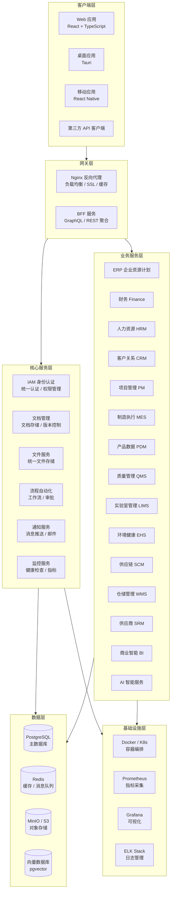

---

## 分层架构

### 五层架构模型

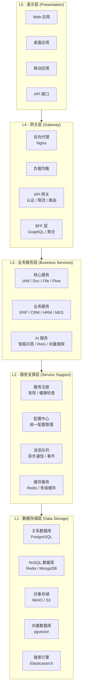

---

## 微服务架构

### 服务分类与端口

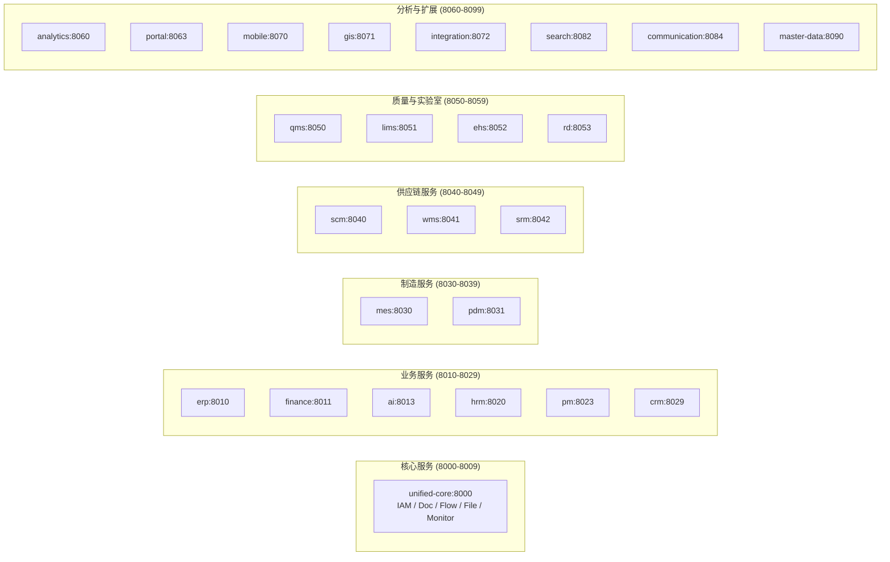

---

## 服务关系图

### 服务依赖关系

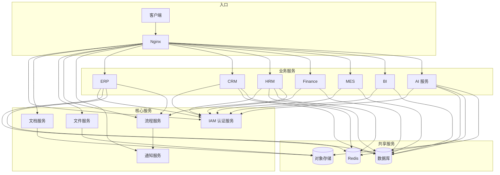

---

## 数据流图

### 用户请求数据流

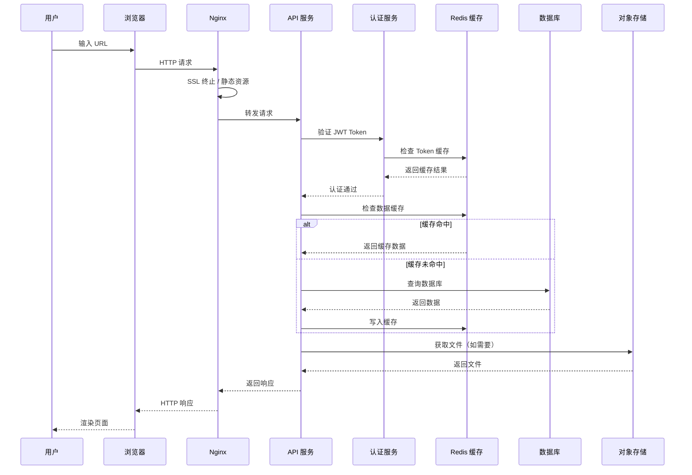

---

## 认证授权流程

### JWT 认证流程

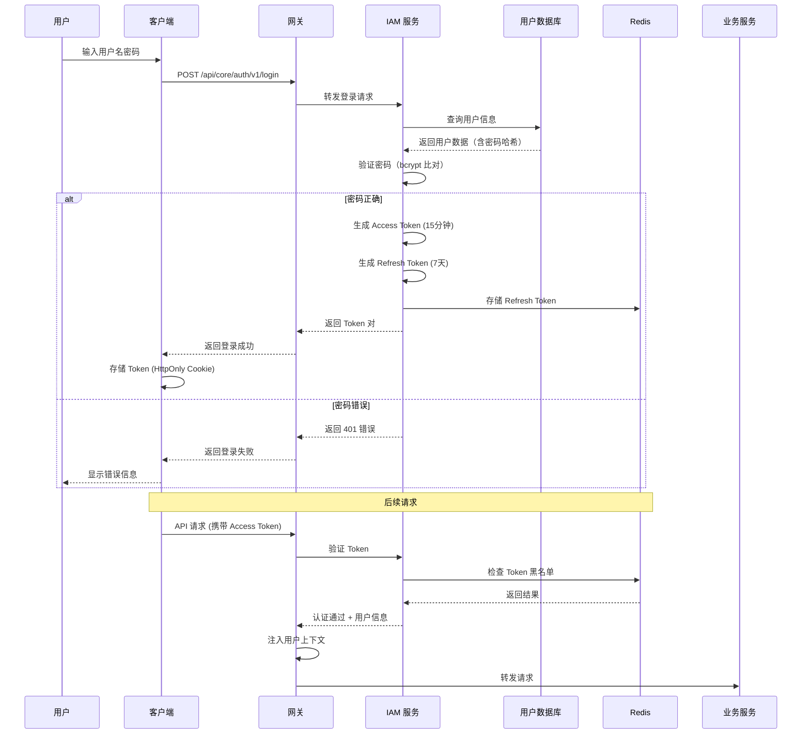

### Token 刷新流程

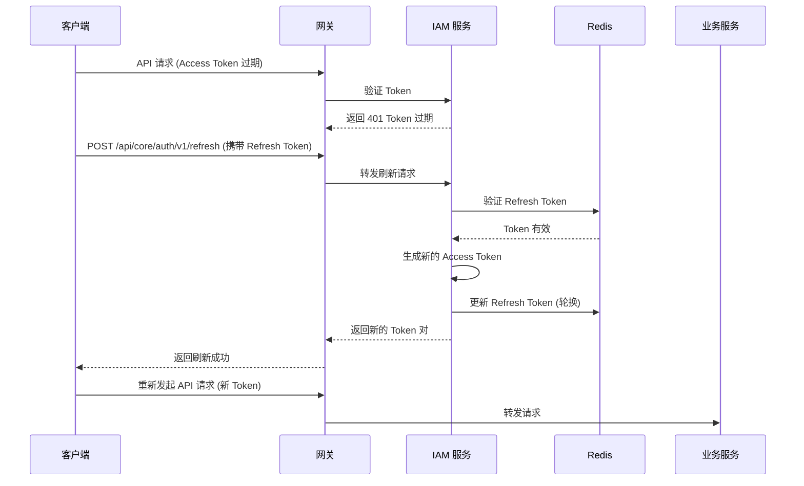

---

## AI 服务架构

### RAG 检索增强生成

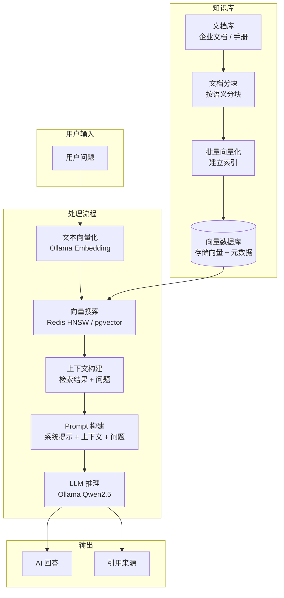

### AI 对话流程

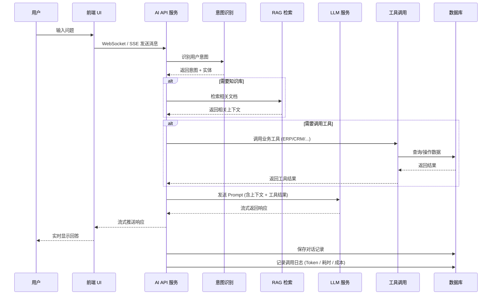

---

## 部署架构

### 单机部署（开发/测试）

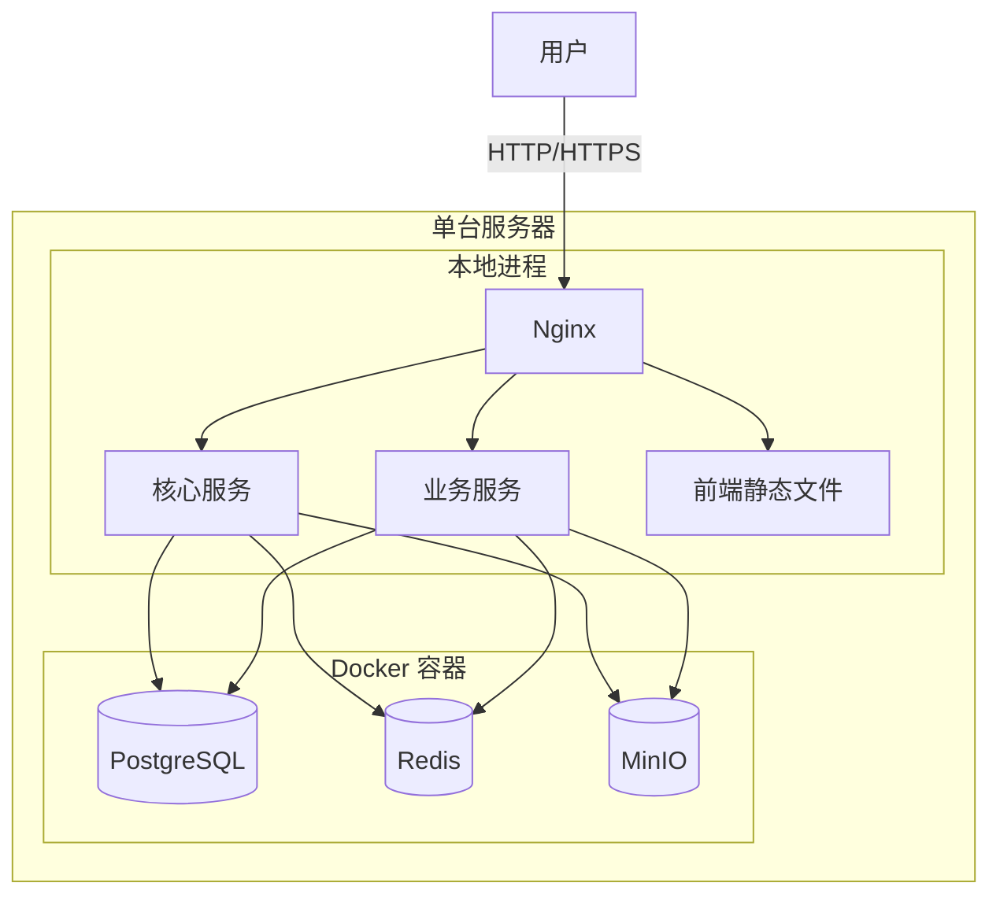

### 生产环境部署（高可用）

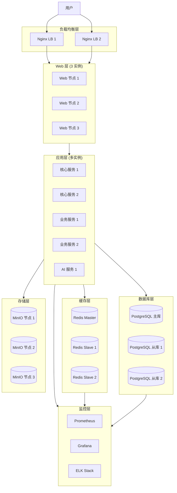

---

## 高可用架构

### 高可用设计

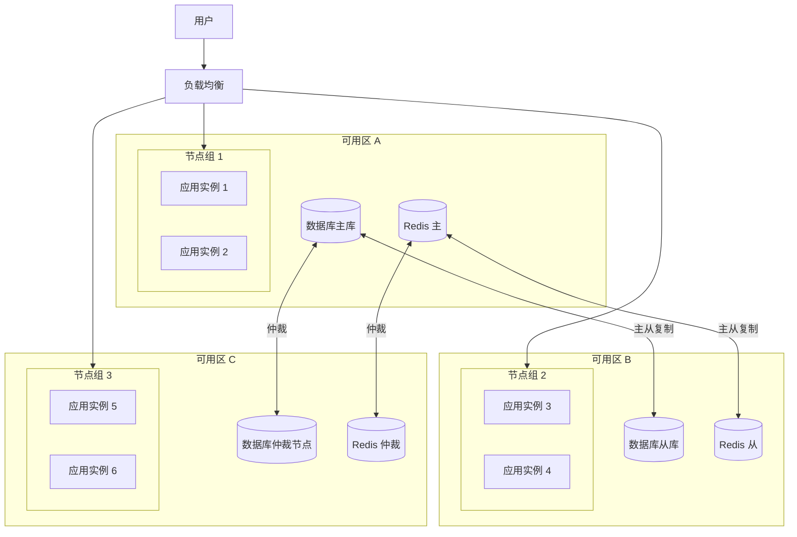

### 故障转移流程

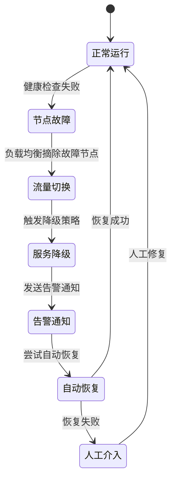

---

## 监控架构

### 可观测性架构

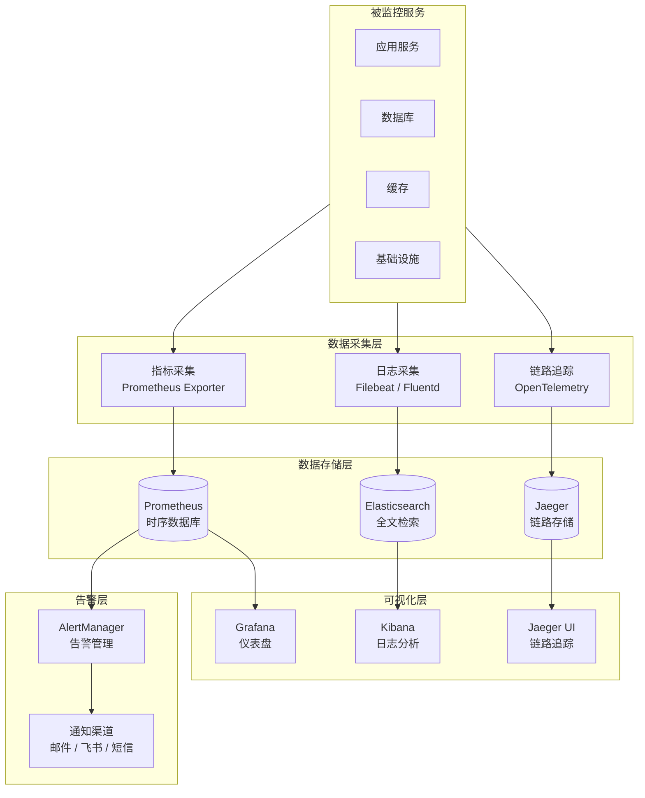

### 监控指标体系

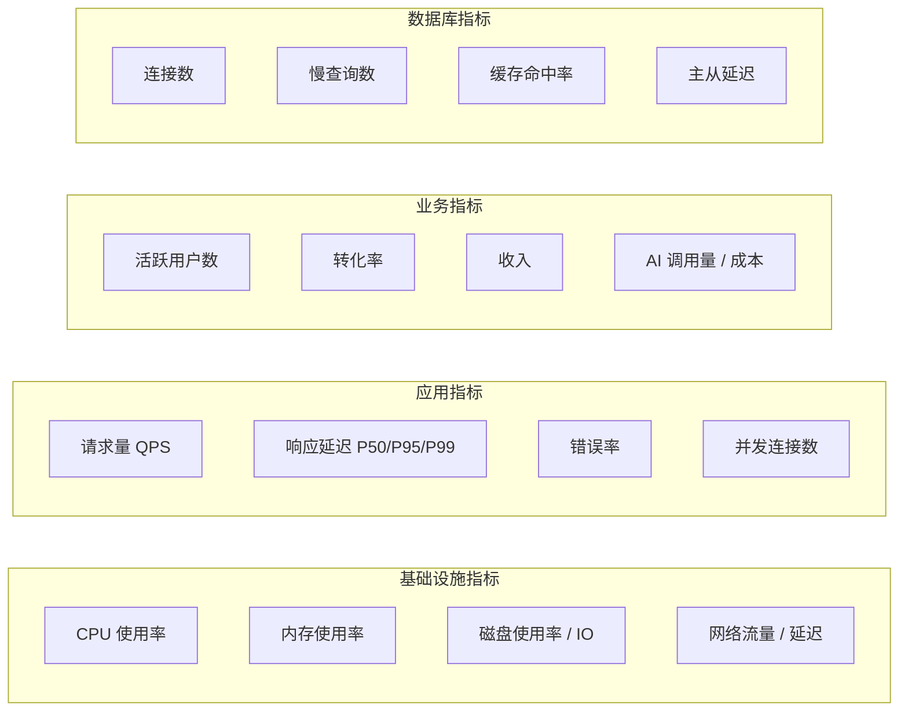

---

## 总结

本文档展示了 TOPEMS 项目的完整架构，包括：

1. **整体架构** - 客户端、网关、核心服务、业务服务、数据层、基础设施
2. **分层架构** - 五层架构模型（表示层、网关层、业务服务层、服务支撑层、数据存储层）
3. **微服务架构** - 28+ 个服务的分类和端口分配
4. **服务关系图** - 服务间的依赖和调用关系
5. **数据流图** - 用户请求的完整数据流
6. **认证授权流程** - JWT 认证和 Token 刷新流程
7. **AI 服务架构** - RAG 检索增强生成和 AI 对话流程
8. **部署架构** - 单机部署和生产环境高可用部署
9. **高可用架构** - 多可用区部署和故障转移流程
10. **监控架构** - 可观测性架构和监控指标体系

这些图表帮助开发者和用户快速理解 TOPEMS 的系统结构和工作原理。

---

*本文档最后更新：2026-08-28*
*架构图使用 Mermaid 语法，可在支持 Mermaid 的 Markdown 渲染器中查看。*
