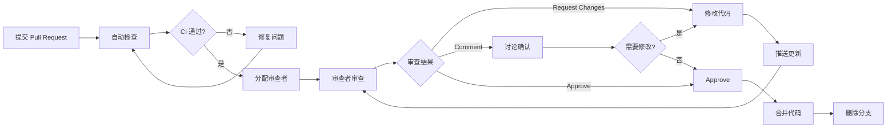

# TOPEMS 代码质量与审查指南

## 概述

本文档定义 TOPEMS 项目的代码质量标准、代码审查流程、质量保证措施和持续改进策略，确保项目代码的可维护性、可读性、性能和安全性。

## 目录

- [代码质量标准](#代码质量标准)
- [代码规范](#代码规范)
- [代码审查流程](#代码审查流程)
- [代码审查清单](#代码审查清单)
- [质量保证措施](#质量保证措施)
- [测试质量标准](#测试质量标准)
- [性能质量标准](#性能质量标准)
- [安全质量标准](#安全质量标准)
- [文档质量标准](#文档质量标准)
- [持续改进](#持续改进)
- [代码质量工具](#代码质量工具)
- [常见代码问题](#常见代码问题)

---

## 代码质量标准

### 质量维度

TOPEMS 代码质量从以下 6 个维度进行评估：

| 维度 | 说明 | 权重 |
|------|------|------|
| **功能性** | 代码是否正确实现了预期功能 | 25% |
| **可读性** | 代码是否易于理解和阅读 | 20% |
| **可维护性** | 代码是否易于修改和扩展 | 20% |
| **性能** | 代码是否高效运行 | 15% |
| **安全性** | 代码是否存在安全漏洞 | 15% |
| **可测试性** | 代码是否易于测试 | 5% |

### 质量等级

| 等级 | 分数范围 | 说明 |
|------|---------|------|
| **A（优秀）** | 90-100 | 代码质量优秀，可以作为范例 |
| **B（良好）** | 80-89 | 代码质量良好，符合标准 |
| **C（合格）** | 70-79 | 代码质量合格，可以接受 |
| **D（需改进）** | 60-69 | 代码质量需要改进 |
| **F（不合格）** | <60 | 代码质量不合格，必须重写 |

### 质量目标

- **代码审查通过率**：≥ 95%
- **测试覆盖率**：≥ 80%（核心模块 ≥ 90%）
- **Bug 密度**：≤ 2 个/千行代码
- **代码重复率**：≤ 5%
- **圈复杂度**：函数 ≤ 10，类 ≤ 20
- **安全漏洞**：0 个高危漏洞

---

## 代码规范

### Rust 代码规范

#### 命名规范

```rust
// 类型（结构体、枚举、Trait）使用大驼峰命名
pub struct UserService { ... }
pub enum OrderStatus { ... }
pub trait Repository { ... }

// 函数、方法、变量使用蛇形命名
pub fn create_user(user: User) -> Result<User, Error> { ... }
let user_name = String::from("张三");

// 常量使用全大写蛇形命名
const MAX_RETRY_COUNT: u32 = 3;
pub const DEFAULT_PAGE_SIZE: usize = 20;

// 静态变量使用全大写蛇形命名
static mut GLOBAL_COUNTER: u64 = 0;

// 模块名使用蛇形命名
mod user_service;
mod order_handler;

// 泛型参数使用单个大写字母
pub fn find<T>(id: Uuid) -> Result<T, Error> where T: Entity { ... }

// 生命周期参数使用小写字母
fn get_name<'a>(&'a self) -> &'a str { ... }
```

#### 代码结构

```rust
// 1. 模块文档注释
//! 用户服务模块
//!
//! 提供用户管理的核心业务逻辑。

// 2. 外部依赖导入
use std::collections::HashMap;
use uuid::Uuid;

// 3. 内部模块导入
use crate::error::AppError;
use crate::model::User;

// 4. 常量定义
const DEFAULT_PAGE_SIZE: usize = 20;
const MAX_PAGE_SIZE: usize = 100;

// 5. 类型定义
pub type UserResult<T> = Result<T, AppError>;

// 6. 结构体定义
pub struct UserService {
    repository: UserRepository,
    cache: CacheService,
}

// 7. 枚举定义
pub enum UserStatus {
    Active,
    Inactive,
    Suspended,
}

// 8. Trait 定义
pub trait UserRepository {
    fn find_by_id(&self, id: Uuid) -> UserResult<Option<User>>;
    fn save(&self, user: User) -> UserResult<User>;
}

// 9. 实现块
impl UserService {
    pub fn new(repository: UserRepository, cache: CacheService) -> Self {
        Self { repository, cache }
    }

    pub async fn get_user(&self, id: Uuid) -> UserResult<Option<User>> {
        // 先查缓存
        if let Some(user) = self.cache.get(&id.to_string()).await? {
            return Ok(Some(user));
        }

        // 再查数据库
        let user = self.repository.find_by_id(id).await?;

        // 写入缓存
        if let Some(ref user) = user {
            self.cache.set(&id.to_string(), user).await?;
        }

        Ok(user)
    }
}

// 10. 测试模块
#[cfg(test)]
mod tests {
    use super::*;

    #[test]
    fn test_get_user() {
        // 测试代码
    }
}
```

#### 错误处理

```rust
// 使用 thiserror 定义自定义错误类型
#[derive(Debug, thiserror::Error)]
pub enum AppError {
    #[error("用户不存在: {0}")]
    UserNotFound(Uuid),

    #[error("数据库错误: {0}")]
    Database(#[from] sqlx::Error),

    #[error("缓存错误: {0}")]
    Cache(#[from] redis::RedisError),

    #[error("验证错误: {0}")]
    Validation(String),
}

// 使用 ? 操作符传播错误
pub async fn get_user(&self, id: Uuid) -> Result<User, AppError> {
    let user = self.repository.find_by_id(id).await?
        .ok_or(AppError::UserNotFound(id))?;
    Ok(user)
}

// 不要忽略错误
// 错误：let _ = function_that_might_fail();
// 正确：function_that_might_fail()?;
// 或：if let Err(e) = function_that_might_fail() {
//         log::error!("操作失败: {}", e);
//     }
```

#### 注释规范

```rust
// 文档注释（用于公共 API）
/// 创建新用户
///
/// 根据提供的用户信息创建新用户账户。
///
/// # 参数
///
/// * `user` - 用户信息
///
/// # 返回
///
/// 返回创建成功的用户信息
///
/// # 错误
///
/// 如果用户名已存在，返回 `AppError::UserAlreadyExists`
///
/// # 示例
///
/// ```
/// let user = User::new("张三", "zhangsan@example.com");
/// let created = service.create_user(user).await?;
/// ```
pub async fn create_user(&self, user: User) -> Result<User, AppError> {
    // 实现代码
}

// 行内注释（解释复杂逻辑）
fn calculate_discount(price: f64, quantity: u32) -> f64 {
    // 批量折扣：购买超过 10 件享受 10% 折扣
    let bulk_discount = if quantity > 10 { 0.1 } else { 0.0 };

    // VIP 折扣：在批量折扣基础上再享受 5% 折扣
    let vip_discount = 0.05;

    price * (1.0 - bulk_discount - vip_discount)
}

// TODO 注释
// TODO: 优化查询性能，添加索引
// FIXME: 修复并发安全问题
// HACK: 临时解决方案，后续需要重构
```

### TypeScript/React 代码规范

#### 命名规范

```typescript
// 组件使用大驼峰命名
const UserProfile = () => { ... };
class OrderService { ... }

// 函数、变量使用小驼峰命名
const getUserInfo = async (id: string) => { ... };
const userName = '张三';

// 常量使用全大写蛇形命名
const MAX_RETRY_COUNT = 3;
const API_BASE_URL = '/api';

// 类型、接口使用大驼峰命名
interface User {
    id: string;
    name: string;
}

type OrderStatus = 'pending' | 'paid' | 'shipped';

// 枚举使用大驼峰命名
enum UserRole {
    Admin = 'admin',
    User = 'user',
}

// 文件名：组件使用大驼峰，工具函数使用小驼峰
// UserProfile.tsx, useAuth.ts, apiClient.ts
```

#### 组件结构

```typescript
// 1. 导入
import React, { useState, useEffect } from 'react';
import { useParams } from 'react-router-dom';

// 2. 类型定义
interface UserProfileProps {
    userId?: string;
}

interface UserData {
    id: string;
    name: string;
    email: string;
}

// 3. 常量
const DEFAULT_AVATAR = '/images/default-avatar.png';

// 4. 自定义 Hooks（如果有）
const useUser = (userId: string) => {
    const [user, setUser] = useState<UserData | null>(null);
    const [loading, setLoading] = useState(true);

    useEffect(() => {
        const fetchUser = async () => {
            try {
                const response = await fetch(`/api/users/${userId}`);
                const data = await response.json();
                setUser(data);
            } finally {
                setLoading(false);
            }
        };
        fetchUser();
    }, [userId]);

    return { user, loading };
};

// 5. 主组件
export const UserProfile: React.FC<UserProfileProps> = ({ userId }) => {
    const { id: paramId } = useParams<{ id: string }>();
    const actualUserId = userId || paramId || '';
    const { user, loading } = useUser(actualUserId);

    if (loading) {
        return <div>加载中...</div>;
    }

    if (!user) {
        return <div>用户不存在</div>;
    }

    return (
        <div className="user-profile">
            
            <h1>{user.name}</h1>
            <p>{user.email}</p>
        </div>
    );
};

// 6. 默认导出
export default UserProfile;
```

#### 错误处理

```typescript
// 使用 try-catch 处理异步错误
const fetchUser = async (id: string): Promise<User> => {
    try {
        const response = await fetch(`/api/users/${id}`);

        if (!response.ok) {
            throw new Error(`HTTP error! status: ${response.status}`);
        }

        const data = await response.json();
        return data;
    } catch (error) {
        console.error('获取用户信息失败:', error);
        throw new Error('获取用户信息失败，请稍后重试');
    }
};

// 使用错误边界处理组件错误
class ErrorBoundary extends React.Component<
    { children: React.ReactNode },
    { hasError: boolean; error: Error | null }
> {
    constructor(props: { children: React.ReactNode }) {
        super(props);
        this.state = { hasError: false, error: null };
    }

    static getDerivedStateFromError(error: Error) {
        return { hasError: true, error };
    }

    componentDidCatch(error: Error, errorInfo: React.ErrorInfo) {
        console.error('组件错误:', error, errorInfo);
    }

    render() {
        if (this.state.hasError) {
            return <div>出错了: {this.state.error?.message}</div>;
        }
        return this.props.children;
    }
}
```

---

## 代码审查流程

### 审查流程图



### 审查前准备

提交者在提交 Pull Request 前应完成：

- [ ] 代码已通过本地编译和测试
- [ ] 代码已通过 lint 和格式化检查
- [ ] 新增功能有对应的测试
- [ ] 公共 API 有文档注释
- [ ] 已更新相关文档（README、CHANGELOG 等）
- [ ] PR 标题和描述清晰完整
- [ ] 关联了相关的 Issue
- [ ] 添加了合适的标签（Label）
- [ ] PR 大小适中（建议不超过 400 行变更）

### 审查者职责

审查者应：

1. **及时审查**：在 24 小时内开始审查
2. **全面审查**：检查代码的各个方面
3. **建设性反馈**：提供具体、有建设性的意见
4. **尊重他人**：对事不对人，保持专业态度
5. **学习交流**：将审查作为学习和交流的机会

### 审查响应

提交者应：

1. **认真阅读**：仔细阅读每条审查意见
2. **及时响应**：在 24 小时内响应审查意见
3. **逐条回复**：对每条意见进行回复（已修改/同意/不同意并说明原因）
4. **及时修改**：根据审查意见修改代码
5. **保持耐心**：理解审查是为了提高代码质量

### 合并标准

Pull Request 满足以下条件才能合并：

- [ ] 至少 1 名审查者 Approve
- [ ] 所有 CI 检查通过
- [ ] 所有审查意见已处理
- [ ] 代码冲突已解决
- [ ] 测试覆盖率达标
- [ ] 文档已更新

### 合并方式

推荐使用以下合并方式：

1. **Squash and merge（推荐）**：将多个提交压缩为一个提交，保持历史整洁
2. **Rebase and merge**：将提交 rebase 到目标分支，保持线性历史
3. **Create a merge commit**：创建合并提交，保留完整历史

---

## 代码审查清单

### 功能性审查

- [ ] 代码是否正确实现了需求？
- [ ] 边界条件是否处理？（空值、零值、最大值、最小值）
- [ ] 错误处理是否完善？
- [ ] 异常情况是否考虑？（网络失败、超时、并发）
- [ ] 业务逻辑是否正确？
- [ ] 是否有遗漏的功能点？
- [ ] 是否与现有功能冲突？

### 代码质量审查

- [ ] 代码是否符合项目规范？
- [ ] 命名是否清晰、有意义？
- [ ] 函数/类职责是否单一？
- [ ] 是否有重复代码？
- [ ] 注释是否充分且准确？
- [ ] 代码是否简洁，没有冗余？
- [ ] 是否有魔法数字/字符串？
- [ ] 函数是否过长？（建议不超过 50 行）
- [ ] 类是否过大？（建议不超过 500 行）
- [ ] 参数是否过多？（建议不超过 5 个）

### 性能审查

- [ ] 是否有明显的性能问题？
- [ ] 数据库查询是否优化？
- [ ] 是否有 N+1 查询问题？
- [ ] 是否使用了合适的索引？
- [ ] 缓存使用是否合理？
- [ ] 是否有内存泄漏风险？
- [ ] 循环中是否有耗时操作？
- [ ] 是否有不必要的重复计算？
- [ ] 大数据量处理是否考虑分页？
- [ ] 异步操作是否合理使用？

### 安全性审查

- [ ] 是否有 SQL 注入风险？（使用参数化查询）
- [ ] 是否有 XSS 风险？（对用户输入进行转义）
- [ ] 是否有 CSRF 风险？（使用 CSRF Token）
- [ ] 输入验证是否完善？
- [ ] 敏感数据是否加密？
- [ ] 权限控制是否正确？
- [ ] 是否有硬编码的密钥或密码？
- [ ] 错误信息是否泄露敏感信息？
- [ ] 文件上传是否安全？（验证类型、大小、路径）
- [ ] 是否有路径遍历风险？
- [ ] 依赖库是否有已知漏洞？

### 测试审查

- [ ] 测试是否覆盖了主要功能？
- [ ] 测试用例命名是否清晰？
- [ ] 测试是否可以独立运行？
- [ ] 是否有 flaky test？
- [ ] 新增功能是否有对应的测试？
- [ ] Bug 修复是否有回归测试？
- [ ] 边界条件是否有测试？
- [ ] 错误场景是否有测试？
- [ ] 测试数据是否合理？
- [ ] 测试是否有断言？

### 文档审查

- [ ] 公共 API 是否有文档注释？
- [ ] 复杂逻辑是否有说明？
- [ ] README 或相关文档是否已更新？
- [ ] 变更日志是否已更新？
- [ ] 示例代码是否正确？
- [ ] 文档是否与代码一致？

### 可维护性审查

- [ ] 代码是否易于理解？
- [ ] 代码是否易于修改？
- [ ] 是否遵循了设计原则？（SOLID、DRY、KISS、YAGNI）
- [ ] 耦合度是否合理？
- [ ] 内聚度是否足够？
- [ ] 是否易于扩展？
- [ ] 是否有技术债务？（标记 TODO/FIXME）
- [ ] 是否有不必要的抽象？
- [ ] 是否有过早优化？

---

## 质量保证措施

### 自动化检查

#### 代码格式化

```bash
# Rust 代码格式化
cargo fmt

# 检查代码格式（不修改）
cargo fmt --check

# TypeScript 代码格式化
pnpm run format

# 检查代码格式
pnpm run format:check
```

#### Lint 检查

```bash
# Rust Lint
cargo clippy --all-targets --all-features -- -D warnings

# TypeScript Lint
pnpm run lint

# 修复可自动修复的问题
pnpm run lint:fix
```

#### 类型检查

```bash
# TypeScript 类型检查
pnpm run typecheck
```

#### 安全检查

```bash
# Rust 依赖安全检查
cargo audit

# 检查未使用的依赖
cargo machete

# TypeScript 依赖安全检查
pnpm audit
```

### 持续集成

CI/CD 流水线应包含以下检查：

1. **代码格式检查**：`cargo fmt --check`、`pnpm run format:check`
2. **Lint 检查**：`cargo clippy`、`pnpm run lint`
3. **类型检查**：`pnpm run typecheck`
4. **单元测试**：`cargo test`、`pnpm run test`
5. **集成测试**：端到端测试
6. **安全检查**：`cargo audit`、`pnpm audit`
7. **覆盖率检查**：测试覆盖率报告
8. **构建检查**：确保代码可以正常构建

### 代码质量门禁

设置代码质量门禁，不满足条件的 PR 不能合并：

- **测试覆盖率**：≥ 80%（核心模块 ≥ 90%）
- **代码重复率**：≤ 5%
- **圈复杂度**：函数 ≤ 10，类 ≤ 20
- **安全漏洞**：0 个高危漏洞
- **Bug 密度**：≤ 2 个/千行代码
- **代码审查**：至少 1 名审查者 Approve
- **CI 检查**：所有检查必须通过

### 定期代码审查

- **每周代码审查会议**：团队一起审查本周的代码
- **每月代码质量报告**：生成代码质量报告，分析趋势
- **每季度技术债务清理**：集中清理技术债务
- **每年代码架构评估**：评估代码架构，制定改进计划

---

## 测试质量标准

### 测试金字塔

```
        /\
       /  \
      / E2E\      端到端测试（少量）
     /------\
    /集成测试\    集成测试（适量）
   /----------\
  /  单元测试   \  单元测试（大量）
  ----------------
```

### 测试覆盖率要求

| 模块类型 | 行覆盖率 | 分支覆盖率 | 函数覆盖率 |
|---------|---------|-----------|-----------|
| 核心模块（认证、权限、支付） | ≥ 90% | ≥ 85% | ≥ 95% |
| 业务模块 | ≥ 80% | ≥ 75% | ≥ 85% |
| 工具模块 | ≥ 85% | ≥ 80% | ≥ 90% |
| UI 组件 | ≥ 70% | ≥ 60% | ≥ 75% |
| 整体项目 | ≥ 80% | ≥ 70% | ≥ 85% |

### 测试命名规范

```rust
// Rust 测试命名：test_<功能>_<场景>_<预期结果>
#[test]
fn test_create_user_with_valid_data_returns_success() { ... }

#[test]
fn test_create_user_with_duplicate_email_returns_error() { ... }

#[test]
fn test_get_user_with_nonexistent_id_returns_none() { ... }
```

```typescript
// TypeScript 测试命名：<功能> <场景> <预期结果>
describe('UserService', () => {
    describe('createUser', () => {
        it('should return success when data is valid', () => { ... });
        it('should return error when email is duplicate', () => { ... });
    });
});
```

### 测试编写原则

1. **AAA 模式**：Arrange（准备）、Act（执行）、Assert（断言）
2. **单一职责**：每个测试只测试一个功能点
3. **独立性**：测试之间不相互依赖
4. **可重复性**：多次运行结果一致
5. **快速执行**：单元测试应在秒级完成
6. **清晰命名**：测试名称应描述测试内容
7. **完整断言**：断言应验证所有相关结果
8. **边界测试**：测试边界条件和异常情况

### 测试示例

```rust
#[cfg(test)]
mod tests {
    use super::*;

    #[test]
    fn test_create_user_success() {
        // Arrange
        let repository = MockUserRepository::new();
        let service = UserService::new(repository);
        let user = User::new("张三", "zhangsan@example.com");

        // Act
        let result = service.create_user(user).await;

        // Assert
        assert!(result.is_ok());
        let created = result.unwrap();
        assert_eq!(created.name, "张三");
        assert_eq!(created.email, "zhangsan@example.com");
        assert!(!created.id.is_nil());
    }

    #[test]
    fn test_create_user_duplicate_email() {
        // Arrange
        let mut repository = MockUserRepository::new();
        repository.set_find_by_email_return(Some(User::new("李四", "zhangsan@example.com")));
        let service = UserService::new(repository);
        let user = User::new("张三", "zhangsan@example.com");

        // Act
        let result = service.create_user(user).await;

        // Assert
        assert!(result.is_err());
        assert!(matches!(result.unwrap_err(), AppError::UserAlreadyExists(_)));
    }
}
```

---

## 性能质量标准

### 性能指标

| 指标 | 目标值 | 说明 |
|------|--------|------|
| API 响应时间（P50） | < 100ms | 50% 的请求响应时间 |
| API 响应时间（P95） | < 500ms | 95% 的请求响应时间 |
| API 响应时间（P99） | < 1s | 99% 的请求响应时间 |
| 页面加载时间 | < 2s | 首屏加载时间 |
| 数据库查询时间 | < 50ms | 单次查询时间 |
| 并发用户数 | ≥ 1000 | 系统支持的并发用户数 |
| 吞吐量 | ≥ 1000 QPS | 系统每秒处理请求数 |
| 错误率 | < 0.1% | 请求错误率 |
| 资源利用率 | < 70% | CPU/内存利用率 |

### 性能优化原则

1. **避免过早优化**：先保证正确性，再优化性能
2. **测量驱动优化**：使用性能分析工具定位瓶颈
3. **算法优先**：优先优化算法和数据结构
4. **缓存策略**：合理使用缓存减少计算和 IO
5. **异步处理**：耗时操作使用异步处理
6. **批量操作**：减少网络和数据库往返次数
7. **延迟加载**：按需加载，不预加载不必要的数据
8. **资源释放**：及时释放不再使用的资源

### 常见性能问题

| 问题 | 症状 | 解决方案 |
|------|------|---------|
| N+1 查询 | 列表查询慢，数据库压力大 | 使用批量查询、预加载、JOIN |
| 缺少索引 | 查询慢，全表扫描 | 添加合适的索引 |
| 大事务 | 锁等待，并发性能差 | 拆分事务，缩短事务时间 |
| 内存泄漏 | 内存持续增长，OOM | 使用内存分析工具，释放资源 |
| 同步阻塞 | 响应慢，吞吐量低 | 使用异步、非阻塞 IO |
| 重复计算 | CPU 利用率高 | 使用缓存、记忆化 |
| 大对象 | 内存占用高，GC 频繁 | 优化数据结构，流式处理 |
| 网络往返 | 延迟高 | 批量操作，减少请求次数 |

---

## 安全质量标准

### OWASP Top 10

必须防范 OWASP Top 10 安全风险：

1. **注入攻击**（SQL、NoSQL、OS、LDAP）- 使用参数化查询
2. **身份认证失效** - 使用安全的会话管理、强密码策略
3. **敏感数据泄露** - 加密传输和存储敏感数据
4. **XML 外部实体（XXE）** - 禁用外部实体解析
5. **访问控制失效** - 实施最小权限原则
6. **安全配置错误** - 安全的默认配置，及时更新
7. **跨站脚本（XSS）** - 对输出进行转义，使用 CSP
8. **不安全的反序列化** - 不反序列化不可信数据
9. **使用含有已知漏洞的组件** - 定期更新依赖，安全扫描
10. **日志和监控不足** - 完整的日志记录和实时监控

### 安全检查清单

#### 输入验证

- [ ] 所有用户输入都进行验证
- [ ] 使用白名单验证（而非黑名单）
- [ ] 验证数据类型、长度、格式、范围
- [ ] 拒绝无效输入，不尝试修复
- [ ] 文件上传验证类型、大小、内容

#### 认证授权

- [ ] 使用安全的密码哈希算法（bcrypt、Argon2）
- [ ] 实施账户锁定机制
- [ ] 使用 HTTPS 传输认证信息
- [ ] Token 设置合理的过期时间
- [ ] 实施最小权限原则
- [ ] 验证每个请求的权限
- [ ] 防止水平越权和垂直越权

#### 数据保护

- [ ] 敏感数据加密存储
- [ ] 使用 TLS 加密传输
- [ ] 不在日志中记录敏感数据
- [ ] 不在 URL 中传递敏感数据
- [ ] 数据库连接信息使用环境变量
- [ ] 定期备份数据并加密存储

#### 输出编码

- [ ] 对 HTML 输出进行转义
- [ ] 对 JavaScript 输出进行转义
- [ ] 对 CSS 输出进行转义
- [ ] 对 URL 参数进行编码
- [ ] 设置 Content-Type 正确的字符集

#### 安全配置

- [ ] 禁用不必要的服务和功能
- [ ] 修改默认密码和配置
- [ ] 保持依赖库最新版本
- [ ] 配置安全响应头（CSP、X-Frame-Options 等）
- [ ] 配置 CORS 白名单
- [ ] 实施速率限制
- [ ] 配置 Web 应用防火墙（WAF）

---

## 文档质量标准

### 文档类型

| 文档类型 | 要求 | 负责人 |
|---------|------|--------|
| 代码注释 | 公共 API 必须有文档注释 | 开发者 |
| README | 项目介绍、安装、使用说明 | 项目负责人 |
| API 文档 | 接口说明、参数、返回值、示例 | 后端开发者 |
| 架构文档 | 系统架构、设计决策 | 架构师 |
| 开发指南 | 开发规范、工作流程 | 技术负责人 |
| 运维文档 | 部署、监控、故障排查 | 运维负责人 |
| 用户手册 | 功能说明、操作指南 | 产品负责人 |
| 变更日志 | 版本变更记录 | 发布负责人 |

### 文档编写原则

1. **准确性**：文档内容必须准确，与代码一致
2. **完整性**：覆盖所有必要的信息
3. **清晰性**：语言简洁明了，易于理解
4. **一致性**：术语、格式、风格一致
5. **时效性**：及时更新，反映最新状态
6. **可搜索**：结构清晰，便于搜索和导航
7. **示例丰富**：提供充足的代码示例和使用示例

### 代码注释标准

```rust
// 好的注释：解释为什么，而不是做什么
// 为什么：因为批量查询可以减少数据库往返次数，提升性能
let users = self.repository.find_by_ids(user_ids).await?;

// 不好的注释：解释做什么（代码本身已经说明）
// 查询用户列表
let users = self.repository.find_all().await?;
```

---

## 持续改进

### 代码质量度量

定期收集和分析以下质量指标：

- **代码覆盖率**：测试覆盖的代码比例
- **代码重复率**：重复代码的比例
- **圈复杂度**：代码的复杂程度
- **技术债务**：需要修复的技术问题
- **Bug 密度**：每千行代码的 Bug 数量
- **审查通过率**：一次通过审查的 PR 比例
- **平均审查时间**：从提交到审查完成的平均时间
- **修复时间**：从发现 Bug 到修复的平均时间

### 技术债务管理

1. **记录技术债务**：使用 TODO/FIXME 注释或 Issue 跟踪
2. **评估优先级**：根据影响和风险确定优先级
3. **制定计划**：安排时间逐步清理技术债务
4. **定期回顾**：每月回顾技术债务清单
5. **预防新增**：代码审查中关注技术债务

### 知识分享

- **代码审查会议**：每周团队代码审查
- **技术分享会**：每月技术分享
- **最佳实践文档**：整理和分享最佳实践
- **代码范例库**：建立优秀代码范例库
- **新人培训**：完善的新人培训体系

---

## 代码质量工具

### Rust 工具

| 工具 | 用途 | 命令 |
|------|------|------|
| `rustfmt` | 代码格式化 | `cargo fmt` |
| `clippy` | 代码 Lint | `cargo clippy` |
| `cargo-audit` | 安全审计 | `cargo audit` |
| `cargo-outdated` | 依赖更新检查 | `cargo outdated` |
| `cargo-machete` | 未使用依赖检查 | `cargo machete` |
| `tarpaulin` | 测试覆盖率 | `cargo tarpaulin` |
| `cargo-geiger` | 不安全代码检测 | `cargo geiger` |

### TypeScript 工具

| 工具 | 用途 | 命令 |
|------|------|------|
| `Prettier` | 代码格式化 | `pnpm run format` |
| `ESLint` | 代码 Lint | `pnpm run lint` |
| `TypeScript` | 类型检查 | `pnpm run typecheck` |
| `Jest/Vitest` | 单元测试 | `pnpm run test` |
| `Playwright` | 端到端测试 | `pnpm run test:e2e` |
| `npm audit` | 安全审计 | `pnpm audit` |
| `depcheck` | 未使用依赖检查 | `npx depcheck` |

### 通用工具

| 工具 | 用途 |
|------|------|
| `SonarQube` | 代码质量分析平台 |
| `CodeQL` | 代码安全分析 |
| `Snyk` | 依赖安全扫描 |
| `Dependabot` | 依赖自动更新 |
| `GitHub Actions` | CI/CD 流水线 |

---

## 常见代码问题

### Rust 常见问题

#### 1. 不必要的 clone

```rust
// 不好：不必要的 clone
fn process_user(user: &User) {
    let cloned = user.clone();
    // 只读取 cloned 的数据
}

// 好：直接使用引用
fn process_user(user: &User) {
    // 直接使用 user
}
```

#### 2. 忽略错误

```rust
// 不好：忽略错误
let _ = save_user(&user);

// 好：处理错误
if let Err(e) = save_user(&user) {
    log::error!("保存用户失败: {}", e);
    return Err(e);
}
```

#### 3. 使用 unwrap

```rust
// 不好：在生产代码中使用 unwrap
let user = get_user(id).unwrap();

// 好：使用 ? 或 match
let user = get_user(id)?;

// 或
let user = match get_user(id) {
    Ok(user) => user,
    Err(e) => {
        log::error!("获取用户失败: {}", e);
        return Err(e);
    }
};
```

#### 4. 过大的函数

```rust
// 不好：函数过长，职责过多
fn process_order(order: Order) -> Result<(), Error> {
    // 100+ 行代码，包含验证、计算、保存、通知等
}

// 好：拆分为多个小函数
fn process_order(order: Order) -> Result<(), Error> {
    validate_order(&order)?;
    let total = calculate_total(&order);
    let saved = save_order(order, total)?;
    send_notification(&saved)?;
    Ok(())
}
```

### TypeScript 常见问题

#### 1.  any 类型

```typescript
// 不好：使用 any
const processData = (data: any) => { ... };

// 好：定义具体类型
interface UserData {
    id: string;
    name: string;
}

const processData = (data: UserData) => { ... };
```

#### 2. 非空断言

```typescript
// 不好：使用非空断言
const name = user!.name;

// 好：检查空值
if (!user) {
    throw new Error('用户不存在');
}
const name = user.name;
```

#### 3. 魔法数字

```typescript
// 不好：魔法数字
if (status === 1) { ... }

// 好：使用枚举或常量
enum OrderStatus {
    Pending = 1,
    Paid = 2,
    Shipped = 3,
}

if (status === OrderStatus.Pending) { ... }
```

#### 4. 重复代码

```typescript
// 不好：重复代码
const getUserNames = (users: User[]) => users.map(u => u.name);
const getOrderNames = (orders: Order[]) => orders.map(o => o.name);

// 好：提取通用函数
const getNames = <T extends { name: string }>(items: T[]) =>
    items.map(item => item.name);
```

---

*本文档最后更新：2026-08-28*
*代码质量标准会根据项目实践持续优化，请关注最新版本。*
