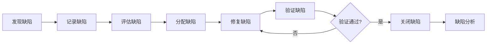

# TOPEMS 项目质量管理

## 概述

本文档定义 TOPEMS 项目的质量管理体系，包括质量计划、质量保证、质量控制、质量改进和质量工具，确保项目交付物满足质量要求和用户期望。

## 目录

- [质量管理目标](#质量管理目标)
- [质量管理原则](#质量管理原则)
- [质量计划](#质量计划)
- [质量保证](#质量保证)
- [质量控制](#质量控制)
- [质量标准](#质量标准)
- [质量检查清单](#质量检查清单)
- [质量工具](#质量工具)
- [质量度量](#质量度量)
- [质量问题管理](#质量问题管理)
- [质量改进](#质量改进)
- [质量审计](#质量审计)
- [质量管理最佳实践](#质量管理最佳实践)

---

## 质量管理目标

### 总体目标

建立全面的质量管理体系，确保：

1. **交付物质量**：所有交付物满足质量标准和用户需求
2. **过程质量**：项目过程规范、高效、可控
3. **产品质量**：最终产品功能完整、性能优良、安全可靠
4. **服务质量**：项目服务响应及时、专业、满意
5. **持续改进**：持续改进质量管理体系和过程

### 具体质量目标

| 质量维度 | 指标 | 目标值 | 测量方法 |
|---------|------|--------|---------|
| **功能质量** | 需求覆盖率 | ≥ 95% | 需求追溯矩阵 |
| | 功能测试通过率 | ≥ 98% | 测试报告 |
| | 严重缺陷数 | 0 | 缺陷管理系统 |
| **性能质量** | API 响应时间（P95） | < 500ms | 性能测试 |
| | 系统可用性 | ≥ 99.9% | 监控系统 |
| | 并发用户数 | ≥ 1000 | 压力测试 |
| **代码质量** | 代码审查通过率 | ≥ 95% | 代码审查记录 |
| | 测试覆盖率 | ≥ 80% | 覆盖率工具 |
| | 代码重复率 | ≤ 5% | 代码分析工具 |
| | 圈复杂度（函数） | ≤ 10 | 代码分析工具 |
| **安全质量** | 高危安全漏洞 | 0 | 安全扫描工具 |
| | 中危安全漏洞 | ≤ 5 | 安全扫描工具 |
| | 安全审计通过率 | 100% | 安全审计报告 |
| **文档质量** | 文档完整率 | ≥ 95% | 文档检查清单 |
| | 文档准确率 | ≥ 98% | 文档评审 |
| | 文档更新及时率 | ≥ 90% | 文档管理系统 |
| **用户满意度** | 用户满意度 | ≥ 85% | 用户满意度调查 |
| | 缺陷修复及时率 | ≥ 90% | 缺陷管理系统 |
| | 问题响应时间 | ≤ 4小时 | 服务台系统 |

---

## 质量管理原则

### 核心原则

1. **以客户为中心**：理解并满足客户需求和期望
2. **领导作用**：领导层确立质量方向和目标
3. **全员参与**：全体人员参与质量管理
4. **过程方法**：将活动作为过程进行管理
5. **改进**：持续改进是永恒的目标
6. **循证决策**：基于数据和信息进行决策
7. **关系管理**：与相关方建立互利关系

### 质量理念

1. **质量是设计出来的**：在设计阶段考虑质量，而非事后检查
2. **质量是每个人的责任**：每个人都对自己的工作质量负责
3. **预防胜于检查**：通过预防措施避免质量问题
4. **持续改进**：不断改进过程和产品质量
5. **数据驱动**：基于数据进行质量决策和改进
6. **客户导向**：以客户需求和满意度为导向

---

## 质量计划

### 质量管理流程


### 质量规划步骤

1. **识别质量要求**：识别客户和相关方的质量要求
2. **制定质量标准**：制定项目质量标准和规范
3. **确定质量指标**：确定可测量的质量指标
4. **制定质量计划**：制定质量管理计划和活动
5. **分配质量责任**：明确各角色的质量责任
6. **配置质量资源**：配置质量管理所需的资源
7. **建立质量流程**：建立质量保证和控制流程

### 质量责任分配

| 角色 | 质量责任 |
|------|---------|
| **项目经理** | 整体质量管理，质量目标达成，质量资源配置 |
| **技术负责人** | 技术质量，代码质量，架构质量，技术评审 |
| **质量负责人** | 质量计划制定，质量保证，质量控制，质量审计 |
| **产品负责人** | 需求质量，产品质量，用户体验质量 |
| **测试负责人** | 测试质量，测试覆盖，缺陷管理，测试报告 |
| **开发人员** | 代码质量，单元测试，代码审查，缺陷修复 |
| **运维人员** | 部署质量，运维质量，系统稳定性，监控质量 |
| **文档人员** | 文档质量，文档完整，文档准确，文档更新 |

### 质量活动计划

| 质量活动 | 频率 | 参与人 | 输出物 | 负责人 |
|---------|------|--------|--------|--------|
| **需求评审** | 每个需求 | 产品、开发、测试 | 评审记录 | 产品负责人 |
| **设计评审** | 每个设计 | 技术团队 | 评审记录 | 技术负责人 |
| **代码审查** | 每次提交 | 开发团队 | 审查记录 | 技术负责人 |
| **单元测试** | 每次提交 | 开发人员 | 测试报告 | 开发人员 |
| **集成测试** | 每周 | 测试团队 | 测试报告 | 测试负责人 |
| **系统测试** | 每阶段 | 测试团队 | 测试报告 | 测试负责人 |
| **性能测试** | 每阶段 | 测试团队 | 性能报告 | 测试负责人 |
| **安全测试** | 每阶段 | 安全团队 | 安全报告 | 安全负责人 |
| **质量审计** | 每月 | 质量负责人 | 审计报告 | 质量负责人 |
| **质量评审会** | 每月 | 核心团队 | 会议纪要 | 项目经理 |
| **用户验收测试** | 上线前 | 用户、测试 | 验收报告 | 产品负责人 |

---

## 质量保证

### 质量保证活动

1. **过程审计**：审计项目过程是否符合规范和标准
2. **产品审计**：审计产品是否满足质量要求
3. **质量培训**：对团队进行质量意识和技能培训
4. **质量工具**：提供和维护质量管理工具
5. **质量文档**：维护质量管理文档和模板
6. **质量度量**：收集和分析质量度量数据
7. **质量报告**：定期发布质量报告
8. **质量改进**：推动质量改进活动

### 过程质量保证

#### 需求过程质量

- [ ] 需求文档完整、清晰、可测试
- [ ] 需求经过评审和确认
- [ ] 需求变更经过控制流程
- [ ] 需求可追溯到设计和测试
- [ ] 需求优先级明确

#### 设计过程质量

- [ ] 设计文档完整、清晰
- [ ] 设计经过评审和确认
- [ ] 设计满足需求和非功能需求
- [ ] 设计考虑可扩展性、可维护性
- [ ] 设计遵循架构原则和标准

#### 开发过程质量

- [ ] 代码遵循编码规范
- [ ] 代码经过代码审查
- [ ] 单元测试覆盖核心逻辑
- [ ] 代码提交有清晰的注释
- [ ] 构建和部署自动化

#### 测试过程质量

- [ ] 测试计划完整、可执行
- [ ] 测试用例覆盖需求和场景
- [ ] 测试执行规范、记录完整
- [ ] 缺陷管理规范、跟踪闭环
- [ ] 测试报告准确、及时

#### 部署过程质量

- [ ] 部署计划完整、经过评审
- [ ] 部署过程自动化、可重复
- [ ] 部署前有回滚方案
- [ ] 部署后有验证检查
- [ ] 部署记录完整

### 产品质量保证

#### 功能质量保证

- [ ] 所有需求功能已实现
- [ ] 功能符合需求规格说明
- [ ] 边界条件和异常情况处理
- [ ] 功能之间集成正常
- [ ] 用户操作流程顺畅

#### 性能质量保证

- [ ] 响应时间满足性能要求
- [ ] 并发处理能力满足要求
- [ ] 系统资源使用合理
- [ ] 大数据量处理性能良好
- [ ] 性能瓶颈已识别和优化

#### 安全质量保证

- [ ] 身份认证和授权安全
- [ ] 数据加密和传输安全
- [ ] 输入验证和输出编码
- [ ] 安全漏洞已修复
- [ ] 安全审计和日志完整

#### 可靠性质量保证

- [ ] 系统可用性满足要求
- [ ] 故障恢复机制完善
- [ ] 数据备份和恢复正常
- [ ] 错误处理和容错机制
- [ ] 系统稳定性经过验证

#### 易用性质量保证

- [ ] 用户界面设计友好
- [ ] 操作流程简单直观
- [ ] 帮助文档完整准确
- [ ] 错误提示清晰有用
- [ ] 响应速度用户可接受

---

## 质量控制

### 质量控制方法

1. **检查**：对交付物进行检查和验证
2. **测试**：通过测试发现缺陷和问题
3. **审查**：通过评审发现问题和改进点
4. **度量**：通过度量数据监控质量状态
5. **统计**：通过统计分析发现质量趋势
6. **审计**：通过审计验证过程和产品合规性

### 质量控制阶段

#### 需求阶段质量控制

- **需求评审**：评审需求文档的完整性、清晰性、可测试性
- **需求确认**：与客户确认需求理解一致
- **需求追溯**：建立需求追溯矩阵

#### 设计阶段质量控制

- **设计评审**：评审设计文档的合理性、完整性
- **架构评审**：评审架构设计的可扩展性、可维护性
- **原型验证**：通过原型验证设计方案

#### 开发阶段质量控制

- **代码审查**：审查代码质量、规范、逻辑
- **静态分析**：使用工具进行静态代码分析
- **单元测试**：验证代码单元功能正确性
- **构建检查**：确保代码可以正常构建

#### 测试阶段质量控制

- **测试用例评审**：评审测试用例的完整性、有效性
- **测试执行监控**：监控测试执行进度和质量
- **缺陷管理**：管理缺陷的发现、修复、验证
- **测试报告**：生成测试报告，评估测试质量

#### 部署阶段质量控制

- **部署检查**：检查部署准备情况
- **部署验证**：验证部署结果是否正确
- **冒烟测试**：部署后进行快速验证
- **回滚准备**：准备回滚方案和步骤

### 质量控制阈值

| 质量指标 | 警告阈值 | 行动阈值 | 处理措施 |
|---------|---------|---------|---------|
| 严重缺陷数 | > 0 | > 0 | 立即修复，暂停发布 |
| 高危安全漏洞 | > 0 | > 0 | 立即修复，安全审计 |
| 测试覆盖率 | < 85% | < 80% | 补充测试，质量审查 |
| 代码重复率 | > 5% | > 10% | 代码重构，消除重复 |
| 圈复杂度（函数） | > 8 | > 10 | 代码重构，简化逻辑 |
| API 响应时间（P95） | > 400ms | > 500ms | 性能优化，架构调整 |
| 系统可用性 | < 99.95% | < 99.9% | 稳定性优化，故障排查 |
| 缺陷修复及时率 | < 95% | < 90% | 增加资源，优化流程 |
| 构建成功率 | < 98% | < 95% | 排查构建问题，优化流程 |

---

## 质量标准

### 代码质量标准

#### Rust 代码质量标准

| 指标 | 标准 | 工具 |
|------|------|------|
| 代码格式 | 符合 rustfmt 规范 | `cargo fmt --check` |
| Lint 检查 | 无 clippy 警告 | `cargo clippy -D warnings` |
| 测试覆盖率 | ≥ 80% | `cargo tarpaulin` |
| 代码重复率 | ≤ 5% | 代码分析工具 |
| 圈复杂度（函数） | ≤ 10 | 代码分析工具 |
| 函数行数 | ≤ 50 行 | 代码审查 |
| 函数参数 | ≤ 5 个 | 代码审查 |
| 公共 API 文档 | 100% 有文档注释 | 代码审查 |
| 不安全代码 | 尽量避免，必须有注释 | 代码审查 |
| 错误处理 | 不使用 unwrap()（除测试外） | 代码审查 |

#### TypeScript 代码质量标准

| 指标 | 标准 | 工具 |
|------|------|------|
| 代码格式 | 符合 Prettier 规范 | `pnpm run format:check` |
| Lint 检查 | 无 ESLint 错误 | `pnpm run lint` |
| 类型检查 | 无 TypeScript 错误 | `pnpm run typecheck` |
| 测试覆盖率 | ≥ 70% | 测试覆盖率工具 |
| 代码重复率 | ≤ 5% | 代码分析工具 |
| 圈复杂度（函数） | ≤ 10 | 代码分析工具 |
| 函数行数 | ≤ 50 行 | 代码审查 |
| 组件行数 | ≤ 300 行 | 代码审查 |
| any 类型使用 | 尽量避免 | 代码审查 |
| 非空断言 | 尽量避免 | 代码审查 |

### 测试质量标准

| 测试类型 | 覆盖率要求 | 执行频率 | 负责人 |
|---------|-----------|---------|--------|
| 单元测试 | ≥ 80%（核心模块 ≥ 90%） | 每次提交 | 开发人员 |
| 集成测试 | ≥ 70% | 每日 | 测试团队 |
| 系统测试 | ≥ 90% 需求覆盖 | 每阶段 | 测试团队 |
| 性能测试 | 满足性能指标 | 每阶段 | 测试团队 |
| 安全测试 | 0 高危漏洞 | 每阶段 | 安全团队 |
| 用户验收测试 | 100% 关键功能 | 上线前 | 用户/产品 |

### 文档质量标准

| 文档类型 | 完整率 | 准确率 | 更新及时率 | 评审要求 |
|---------|--------|--------|-----------|---------|
| 需求文档 | ≥ 95% | ≥ 98% | ≥ 90% | 必须评审 |
| 设计文档 | ≥ 95% | ≥ 98% | ≥ 90% | 必须评审 |
| API 文档 | 100% | ≥ 99% | ≥ 95% | 必须评审 |
| 用户手册 | ≥ 95% | ≥ 98% | ≥ 90% | 必须评审 |
| 运维手册 | ≥ 95% | ≥ 98% | ≥ 90% | 必须评审 |
| 代码注释 | ≥ 80% 公共 API | ≥ 95% | ≥ 90% | 代码审查 |

### 安全质量标准

| 安全维度 | 标准 | 检查方法 |
|---------|------|---------|
| 身份认证 | 强密码策略、MFA 支持、安全会话 | 安全测试 |
| 访问控制 | 最小权限原则、角色权限管理 | 安全审计 |
| 数据加密 | 传输加密（TLS）、存储加密 | 安全扫描 |
| 输入验证 | 所有输入验证、参数化查询 | 代码审查 |
| 输出编码 | 所有输出编码、防止 XSS | 安全测试 |
| 安全日志 | 完整的安全审计日志 | 日志审查 |
| 漏洞管理 | 定期漏洞扫描、及时修复 | 安全扫描 |
| 依赖安全 | 定期检查依赖漏洞 | 依赖扫描 |

---

## 质量检查清单

### 需求质量检查清单

- [ ] 需求文档完整，包含所有功能和非功能需求
- [ ] 需求描述清晰，无歧义
- [ ] 需求可测试，有明确的验收标准
- [ ] 需求优先级明确
- [ ] 需求经过评审和确认
- [ ] 需求变更经过控制流程
- [ ] 需求可追溯到设计和测试
- [ ] 非功能需求（性能、安全、可用性等）已定义
- [ ] 业务规则和约束已明确
- [ ] 接口需求已定义

### 设计质量检查清单

- [ ] 设计文档完整，包含架构设计和详细设计
- [ ] 设计满足需求和非功能需求
- [ ] 架构设计考虑可扩展性、可维护性
- [ ] 设计遵循架构原则和标准
- [ ] 接口设计清晰、一致
- [ ] 数据库设计合理，有索引和优化
- [ ] 安全设计考虑认证、授权、加密
- [ ] 性能设计考虑缓存、异步、批量
- [ ] 错误处理和异常设计完善
- [ ] 设计经过评审和确认
- [ ] 设计有原型或验证

### 代码质量检查清单

- [ ] 代码遵循编码规范和风格
- [ ] 代码经过代码审查
- [ ] 单元测试覆盖核心逻辑
- [ ] 代码无编译错误和警告
- [ ] 代码无 Lint 错误
- [ ] 代码注释充分，公共 API 有文档
- [ ] 代码无硬编码的魔法数字和字符串
- [ ] 代码无重复逻辑
- [ ] 函数职责单一，长度适中
- [ ] 错误处理完善，不忽略错误
- [ ] 代码无安全漏洞
- [ ] 代码性能考虑合理

### 测试质量检查清单

- [ ] 测试计划完整，包含测试范围、策略、资源
- [ ] 测试用例覆盖所有需求和场景
- [ ] 测试用例包含正常、异常、边界场景
- [ ] 测试用例命名清晰，描述准确
- [ ] 测试数据准备充分
- [ ] 测试环境配置正确
- [ ] 测试执行规范，记录完整
- [ ] 缺陷管理规范，跟踪闭环
- [ ] 测试报告准确、及时
- [ ] 测试覆盖率达标
- [ ] 回归测试执行充分
- [ ] 自动化测试覆盖率合理

### 部署质量检查清单

- [ ] 部署计划完整，经过评审
- [ ] 部署过程自动化、可重复
- [ ] 部署前有回滚方案
- [ ] 部署配置正确，环境变量设置
- [ ] 数据库迁移脚本准备和测试
- [ ] 部署后有验证检查清单
- [ ] 冒烟测试用例准备
- [ ] 监控和告警配置
- [ ] 日志收集和分析配置
- [ ] 备份和恢复准备
- [ ] 部署通知和沟通
- [ ] 部署记录完整

### 文档质量检查清单

- [ ] 文档内容完整，覆盖所有必要信息
- [ ] 文档描述准确，无错误
- [ ] 文档结构清晰，易于阅读
- [ ] 文档格式统一，符合规范
- [ ] 文档版本管理规范
- [ ] 文档与代码/产品一致
- [ ] 文档更新及时
- [ ] 文档有目录和索引
- [ ] 文档有示例和截图（如需要）
- [ ] 文档经过评审和确认
- [ ] 文档可搜索、可检索

---

## 质量工具

### 代码质量工具

| 工具 | 用途 | 语言 | 命令 |
|------|------|------|------|
| **rustfmt** | 代码格式化 | Rust | `cargo fmt` |
| **clippy** | 代码 Lint | Rust | `cargo clippy` |
| **cargo-audit** | 安全审计 | Rust | `cargo audit` |
| **tarpaulin** | 测试覆盖率 | Rust | `cargo tarpaulin` |
| **Prettier** | 代码格式化 | TypeScript | `pnpm run format` |
| **ESLint** | 代码 Lint | TypeScript | `pnpm run lint` |
| **TypeScript** | 类型检查 | TypeScript | `pnpm run typecheck` |
| **Jest/Vitest** | 单元测试 | TypeScript | `pnpm run test` |
| **Playwright** | 端到端测试 | TypeScript | `pnpm run test:e2e` |
| **SonarQube** | 代码质量分析 | 多语言 | 平台工具 |
| **CodeQL** | 代码安全分析 | 多语言 | 平台工具 |

### 测试工具

| 工具 | 用途 | 类型 |
|------|------|------|
| **cargo test** | Rust 单元测试 | 单元测试 |
| **Jest/Vitest** | TypeScript 单元测试 | 单元测试 |
| **Postman** | API 测试 | 接口测试 |
| **k6** | 性能测试 | 性能测试 |
| **JMeter** | 性能测试 | 性能测试 |
| **Playwright** | 端到端测试 | E2E 测试 |
| **OWASP ZAP** | 安全测试 | 安全测试 |
| **Snyk** | 依赖安全扫描 | 安全测试 |

### 质量管理工具

| 工具 | 用途 | 说明 |
|------|------|------|
| **Jira/禅道** | 缺陷和任务管理 | 缺陷跟踪、任务管理 |
| **TestRail** | 测试管理 | 测试用例管理、测试执行 |
| **SonarQube** | 代码质量管理 | 代码质量分析、度量 |
| **Grafana** | 质量度量可视化 | 质量指标仪表盘 |
| **Confluence** | 质量管理文档 | 质量文档、知识管理 |
| **飞书项目** | 项目质量管理 | 项目管理、质量跟踪 |

### 质量分析工具

| 工具 | 用途 | 分析维度 |
|------|------|---------|
| **帕累托图** | 缺陷分布分析 | 80/20 法则，找出主要问题 |
| **鱼骨图** | 原因分析 | 分析问题根本原因 |
| **控制图** | 过程稳定性分析 | 监控过程是否稳定 |
| **散点图** | 相关性分析 | 分析两个变量的关系 |
| **直方图** | 分布分析 | 分析数据分布情况 |
| **趋势图** | 趋势分析 | 分析质量指标变化趋势 |

---

## 质量度量

### 质量度量指标

#### 产品质量度量

| 指标 | 定义 | 计算公式 | 目标值 |
|------|------|---------|--------|
| 需求覆盖率 | 已实现需求占总需求的比例 | 已实现需求数 / 总需求数 × 100% | ≥ 95% |
| 缺陷密度 | 每千行代码的缺陷数 | 缺陷数 / 代码行数（千行） | ≤ 2 |
| 缺陷逃逸率 | 发布后发现的缺陷占总缺陷的比例 | 发布后缺陷数 / 总缺陷数 × 100% | ≤ 5% |
| 严重缺陷率 | 严重缺陷占总缺陷的比例 | 严重缺陷数 / 总缺陷数 × 100% | ≤ 5% |
| 平均修复时间 | 缺陷从发现到修复的平均时间 | 修复时间总和 / 缺陷数 | ≤ 3天 |
| 测试通过率 | 通过的测试用例占总测试用例的比例 | 通过测试数 / 总测试数 × 100% | ≥ 98% |

#### 过程质量度量

| 指标 | 定义 | 计算公式 | 目标值 |
|------|------|---------|--------|
| 代码审查覆盖率 | 经过审查的代码占总代码的比例 | 审查代码行数 / 总代码行数 × 100% | 100% |
| 代码审查通过率 | 一次通过审查的代码占比 | 一次通过数 / 总审查数 × 100% | ≥ 85% |
| 构建成功率 | 成功构建占总构建的比例 | 成功构建数 / 总构建数 × 100% | ≥ 98% |
| 部署成功率 | 成功部署占总部署的比例 | 成功部署数 / 总部署数 × 100% | ≥ 95% |
| 需求变更率 | 变更的需求占总需求的比例 | 变更需求数 / 总需求数 × 100% | ≤ 15% |
| 进度偏差率 | 实际进度与计划进度的偏差 | (实际 - 计划) / 计划 × 100% | ≤ 10% |

#### 代码质量度量

| 指标 | 定义 | 目标值 | 测量工具 |
|------|------|--------|---------|
| 测试覆盖率 | 测试覆盖的代码比例 | ≥ 80% | 覆盖率工具 |
| 代码重复率 | 重复代码占总代码的比例 | ≤ 5% | 代码分析工具 |
| 圈复杂度 | 代码逻辑复杂程度 | 函数 ≤ 10 | 代码分析工具 |
| 代码行数 | 代码总量 | 合理范围 | 代码统计工具 |
| 注释率 | 注释占代码的比例 | ≥ 20% | 代码统计工具 |
| 技术债务 | 需要修复的技术问题 | 可控范围 | 代码分析工具 |

#### 服务质量度量

| 指标 | 定义 | 目标值 | 测量方法 |
|------|------|--------|---------|
| 系统可用性 | 系统正常运行时间比例 | ≥ 99.9% | 监控系统 |
| 平均故障间隔时间 | 两次故障之间的平均时间 | ≥ 30天 | 故障记录 |
| 平均恢复时间 | 故障恢复的平均时间 | ≤ 1小时 | 故障记录 |
| 问题响应时间 | 从问题报告到响应的时间 | ≤ 4小时 | 服务台 |
| 问题解决时间 | 从问题报告到解决的时间 | ≤ 3天 | 服务台 |
| 用户满意度 | 用户对服务的满意程度 | ≥ 85% | 满意度调查 |

### 质量度量报告

#### 月度质量报告模板

```
TOPEMS 项目月度质量报告

报告期间：2026年8月
报告日期：2026-08-31
报告人：质量负责人

一、质量概览
- 整体质量状态：良好（绿色）
- 质量目标达成率：92%
- 本月质量评分：88分（上月：85分）
- 质量趋势：稳步提升

二、产品质量
1. 需求覆盖率：95%（目标：≥95%）✅
2. 缺陷密度：1.5个/千行（目标：≤2）✅
3. 缺陷逃逸率：3%（目标：≤5%）✅
4. 严重缺陷率：4%（目标：≤5%）✅
5. 平均修复时间：2.5天（目标：≤3天）✅
6. 测试通过率：98.5%（目标：≥98%）✅

三、过程质量
1. 代码审查覆盖率：100%（目标：100%）✅
2. 代码审查通过率：88%（目标：≥85%）✅
3. 构建成功率：98.5%（目标：≥98%）✅
4. 部署成功率：96%（目标：≥95%）✅
5. 需求变更率：12%（目标：≤15%）✅
6. 进度偏差率：8%（目标：≤10%）✅

四、代码质量
1. 测试覆盖率：82%（目标：≥80%）✅
2. 代码重复率：4.5%（目标：≤5%）✅
3. 圈复杂度：平均6.5（目标：≤10）✅
4. 技术债务：8项（可控）⚠️

五、服务质量
1. 系统可用性：99.92%（目标：≥99.9%）✅
2. 平均故障间隔时间：35天（目标：≥30天）✅
3. 平均恢复时间：45分钟（目标：≤1小时）✅
4. 问题响应时间：3.5小时（目标：≤4小时）✅
5. 用户满意度：86%（目标：≥85%）✅

六、质量问题分析
1. 主要问题：
   - 技术债务有增加趋势（8项）
   - 部分模块测试覆盖率偏低（<75%）

2. 原因分析：
   - 开发进度紧张，技术债务清理不及时
   - 新成员对测试规范不熟悉

3. 改进措施：
   - 安排专门时间清理技术债务
   - 加强新成员测试培训
   - 建立测试覆盖率门禁

七、下月质量计划
1. 重点工作：
   - 清理技术债务，目标减少到5项
   - 提升测试覆盖率，目标达到85%
   - 开展质量培训，提升团队质量意识

2. 质量目标：
   - 整体质量评分：90分
   - 所有质量指标达标
   - 0严重缺陷发布

八、需要支持事项
1. 需要增加测试资源，提升测试覆盖率
2. 需要安排技术债务清理时间
```

---

## 质量问题管理

### 缺陷管理流程



### 缺陷等级定义

| 等级 | 定义 | 示例 | 响应时间 | 修复时间 |
|------|------|------|---------|---------|
| **致命（P0）** | 系统崩溃、数据丢失、核心功能完全不可用 | 系统宕机、数据库损坏、支付功能失效 | 15分钟 | 4小时 |
| **严重（P1）** | 核心功能严重受损，无替代方案 | 登录失败、订单无法提交、数据错误 | 1小时 | 24小时 |
| **一般（P2）** | 非核心功能受损，有替代方案 | 报表导出失败、搜索不准确、UI显示异常 | 4小时 | 3天 |
| **轻微（P3）** | 界面、文案、体验问题，不影响功能 | 错别字、对齐问题、提示信息不准确 | 1天 | 1周 |
| **建议（P4）** | 改进建议、优化建议 | 功能优化建议、体验改进建议 | 3天 | 下版本 |

### 缺陷状态管理

| 状态 | 说明 | 责任人 |
|------|------|--------|
| **新建（New）** | 缺陷刚被创建，尚未评估 | 报告人 |
| **已确认（Confirmed）** | 缺陷已确认，可复现 | 测试负责人 |
| **已分配（Assigned）** | 缺陷已分配给开发人员 | 开发负责人 |
| **修复中（In Progress）** | 开发人员正在修复 | 开发人员 |
| **已修复（Fixed）** | 缺陷已修复，等待验证 | 开发人员 |
| **验证中（In Testing）** | 测试人员正在验证 | 测试人员 |
| **已关闭（Closed）** | 缺陷验证通过，已关闭 | 测试人员 |
| **重新打开（Reopened）** | 缺陷验证不通过，重新修复 | 测试人员 |
| **已拒绝（Rejected）** | 缺陷不成立，或重复 | 测试负责人 |
| **延期（Deferred）** | 缺陷延期到下一版本修复 | 项目经理 |

### 缺陷分析

#### 缺陷分布分析

定期分析缺陷分布，找出质量薄弱环节：

1. **按模块分布**：哪些模块缺陷最多
2. **按类型分布**：哪些类型缺陷最多（功能、性能、安全、UI等）
3. **按严重程度分布**：严重缺陷占比
4. **按引入阶段分布**：缺陷在哪个阶段引入（需求、设计、开发、测试）
5. **按修复时间分布**：缺陷修复时间分布

#### 缺陷根因分析

对严重和重复出现的缺陷进行根因分析：

1. **5 Why 分析**：连续问 5 个为什么，找出根本原因
2. **鱼骨图分析**：从人、机、料、法、环、测六个维度分析
3. **故障树分析**：自上而下分析故障原因
4. ** Pareto 分析**：找出 80% 问题的 20% 原因

---

## 质量改进

### 质量改进流程

1. **识别改进机会**：通过质量度量、审计、反馈识别改进机会
2. **分析改进需求**：分析改进的必要性、可行性、收益
3. **制定改进计划**：制定改进目标、措施、资源、时间
4. **实施改进措施**：执行改进计划，落实改进措施
5. **验证改进效果**：验证改进是否达到预期目标
6. **标准化改进成果**：将改进成果标准化，纳入流程和规范
7. **持续改进**：持续寻找改进机会，循环改进

### 质量改进方法

#### PDCA 循环

- **Plan（计划）**：分析现状，找出问题，制定计划
- **Do（执行）**：实施计划，执行措施
- **Check（检查）**：检查效果，评估结果
- **Act（处理）**：标准化成果，持续改进

#### 六西格玛

- **定义（Define）**：定义问题和目标
- **测量（Measure）**：测量当前状态
- **分析（Analyze）**：分析根本原因
- **改进（Improve）**：实施改进措施
- **控制（Control）**：控制和维持改进成果

#### 质量圈

- 团队成员自愿组成质量改进小组
- 定期讨论质量问题，提出改进建议
- 实施改进措施，分享改进成果
- 培养团队质量意识和改进能力

### 质量改进计划

| 改进领域 | 改进目标 | 改进措施 | 负责人 | 完成时间 | 预期效果 |
|---------|---------|---------|--------|---------|---------|
| 代码质量 | 测试覆盖率提升到85% | 增加测试用例、建立覆盖率门禁 | 技术负责人 | 2026-09-30 | 减少缺陷、提升可维护性 |
| 测试质量 | 自动化测试覆盖率达到60% | 开发自动化测试脚本、CI集成 | 测试负责人 | 2026-10-31 | 提升测试效率、减少回归缺陷 |
| 性能质量 | API响应时间P95<300ms | 性能优化、缓存优化、数据库优化 | 技术负责人 | 2026-09-30 | 提升用户体验、系统吞吐量 |
| 安全质量 | 0中高危漏洞 | 安全扫描、安全培训、安全审计 | 安全负责人 | 2026-09-15 | 提升系统安全性、合规性 |
| 文档质量 | 文档完整率达到98% | 文档模板、文档评审、文档检查 | 文档负责人 | 2026-10-15 | 提升文档质量、减少沟通成本 |
| 流程质量 | 构建成功率达到99% | CI/CD优化、构建流程改进 | 运维负责人 | 2026-09-30 | 提升开发效率、减少部署问题 |

---

## 质量审计

### 质量审计类型

| 审计类型 | 审计内容 | 频率 | 审计人 |
|---------|---------|------|--------|
| **过程审计** | 审计项目过程是否符合规范 | 每月 | 质量负责人 |
| **产品审计** | 审计产品是否满足质量要求 | 每阶段 | 质量负责人 |
| **代码审计** | 审计代码质量和安全 | 每月 | 技术负责人 |
| **安全审计** | 审计系统安全性和合规性 | 每季度 | 安全负责人 |
| **文档审计** | 审计文档质量和完整性 | 每月 | 文档负责人 |
| **供应商审计** | 审计供应商交付物质量 | 按需 | 项目经理 |

### 质量审计流程

1. **制定审计计划**：确定审计目标、范围、时间、人员
2. **准备审计材料**：收集相关文档、记录、数据
3. **执行审计**：通过检查、访谈、测试等方式进行审计
4. **记录审计发现**：记录审计发现的问题和改进建议
5. **编制审计报告**：编制审计报告，总结审计结果
6. **跟踪整改**：跟踪问题整改情况，验证整改效果
7. **审计闭环**：确认所有问题已整改，关闭审计

### 质量审计检查清单

#### 过程审计检查清单

- [ ] 项目过程是否符合组织和项目规范
- [ ] 质量计划是否制定并执行
- [ ] 质量活动是否按计划执行
- [ ] 质量记录是否完整、准确
- [ ] 质量问题是否及时处理和闭环
- [ ] 质量度量是否收集和分析
- [ ] 质量报告是否定期发布
- [ ] 质量改进是否持续进行

#### 产品审计检查清单

- [ ] 产品是否满足需求规格说明
- [ ] 产品是否满足质量标准
- [ ] 产品功能是否完整、正确
- [ ] 产品性能是否满足要求
- [ ] 产品安全性是否满足要求
- [ ] 产品易用性是否满足要求
- [ ] 产品文档是否完整、准确
- [ ] 产品是否经过测试和验证

#### 代码审计检查清单

- [ ] 代码是否遵循编码规范
- [ ] 代码是否经过代码审查
- [ ] 代码是否有充分的单元测试
- [ ] 代码是否有安全漏洞
- [ ] 代码是否有性能问题
- [ ] 代码是否有重复逻辑
- [ ] 代码注释是否充分
- [ ] 代码是否有技术债务

---

## 质量管理最佳实践

### 质量管理 10 大最佳实践

1. **质量第一**：将质量作为项目的首要目标，不牺牲质量赶进度
2. **预防为主**：通过预防措施避免质量问题，而非事后检查和修复
3. **全员参与**：每个人都对质量负责，全员参与质量管理
4. **过程控制**：通过控制过程质量来保证产品质量
5. **数据驱动**：基于数据和度量进行质量决策和改进
6. **持续改进**：持续改进质量体系、过程和产品
7. **客户导向**：以客户需求和满意度为质量导向
8. **标准化**：建立和执行质量标准和规范
9. **工具化**：使用工具提升质量管理效率和准确性
10. **透明化**：质量信息公开透明，及时沟通和反馈

### 常见质量误区

| 误区 | 正确理解 |
|------|---------|
| 质量是测试人员的事 | 质量是每个人的责任，从需求到运维 |
| 质量就是测试 | 测试只是质量控制的一部分，质量保证更重要 |
| 质量会增加成本 | 质量可以减少返工和缺陷成本，长期来看降低成本 |
| 进度紧可以降低质量 | 降低质量会导致更多返工，反而影响进度 |
| 质量是完美无缺 | 质量是满足需求和期望，不是追求完美 |
| 质量检查越多越好 | 质量检查应该有针对性和效率，不是越多越好 |
| 质量问题都是开发的问题 | 质量问题可能来自需求、设计、测试、运维等各个环节 |
| 质量管理就是写文档 | 质量管理重在执行和改进，不是写文档 |

### 质量文化建设

1. **领导垂范**：领导层重视质量，以身作则
2. **质量培训**：定期进行质量意识和技能培训
3. **质量激励**：建立质量激励机制，奖励质量优秀的团队和个人
4. **质量分享**：定期分享质量经验和最佳实践
5. **质量氛围**：营造重视质量、追求卓越的团队氛围
6. **质量参与**：鼓励全员参与质量改进活动
7. **质量透明**：质量信息公开透明，不隐瞒质量问题
8. **质量改进**：持续改进质量，追求卓越

---

*本文档最后更新：2026-08-28*
*质量管理体系会根据项目实践持续优化，请关注最新版本。*
*质量是项目成功的基石，需要全体团队成员共同努力和持续改进。*
