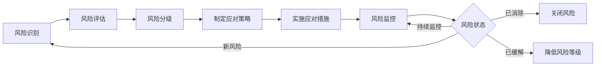
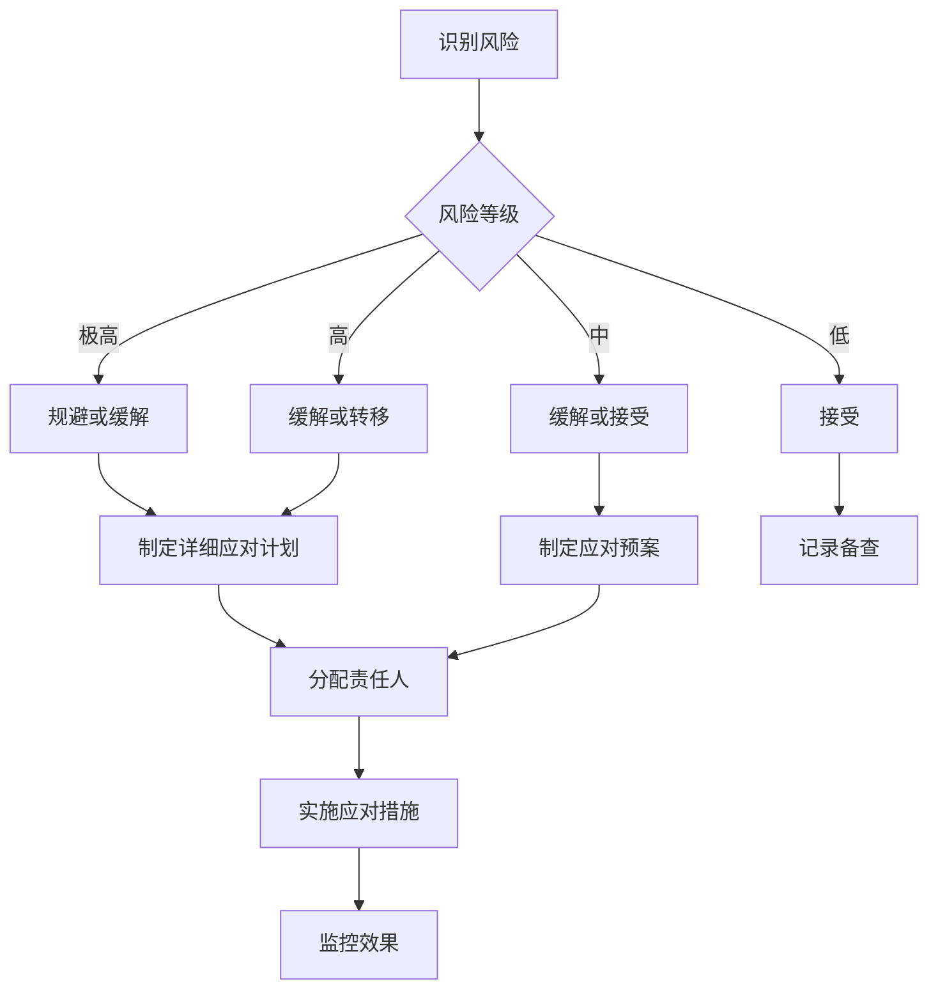
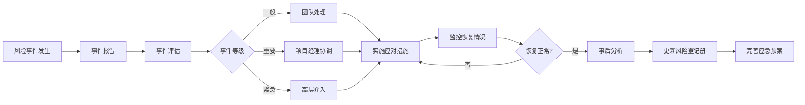

# TOPEMS 项目风险评估与管理

## 概述

本文档对 TOPEMS 项目进行全面的风险评估，识别潜在风险，评估风险等级，制定应对策略，并建立风险监控机制，确保项目顺利实施和交付。

## 目录

- [风险管理框架](#风险管理框架)
- [风险识别](#风险识别)
- [风险评估](#风险评估)
- [技术风险](#技术风险)
- [项目管理风险](#项目管理风险)
- [人员风险](#人员风险)
- [业务风险](#业务风险)
- [安全风险](#安全风险)
- [运维风险](#运维风险)
- [合规风险](#合规风险)
- [风险应对策略](#风险应对策略)
- [风险监控](#风险监控)
- [应急预案](#应急预案)
- [风险登记册](#风险登记册)

---

## 风险管理框架

### 风险管理流程



### 风险管理原则

1. **全面性**：覆盖项目所有方面的风险
2. **前瞻性**：提前识别潜在风险，防患于未然
3. **动态性**：风险状态持续变化，需要持续监控
4. **可操作性**：应对策略具体可行，责任到人
5. **成本效益**：应对措施的成本不超过风险造成的损失
6. **透明性**：风险信息公开透明，及时沟通

### 风险责任分工

| 角色 | 风险管理职责 |
|------|------------|
| **项目经理** | 整体风险管理，风险协调，风险报告 |
| **技术负责人** | 技术风险识别和应对，架构风险评估 |
| **安全负责人** | 安全风险识别和应对，安全审计 |
| **运维负责人** | 运维风险识别和应对，系统稳定性 |
| **产品负责人** | 业务风险识别和应对，需求管理 |
| **团队成员** | 参与风险识别，执行风险应对措施 |

---

## 风险识别

### 风险来源

TOPEMS 项目的风险主要来自以下方面：

1. **技术风险**：技术选型、系统架构、性能、兼容性等
2. **项目管理风险**：进度、成本、范围、质量等
3. **人员风险**：人员流动、技能不足、沟通协作等
4. **业务风险**：需求变更、市场变化、用户接受度等
5. **安全风险**：数据安全、系统安全、网络安全等
6. **运维风险**：部署、监控、故障恢复、扩展性等
7. **合规风险**：法律法规、行业标准、数据隐私等
8. **外部风险**：供应商、依赖服务、政策变化等

### 风险识别方法

1. **头脑风暴**：团队集体讨论，识别潜在风险
2. **专家访谈**：咨询领域专家，获取专业意见
3. **历史数据分析**：参考类似项目的风险经验
4. **检查表分析**：使用风险检查表逐项排查
5. **SWOT 分析**：分析优势、劣势、机会、威胁
6. **假设分析**：分析项目假设条件的不确定性
7. **因果图分析**：使用鱼骨图分析风险原因

---

## 风险评估

### 风险评估矩阵

风险等级 = 发生概率 × 影响程度

#### 发生概率等级

| 等级 | 概率范围 | 描述 |
|------|---------|------|
| **1 - 极低** | < 10% | 几乎不可能发生 |
| **2 - 低** | 10% - 30% | 不太可能发生 |
| **3 - 中** | 30% - 60% | 可能发生 |
| **4 - 高** | 60% - 90% | 很可能发生 |
| **5 - 极高** | > 90% | 几乎肯定发生 |

#### 影响程度等级

| 等级 | 影响范围 | 描述 |
|------|---------|------|
| **1 - 轻微** | 可忽略 | 对项目影响很小，可轻松应对 |
| **2 - 较小** | 局部 | 对项目有一定影响，但可控制 |
| **3 - 中等** | 部分 | 对项目进度、成本或质量有明显影响 |
| **4 - 严重** | 重大 | 对项目目标有重大影响，可能导致延期或超支 |
| **5 - 灾难** | 致命 | 可能导致项目失败或重大损失 |

#### 风险等级矩阵

| 概率\影响 | 1 轻微 | 2 较小 | 3 中等 | 4 严重 | 5 灾难 |
|----------|--------|--------|--------|--------|--------|
| **5 极高** | 中 | 高 | 高 | 极高 | 极高 |
| **4 高** | 中 | 中 | 高 | 高 | 极高 |
| **3 中** | 低 | 中 | 中 | 高 | 高 |
| **2 低** | 低 | 低 | 中 | 中 | 高 |
| **1 极低** | 低 | 低 | 低 | 中 | 中 |

#### 风险等级定义

| 等级 | 分数范围 | 颜色 | 应对要求 |
|------|---------|------|---------|
| **极高** | 20-25 | 🔴 红色 | 立即处理，制定详细应对计划，高层关注 |
| **高** | 12-19 | 🟠 橙色 | 优先处理，制定应对计划，项目经理关注 |
| **中** | 6-11 | 🟡 黄色 | 定期监控，制定应对预案，团队关注 |
| **低** | 1-5 | 🟢 绿色 | 接受风险，定期复查，记录备查 |

---

## 技术风险

### 技术风险清单

| 风险编号 | 风险描述 | 概率 | 影响 | 等级 | 风险类别 |
|---------|---------|------|------|------|---------|
| TECH-001 | 技术选型不当，无法满足业务需求 | 2 | 4 | 高 | 架构 |
| TECH-002 | 系统架构设计缺陷，扩展性不足 | 2 | 5 | 高 | 架构 |
| TECH-003 | 性能不达标，响应时间过长 | 3 | 4 | 高 | 性能 |
| TECH-004 | 并发能力不足，高并发下系统崩溃 | 2 | 5 | 高 | 性能 |
| TECH-005 | 数据库设计不合理，查询效率低 | 3 | 3 | 中 | 数据 |
| TECH-006 | 第三方依赖服务不稳定或停止服务 | 2 | 4 | 高 | 依赖 |
| TECH-007 | 技术债务积累，维护成本高 | 4 | 3 | 高 | 质量 |
| TECH-008 | 代码质量差，Bug 率高 | 3 | 3 | 中 | 质量 |
| TECH-009 | 测试覆盖不足，隐藏缺陷多 | 3 | 3 | 中 | 质量 |
| TECH-010 | 技术栈过于复杂，学习成本高 | 2 | 2 | 低 | 技术 |
| TECH-011 | 微服务拆分不合理，服务间耦合严重 | 2 | 4 | 高 | 架构 |
| TECH-012 | API 设计不合理，前后端协作困难 | 3 | 2 | 中 | 接口 |
| TECH-013 | 数据一致性问题，分布式事务处理困难 | 2 | 4 | 高 | 数据 |
| TECH-014 | 系统兼容性问题，多浏览器/设备适配困难 | 3 | 2 | 中 | 兼容 |
| TECH-015 | AI 模型效果不理想，准确率低 | 3 | 3 | 中 | AI |

### 重点技术风险分析

#### TECH-002: 系统架构设计缺陷

**风险描述**：系统架构设计存在缺陷，无法满足未来业务扩展需求，可能需要大规模重构。

**可能原因**：
- 需求理解不充分，架构设计过于简单
- 缺乏架构评审，设计考虑不周
- 技术选型过于激进或过于保守
- 没有考虑未来 3-5 年的业务发展

**影响分析**：
- 系统扩展性差，无法应对业务增长
- 维护成本高，修改困难
- 可能需要大规模重构，成本高、风险大
- 影响团队士气和开发效率

**应对策略**：
1. **预防措施**：
   - 进行充分的需求分析和业务调研
   - 组织架构评审会议，多方参与
   - 参考成熟的架构模式和最佳实践
   - 设计时考虑可扩展性和可维护性
2. **监控指标**：
   - 系统模块耦合度
   - 代码变更影响范围
   - 新功能开发周期
   - 技术债务数量
3. **应急预案**：
   - 制定架构演进路线图
   - 分阶段进行架构优化
   - 建立架构守护机制

---

## 项目管理风险

### 项目管理风险清单

| 风险编号 | 风险描述 | 概率 | 影响 | 等级 | 风险类别 |
|---------|---------|------|------|------|---------|
| PM-001 | 项目进度延期，无法按时交付 | 3 | 4 | 高 | 进度 |
| PM-002 | 项目成本超支，预算不足 | 2 | 4 | 高 | 成本 |
| PM-003 | 需求频繁变更，范围蔓延 | 4 | 3 | 高 | 范围 |
| PM-004 | 项目目标不明确，方向偏差 | 2 | 5 | 高 | 目标 |
| PM-005 | 沟通不畅，信息传递失真 | 3 | 3 | 中 | 沟通 |
| PM-006 | 项目计划不合理，过于乐观 | 3 | 3 | 中 | 计划 |
| PM-007 | 资源分配不合理，关键路径资源不足 | 2 | 4 | 高 | 资源 |
| PM-008 | 质量控制不足，交付质量差 | 2 | 4 | 高 | 质量 |
| PM-009 | 风险管理不足，风险应对不及时 | 2 | 3 | 中 | 风险 |
| PM-010 | 干系人管理不当，期望管理失败 | 2 | 3 | 中 | 干系人 |

### 重点项目管理风险分析

#### PM-003: 需求频繁变更

**风险描述**：项目需求频繁变更，导致范围蔓延，影响项目进度和质量。

**可能原因**：
- 需求分析不充分，初始需求不完整
- 业务环境变化快，需求需要调整
- 干系人参与不足，需求确认不充分
- 缺乏变更控制流程，变更随意

**影响分析**：
- 项目进度延期，交付时间推迟
- 开发成本增加，预算超支
- 团队疲劳，士气下降
- 代码质量下降，技术债务增加
- 测试不充分，Bug 率上升

**应对策略**：
1. **预防措施**：
   - 进行充分的需求调研和分析
   - 建立需求变更控制流程
   - 需求变更需要评估影响并获得批准
   - 采用敏捷开发，拥抱合理的变更
2. **监控指标**：
   - 需求变更次数
   - 需求变更影响范围
   - 需求稳定性指数
   - 范围蔓延程度
3. **应急预案**：
   - 建立需求优先级机制
   - 非关键需求延期到下一版本
   - 增加资源投入（如可行）
   - 调整项目范围和交付计划

---

## 人员风险

### 人员风险清单

| 风险编号 | 风险描述 | 概率 | 影响 | 等级 | 风险类别 |
|---------|---------|------|------|------|---------|
| HR-001 | 核心人员离职，项目知识流失 | 3 | 5 | 极高 | 人员 |
| HR-002 | 人员技能不足，无法胜任工作 | 2 | 4 | 高 | 技能 |
| HR-003 | 团队协作不畅，内耗严重 | 2 | 3 | 中 | 协作 |
| HR-004 | 人员不足，工作量过大 | 3 | 3 | 中 | 资源 |
| HR-005 | 团队士气低落，效率下降 | 2 | 3 | 中 | 士气 |
| HR-006 | 关键岗位人员请假，工作中断 | 2 | 2 | 低 | 人员 |
| HR-007 | 新成员融入困难，上手慢 | 3 | 2 | 中 | 培训 |
| HR-008 | 沟通障碍，语言/文化差异 | 1 | 2 | 低 | 沟通 |

### 重点人员风险分析

#### HR-001: 核心人员离职

**风险描述**：核心开发人员或技术负责人离职，导致项目知识流失，影响项目进度和质量。

**可能原因**：
- 薪酬待遇不满意
- 职业发展空间有限
- 工作压力过大
- 团队氛围不好
- 个人原因（家庭、健康等）
- 外部更好的机会

**影响分析**：
- 项目知识流失，关键技术无人掌握
- 项目进度延期，需要时间交接和适应
- 代码质量下降，新人需要学习周期
- 团队士气受影响，可能引发连锁离职
- 招聘和培训成本增加

**应对策略**：
1. **预防措施**：
   - 建立知识共享机制，文档化关键知识
   - 实行代码审查，多人了解关键模块
   - 建立备份机制，关键岗位有备份人员
   - 关注团队成员状态，及时沟通
   - 提供有竞争力的薪酬和发展空间
   - 营造良好的团队氛围和工作环境
2. **监控指标**：
   - 团队成员满意度
   - 人员离职率
   - 关键岗位备份情况
   - 知识文档完整度
3. **应急预案**：
   - 启动知识交接流程
   - 安排其他成员接手工作
   - 必要时招聘外部人员
   - 调整项目计划和优先级
   - 寻求外部技术支持

---

## 业务风险

### 业务风险清单

| 风险编号 | 风险描述 | 概率 | 影响 | 等级 | 风险类别 |
|---------|---------|------|------|------|---------|
| BIZ-001 | 需求理解偏差，产品不符合预期 | 3 | 4 | 高 | 需求 |
| BIZ-002 | 市场变化，产品定位失效 | 2 | 5 | 高 | 市场 |
| BIZ-003 | 用户接受度低，产品使用率不高 | 3 | 4 | 高 | 用户 |
| BIZ-004 | 竞争对手推出更好的产品 | 2 | 4 | 高 | 竞争 |
| BIZ-005 | 业务流程不合理，用户体验差 | 3 | 3 | 中 | 流程 |
| BIZ-006 | 产品功能过多，复杂度高 | 3 | 2 | 中 | 产品 |
| BIZ-007 | 商业模式不清晰，盈利困难 | 2 | 5 | 高 | 商业 |
| BIZ-008 | 客户需求不明确，频繁调整 | 3 | 3 | 中 | 客户 |

### 重点业务风险分析

#### BIZ-003: 用户接受度低

**风险描述**：产品上线后用户接受度低，使用率不高，无法实现业务价值。

**可能原因**：
- 产品功能不符合用户实际需求
- 用户体验差，操作复杂
- 性能不佳，响应慢
- 缺乏有效的用户培训和引导
- 用户习惯难以改变
- 产品价值主张不清晰

**影响分析**：
- 产品使用率低，投资回报差
- 用户满意度低，口碑差
- 业务目标无法实现
- 后续推广困难
- 团队成就感低

**应对策略**：
1. **预防措施**：
   - 进行充分的用户调研和需求分析
   - 采用用户中心设计（UCD）方法
   - 进行原型测试和用户验证
   - 设计简洁易用的用户界面
   - 提供完善的用户培训和帮助文档
   - 建立用户反馈机制，持续优化
2. **监控指标**：
   - 用户活跃度（DAU/MAU）
   - 用户留存率
   - 功能使用率
   - 用户满意度（NPS）
   - 用户反馈数量和类型
3. **应急预案**：
   - 快速迭代优化用户体验
   - 加强用户培训和支持
   - 调整产品功能和定位
   - 寻求用户反馈和建议
   - 考虑产品转型或重新定位

---

## 安全风险

### 安全风险清单

| 风险编号 | 风险描述 | 概率 | 影响 | 等级 | 风险类别 |
|---------|---------|------|------|------|---------|
| SEC-001 | 数据泄露，敏感信息暴露 | 2 | 5 | 高 | 数据 |
| SEC-002 | 系统被黑客攻击，服务中断 | 2 | 5 | 高 | 攻击 |
| SEC-003 | 账号被盗，权限被滥用 | 2 | 4 | 高 | 认证 |
| SEC-004 | SQL 注入，数据被篡改或窃取 | 2 | 5 | 高 | 注入 |
| SEC-005 | XSS 攻击，用户信息被盗 | 2 | 4 | 高 | XSS |
| SEC-006 | 依赖库存在已知漏洞 | 3 | 3 | 中 | 依赖 |
| SEC-007 | 内部人员违规操作，数据泄露 | 1 | 5 | 高 | 内部 |
| SEC-008 | 备份数据丢失或损坏 | 1 | 5 | 高 | 备份 |
| SEC-009 | 加密算法不安全，数据被破解 | 1 | 4 | 中 | 加密 |
| SEC-010 | 安全审计不足，违规行为未发现 | 2 | 3 | 中 | 审计 |

### 重点安全风险分析

#### SEC-001: 数据泄露

**风险描述**：系统敏感数据（用户信息、业务数据、财务数据等）被泄露，造成严重损失。

**可能原因**：
- 系统存在安全漏洞，被黑客利用
- 访问控制不当，未授权人员访问数据
- 数据传输未加密，被中间人窃取
- 数据存储未加密，数据库被入侵
- 内部人员违规导出数据
- 第三方服务泄露数据
- 备份介质丢失或被盗

**影响分析**：
- 用户隐私泄露，法律责任重大
- 商业机密泄露，竞争优势丧失
- 财务损失，赔偿和罚款
- 声誉损失，用户信任下降
- 业务中断，系统需要关停排查
- 监管处罚，可能面临停业整顿

**应对策略**：
1. **预防措施**：
   - 实施严格的访问控制和权限管理
   - 敏感数据加密存储和传输
   - 定期进行安全审计和渗透测试
   - 建立数据分类分级制度
   - 实施数据脱敏和匿名化
   - 加强内部人员安全培训和管理
   - 建立数据泄露检测和响应机制
2. **监控指标**：
   - 异常访问次数
   - 数据导出操作记录
   - 安全漏洞数量和等级
   - 安全事件响应时间
   - 数据加密覆盖率
3. **应急预案**：
   - 立即启动安全事件响应流程
   - 隔离受影响系统，防止扩散
   - 评估泄露范围和影响
   - 通知相关方（用户、监管机构等）
   - 修复安全漏洞，恢复系统
   - 进行事后分析和改进

---

## 运维风险

### 运维风险清单

| 风险编号 | 风险描述 | 概率 | 影响 | 等级 | 风险类别 |
|---------|---------|------|------|------|---------|
| OPS-001 | 系统宕机，服务中断 | 2 | 5 | 高 | 可用性 |
| OPS-002 | 部署失败，系统无法启动 | 2 | 4 | 高 | 部署 |
| OPS-003 | 性能下降，用户体验差 | 3 | 3 | 中 | 性能 |
| OPS-004 | 监控不足，故障发现不及时 | 2 | 4 | 高 | 监控 |
| OPS-005 | 备份失败，数据无法恢复 | 1 | 5 | 高 | 备份 |
| OPS-006 | 扩容不及时，系统过载 | 2 | 3 | 中 | 扩展 |
| OPS-007 | 配置错误，系统异常 | 2 | 3 | 中 | 配置 |
| OPS-008 | 日志丢失，故障无法排查 | 1 | 3 | 中 | 日志 |
| OPS-009 | 网络故障，服务不可访问 | 2 | 4 | 高 | 网络 |
| OPS-010 | 硬件故障，服务中断 | 1 | 4 | 中 | 硬件 |

### 重点运维风险分析

#### OPS-001: 系统宕机

**风险描述**：生产系统宕机，服务中断，影响用户使用和业务运营。

**可能原因**：
- 硬件故障（服务器、网络设备等）
- 软件 Bug 导致系统崩溃
- 数据库故障或性能问题
- 网络故障或 DDoS 攻击
- 人为操作失误
- 部署或配置错误
- 资源耗尽（CPU、内存、磁盘等）
- 电力或机房故障

**影响分析**：
- 业务中断，无法正常运营
- 用户无法访问，满意度下降
- 经济损失，交易失败
- 声誉损失，用户信任下降
- 数据丢失或不一致
- 恢复成本高，需要紧急排查

**应对策略**：
1. **预防措施**：
   - 建立高可用架构，消除单点故障
   - 实施自动故障检测和转移
   - 定期进行系统健康检查
   - 建立完善的监控告警体系
   - 制定部署规范和回滚机制
   - 进行容量规划和性能测试
   - 建立灾备系统和数据备份
   - 加强运维人员培训和操作规范
2. **监控指标**：
   - 系统可用性（SLA）
   - 平均故障间隔时间（MTBF）
   - 平均恢复时间（MTTR）
   - 告警数量和响应时间
   - 系统资源使用率
3. **应急预案**：
   - 立即启动故障响应流程
   - 通知相关人员，组建应急团队
   - 评估故障影响范围
   - 尝试快速恢复服务（重启、回滚、切换等）
   - 如无法快速恢复，启动灾备系统
   - 故障恢复后进行事后分析
   - 更新应急预案和预防措施

---

## 合规风险

### 合规风险清单

| 风险编号 | 风险描述 | 概率 | 影响 | 等级 | 风险类别 |
|---------|---------|------|------|------|---------|
| COMP-001 | 违反数据保护法规（如 GDPR、个人信息保护法） | 2 | 5 | 高 | 数据 |
| COMP-002 | 违反行业监管要求 | 2 | 4 | 高 | 监管 |
| COMP-003 | 软件许可证合规问题 | 2 | 3 | 中 | 许可 |
| COMP-004 | 知识产权侵权 | 1 | 4 | 中 | 知识产权 |
| COMP-005 | 审计不通过，合规缺陷 | 2 | 3 | 中 | 审计 |
| COMP-006 | 数据跨境传输违规 | 1 | 4 | 中 | 跨境 |
| COMP-007 | 电子签名/电子合同合规问题 | 1 | 3 | 低 | 合同 |
| COMP-008 | 税务合规问题 | 1 | 4 | 中 | 税务 |

### 重点合规风险分析

#### COMP-001: 违反数据保护法规

**风险描述**：系统处理个人数据时违反数据保护法规（如《个人信息保护法》、GDPR 等），面临法律风险和处罚。

**可能原因**：
- 未获得用户明确同意收集个人数据
- 超出授权范围使用个人数据
- 未提供数据删除、更正等权利
- 数据泄露未及时通知监管机构和用户
- 未进行数据保护影响评估（DPIA）
- 未任命数据保护官（DPO）
- 跨境数据传输未满足合规要求

**影响分析**：
- 高额罚款（最高可达全球营业额的 4%）
- 业务受限，可能被责令暂停数据处理
- 声誉损失，用户信任下降
- 法律诉讼，用户集体索赔
- 监管机构调查和整改要求
- 上市或融资受阻

**应对策略**：
1. **预防措施**：
   - 建立数据保护合规体系
   - 进行数据保护影响评估（DPIA）
   - 实施隐私设计（Privacy by Design）
   - 获得用户明确同意，提供撤回选项
   - 提供数据访问、更正、删除等权利
   - 建立数据泄露通知流程
   - 定期进行合规审计和培训
   - 必要时任命数据保护官（DPO）
2. **监控指标**：
   - 数据处理活动记录完整度
   - 用户同意获取率
   - 数据主体请求响应时间
   - 合规审计发现问题数量
   - 数据泄露事件数量
3. **应急预案**：
   - 立即启动数据泄露响应流程
   - 评估泄露范围和影响
   - 72 小时内通知监管机构（如适用）
   - 及时通知受影响用户
   - 采取措施防止进一步泄露
   - 配合监管机构调查
   - 进行事后分析和整改

---

## 风险应对策略

### 风险应对类型

| 策略类型 | 说明 | 适用场景 |
|---------|------|---------|
| **规避** | 消除风险源，改变项目计划以避免风险 | 高概率高影响的风险，且可以通过改变计划规避 |
| **转移** | 将风险转移给第三方（保险、外包等） | 金融风险、专业技术风险 |
| **缓解** | 采取措施降低风险概率或影响 | 大多数风险，通过措施可以降低 |
| **接受** | 接受风险，不采取主动措施 | 低概率低影响的风险，或应对成本过高 |
| **利用** | 主动利用机会型风险（正面风险） | 可能带来机会的不确定性 |

### 风险应对策略选择



### 风险应对计划模板

每个高风险和极高风险都应制定详细的应对计划：

```
风险编号：TECH-002
风险描述：系统架构设计缺陷，扩展性不足
风险等级：高（概率 2 × 影响 5 = 10）

应对策略：缓解
应对目标：降低架构缺陷的影响，确保系统可扩展
责任人：技术负责人
完成时间：2026-09-30

预防措施：
1. 组织架构评审会议，多方参与评审
2. 参考成熟的架构模式和最佳实践
3. 进行架构原型验证和性能测试
4. 设计时考虑可扩展性和可维护性

监控指标：
- 系统模块耦合度 < 5
- 新功能开发周期 < 2 周
- 技术债务数量 < 10 项

应急预案：
1. 制定架构演进路线图
2. 分阶段进行架构优化
3. 建立架构守护机制
4. 必要时引入外部架构专家
```

---

## 风险监控

### 风险监控机制

1. **定期风险评审**：每周项目例会回顾风险状态
2. **风险状态更新**：风险责任人定期更新风险状态
3. **风险预警**：设置风险阈值，达到阈值自动预警
4. **风险报告**：每月生成风险管理报告
5. **风险审计**：每季度进行风险管理审计

### 风险监控指标

| 指标类别 | 监控指标 | 监控频率 | 责任人 |
|---------|---------|---------|--------|
| **风险数量** | 新增风险数量 | 每周 | 项目经理 |
| | 已关闭风险数量 | 每周 | 项目经理 |
| | 待处理风险数量 | 每周 | 项目经理 |
| **风险等级** | 极高风险数量 | 每周 | 项目经理 |
| | 高风险数量 | 每周 | 项目经理 |
| | 中风险数量 | 每周 | 项目经理 |
| **风险应对** | 风险应对计划完成率 | 每周 | 各责任人 |
| | 风险应对措施有效性 | 每月 | 项目经理 |
| | 风险复发率 | 每月 | 项目经理 |
| **项目影响** | 风险导致的进度延期 | 每周 | 项目经理 |
| | 风险导致的成本超支 | 每周 | 项目经理 |
| | 风险导致的质量问题 | 每周 | 质量负责人 |

### 风险报告模板

```
TOPEMS 项目风险管理月报
报告期间：2026年8月
报告日期：2026-08-28

一、风险概览
- 风险总数：25 项
- 极高风险：2 项
- 高风险：5 项
- 中风险：10 项
- 低风险：8 项
- 本月新增：3 项
- 本月关闭：5 项

二、重点风险跟踪
1. HR-001 核心人员离职（极高）
   - 状态：监控中
   - 应对措施：已建立知识共享机制，关键岗位有备份
   - 最新进展：团队成员满意度调查完成，整体良好

2. TECH-002 系统架构设计缺陷（高）
   - 状态：缓解中
   - 应对措施：已组织架构评审，制定架构演进路线图
   - 最新进展：第一阶段架构优化已完成

三、风险趋势分析
- 风险总数较上月减少 2 项
- 高风险数量较上月减少 1 项
- 风险应对计划完成率 85%

四、下月重点
- 持续监控 HR-001 核心人员离职风险
- 推进 TECH-002 架构优化第二阶段
- 完成新识别风险的评估和应对计划
```

---

## 应急预案

### 应急响应流程



### 事件等级定义

| 等级 | 描述 | 响应时间 | 决策人 |
|------|------|---------|--------|
| **紧急** | 系统宕机、数据泄露、重大安全事件 | 15 分钟内 | 高层管理者 |
| **重要** | 核心功能故障、重要数据异常、进度严重延期 | 1 小时内 | 项目经理 |
| **一般** | 非核心功能故障、一般风险事件 | 4 小时内 | 团队负责人 |

### 常见应急预案

#### 系统宕机应急预案

1. **发现与报告**（0-15 分钟）
   - 监控系统告警或用户报告
   - 值班人员确认故障
   - 通知应急团队

2. **评估与决策**（15-30 分钟）
   - 评估故障影响范围
   - 判断故障原因
   - 决定应对策略

3. **应急处理**（30 分钟-2 小时）
   - 尝试重启服务
   - 如部署导致，回滚到上一版本
   - 如硬件故障，切换到备用服务器
   - 如数据库故障，启动灾备数据库
   - 持续监控恢复情况

4. **恢复与验证**（恢复后）
   - 确认系统恢复正常
   - 验证核心功能正常
   - 通知用户服务恢复

5. **事后分析**（24 小时内）
   - 分析故障根本原因
   - 评估故障影响和损失
   - 制定改进措施
   - 更新应急预案

#### 数据泄露应急预案

1. **发现与报告**（0-1 小时）
   - 安全系统告警或人工发现
   - 安全负责人确认泄露
   - 通知应急团队和管理层

2. **遏制与评估**（1-4 小时）
   - 隔离受影响系统，防止扩散
   - 评估泄露数据范围和类型
   - 评估泄露原因和途径

3. **通知与合规**（4-72 小时）
   - 通知受影响用户
   - 72 小时内通知监管机构（如适用）
   - 准备公开声明（如需要）

4. **修复与恢复**（1-7 天）
   - 修复安全漏洞
   - 恢复系统正常运行
   - 加强安全措施

5. **事后分析**（7 天内）
   - 分析泄露根本原因
   - 评估损失和影响
   - 制定长期改进措施
   - 更新安全策略和应急预案

---

## 风险登记册

### 风险登记册总览

| 风险类别 | 极高 | 高 | 中 | 低 | 总计 |
|---------|------|-----|-----|-----|------|
| 技术风险 | 0 | 6 | 6 | 3 | 15 |
| 项目管理风险 | 0 | 5 | 4 | 1 | 10 |
| 人员风险 | 1 | 1 | 4 | 2 | 8 |
| 业务风险 | 0 | 4 | 3 | 1 | 8 |
| 安全风险 | 0 | 7 | 3 | 0 | 10 |
| 运维风险 | 0 | 5 | 4 | 1 | 10 |
| 合规风险 | 0 | 2 | 4 | 2 | 8 |
| **总计** | **1** | **30** | **28** | **10** | **69** |

### 极高风险清单

| 风险编号 | 风险描述 | 概率 | 影响 | 等级 | 责任人 | 状态 |
|---------|---------|------|------|------|--------|------|
| HR-001 | 核心人员离职，项目知识流失 | 3 | 5 | 极高 | 项目经理 | 监控中 |

### 高风险清单（Top 10）

| 风险编号 | 风险描述 | 概率 | 影响 | 等级 | 责任人 | 状态 |
|---------|---------|------|------|------|--------|------|
| TECH-001 | 技术选型不当，无法满足业务需求 | 2 | 4 | 高 | 技术负责人 | 已缓解 |
| TECH-002 | 系统架构设计缺陷，扩展性不足 | 2 | 5 | 高 | 技术负责人 | 缓解中 |
| TECH-003 | 性能不达标，响应时间过长 | 3 | 4 | 高 | 技术负责人 | 监控中 |
| TECH-004 | 并发能力不足，高并发下系统崩溃 | 2 | 5 | 高 | 技术负责人 | 已缓解 |
| TECH-006 | 第三方依赖服务不稳定或停止服务 | 2 | 4 | 高 | 技术负责人 | 监控中 |
| TECH-007 | 技术债务积累，维护成本高 | 4 | 3 | 高 | 技术负责人 | 缓解中 |
| TECH-011 | 微服务拆分不合理，服务间耦合严重 | 2 | 4 | 高 | 技术负责人 | 已缓解 |
| TECH-013 | 数据一致性问题，分布式事务处理困难 | 2 | 4 | 高 | 技术负责人 | 监控中 |
| PM-001 | 项目进度延期，无法按时交付 | 3 | 4 | 高 | 项目经理 | 监控中 |
| PM-002 | 项目成本超支，预算不足 | 2 | 4 | 高 | 项目经理 | 监控中 |

### 风险状态定义

| 状态 | 说明 |
|------|------|
| **已识别** | 风险已识别，尚未制定应对计划 |
| **评估中** | 正在进行风险评估 |
| **计划中** | 正在制定应对计划 |
| **缓解中** | 正在实施缓解措施 |
| **监控中** | 风险已缓解，持续监控 |
| **已缓解** | 风险已有效缓解，概率或影响降低 |
| **已规避** | 风险已被规避，不再存在 |
| **已转移** | 风险已转移给第三方 |
| **已接受** | 风险已被接受，不采取主动措施 |
| **已发生** | 风险已发生，正在处理 |
| **已关闭** | 风险已消除，关闭登记 |

---

*本文档最后更新：2026-08-28*
*风险登记册会持续更新，每月进行风险评审和状态更新。*
*风险管理是项目管理的重要组成部分，需要全员参与和持续改进。*
