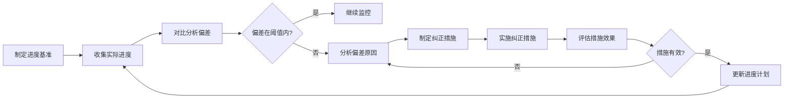

# TOPEMS 项目时间管理

## 概述

本文档定义 TOPEMS 项目的时间管理体系，包括进度计划、里程碑管理、关键路径、进度控制、进度报告和时间管理工具，确保项目按时交付。

## 目录

- [时间管理目标](#时间管理目标)
- [时间管理原则](#时间管理原则)
- [项目进度计划](#项目进度计划)
- [里程碑管理](#里程碑管理)
- [关键路径分析](#关键路径分析)
- [进度控制](#进度控制)
- [进度报告](#进度报告)
- [时间管理工具](#时间管理工具)
- [进度风险管理](#进度风险管理)
- [时间管理最佳实践](#时间管理最佳实践)
- [常见进度问题](#常见进度问题)

---

## 时间管理目标

### 总体目标

建立科学的项目时间管理体系，确保：

1. **按时交付**：项目按计划时间交付
2. **进度可控**：项目进度可控，偏差在可接受范围内
3. **资源优化**：资源合理分配，避免资源冲突
4. **风险预警**：进度风险提前预警，及时应对
5. **持续改进**：持续改进时间管理过程和方法

### 具体时间管理目标

| 目标 | 指标 | 目标值 | 测量方法 |
|------|------|--------|---------|
| **进度达成率** | 里程碑按时完成率 | ≥ 90% | 里程碑跟踪 |
| | 任务按时完成率 | ≥ 85% | 任务管理系统 |
| **进度偏差** | 整体进度偏差率 | ≤ 10% | 进度报告 |
| | 关键路径偏差 | ≤ 5% | 关键路径分析 |
| **资源利用** | 资源利用率 | 70%-90% | 资源管理 |
| | 资源冲突次数 | ≤ 2次/月 | 资源调度 |
| **变更控制** | 进度变更次数 | ≤ 3次/项目 | 变更管理 |
| | 变更审批及时率 | ≥ 95% | 变更管理 |
| **预测准确性** | 进度预测准确率 | ≥ 85% | 预测对比 |
| | 工期估算偏差率 | ≤ 15% | 估算对比 |

---

## 时间管理原则

### 核心原则

1. **目标导向**：以项目交付目标为导向制定进度计划
2. **合理估算**：基于历史数据和专家经验进行合理估算
3. **关键路径**：重点关注关键路径上的任务
4. **缓冲管理**：设置合理的缓冲时间应对不确定性
5. **资源平衡**：合理分配资源，避免资源过载或闲置
6. **动态调整**：根据实际情况动态调整进度计划
7. **透明沟通**：进度信息公开透明，及时沟通
8. **持续改进**：持续改进时间管理过程和方法

### 时间管理理念

1. **时间是最稀缺的资源**：时间一旦流逝无法挽回，必须珍惜
2. **进度是项目的脉搏**：进度反映项目健康状态
3. **预防胜于补救**：提前预防进度问题，而非事后补救
4. **数据驱动决策**：基于数据进行进度决策和调整
5. **全员参与**：每个人都对自己的任务进度负责
6. **持续跟踪**：持续跟踪进度，及时发现和解决问题
7. **灵活应变**：面对变化灵活调整，保持项目目标不变

---

## 项目进度计划

### 项目阶段划分

| 阶段 | 名称 | 主要工作 | 预计工期 | 开始时间 | 结束时间 |
|------|------|---------|---------|---------|---------|
| **P1** | 项目启动 | 项目立项、团队组建、需求调研 | 2周 | 2026-06-01 | 2026-06-14 |
| **P2** | 需求分析 | 需求分析、需求文档、需求评审 | 3周 | 2026-06-15 | 2026-07-05 |
| **P3** | 系统设计 | 架构设计、详细设计、UI设计 | 4周 | 2026-07-06 | 2026-08-02 |
| **P4** | 开发实现 | 后端开发、前端开发、集成开发 | 12周 | 2026-08-03 | 2026-10-25 |
| **P5** | 测试验证 | 单元测试、集成测试、系统测试、UAT | 6周 | 2026-10-26 | 2026-12-06 |
| **P6** | 部署上线 | 部署准备、生产部署、上线验证 | 2周 | 2026-12-07 | 2026-12-20 |
| **P7** | 项目收尾 | 验收交付、文档整理、项目总结 | 2周 | 2026-12-21 | 2027-01-03 |

**项目总工期：31 周（约 7 个月）**

### 工作分解结构（WBS）

#### P4 开发实现阶段 WBS 示例

```
P4 开发实现
├── 4.1 后端开发
│   ├── 4.1.1 核心服务开发
│   │   ├── 4.1.1.1 认证授权服务
│   │   ├── 4.1.1.2 用户管理服务
│   │   ├── 4.1.1.3 权限管理服务
│   │   └── 4.1.1.4 系统配置服务
│   ├── 4.1.2 业务服务开发
│   │   ├── 4.1.2.1 ERP 服务
│   │   ├── 4.1.2.2 CRM 服务
│   │   ├── 4.1.2.3 HRM 服务
│   │   ├── 4.1.2.4 Finance 服务
│   │   └── 4.1.2.5 WMS 服务
│   ├── 4.1.3 AI 服务开发
│   │   ├── 4.1.3.1 AI 对话服务
│   │   ├── 4.1.3.2 知识库服务
│   │   ├── 4.1.3.3 Agent 编排服务
│   │   └── 4.1.3.4 智能 Copilot 服务
│   └── 4.1.4 基础设施开发
│       ├── 4.1.4.1 网关服务
│       ├── 4.1.4.2 注册中心
│       ├── 4.1.4.3 配置中心
│       └── 4.1.4.4 监控服务
├── 4.2 前端开发
│   ├── 4.2.1 基础框架开发
│   ├── 4.2.2 核心模块开发
│   ├── 4.2.3 业务模块开发
│   ├── 4.2.4 AI 功能开发
│   └── 4.2.5 移动端适配
└── 4.3 集成开发
    ├── 4.3.1 前后端集成
    ├── 4.3.2 第三方系统集成
    ├── 4.3.3 AI 服务集成
    └── 4.3.4 数据集成
```

### 任务估算方法

#### 1. 专家判断法

- 由经验丰富的专家进行估算
- 适用于新技术、不确定性高的任务
- 优点：快速、灵活
- 缺点：主观性强、准确性依赖专家经验

#### 2. 类比估算法

- 参考类似历史项目的实际数据进行估算
- 适用于有类似项目经验的情况
- 优点：简单、成本低
- 缺点：准确性受项目相似度影响

#### 3. 参数估算法

- 基于历史数据建立参数模型进行估算
- 适用于重复性高、参数明确的任务
- 优点：准确性高、可重复
- 缺点：需要历史数据、模型建立成本高

#### 4. 三点估算法

- 估算最乐观、最可能、最悲观三种情况
- 公式：期望工期 = (乐观 + 4×最可能 + 悲观) / 6
- 适用于不确定性高的任务
- 优点：考虑不确定性、更准确
- 缺点：需要更多时间估算

#### 5. 自下而上估算法

- 将任务分解为更小的子任务，逐个估算后汇总
- 适用于任务分解明确的情况
- 优点：准确性高、详细
- 缺点：耗时、需要详细的 WBS

### 任务估算模板

```
任务估算表

任务编号：T-001
任务名称：用户认证服务开发
负责人：张三
估算方法：三点估算法

任务描述：
开发用户认证服务，包括登录、注册、密码重置、Token管理等功能。

工作内容：
1. 接口设计和数据库设计（2天）
2. 登录功能开发（3天）
3. 注册功能开发（2天）
4. 密码重置功能开发（2天）
5. Token管理功能开发（3天）
6. 单元测试编写（3天）
7. 代码审查和修复（2天）

工期估算：
- 最乐观：14天
- 最可能：17天
- 最悲观：22天
- 期望工期：(14 + 4×17 + 22) / 6 = 17.3天 ≈ 18天

资源需求：
- 后端开发：1人 × 18天
- 数据库设计：0.5人 × 2天
- 测试：0.5人 × 3天

依赖关系：
- 前置任务：数据库设计完成
- 后置任务：用户管理服务开发

风险和假设：
- 假设：需求稳定，无重大变更
- 风险：第三方认证集成可能延迟
- 缓冲：2天
```

---

## 里程碑管理

### 项目里程碑清单

| 里程碑编号 | 里程碑名称 | 计划日期 | 实际日期 | 状态 | 负责人 | 交付物 |
|-----------|-----------|---------|---------|------|--------|--------|
| M1 | 项目启动完成 | 2026-06-14 | - | 进行中 | 项目经理 | 项目章程、团队组建完成 |
| M2 | 需求分析完成 | 2026-07-05 | - | 未开始 | 产品负责人 | 需求规格说明书、需求评审通过 |
| M3 | 系统设计完成 | 2026-08-02 | - | 未开始 | 技术负责人 | 架构设计文档、详细设计文档、UI设计稿 |
| M4 | 核心功能开发完成 | 2026-09-13 | - | 未开始 | 技术负责人 | 核心服务、核心模块可演示 |
| M5 | 业务功能开发完成 | 2026-10-25 | - | 未开始 | 技术负责人 | 所有业务功能开发完成 |
| M6 | 集成测试完成 | 2026-11-15 | - | 未开始 | 测试负责人 | 集成测试报告、缺陷修复完成 |
| M7 | 系统测试完成 | 2026-12-06 | - | 未开始 | 测试负责人 | 系统测试报告、性能测试报告、安全测试报告 |
| M8 | 用户验收测试完成 | 2026-12-13 | - | 未开始 | 产品负责人 | UAT报告、用户签字确认 |
| M9 | 生产部署完成 | 2026-12-20 | - | 未开始 | 运维负责人 | 生产环境部署完成、上线验证通过 |
| M10 | 项目验收交付 | 2027-01-03 | - | 未开始 | 项目经理 | 项目验收报告、交付物清单、项目总结报告 |

### 里程碑状态定义

| 状态 | 说明 | 颜色 |
|------|------|------|
| **未开始** | 里程碑尚未开始 | ⚪ 灰色 |
| **进行中** | 里程碑正在进行中 | 🔵 蓝色 |
| **按时完成** | 里程碑按计划时间完成 | 🟢 绿色 |
| **延期完成** | 里程碑延期但已完成 | 🟡 黄色 |
| **延期中** | 里程碑已延期，尚未完成 | 🟠 橙色 |
| **严重延期** | 里程碑严重延期，影响项目整体 | 🔴 红色 |
| **已取消** | 里程碑已取消 | ⚫ 黑色 |

### 里程碑跟踪

#### 里程碑跟踪表

每周更新里程碑状态：

```
里程碑跟踪周报

报告期间：2026-08-22 至 2026-08-28
报告日期：2026-08-28

一、里程碑状态总览
- 总里程碑数：10个
- 已完成：3个（M1、M2、M3）
- 进行中：1个（M4）
- 未开始：6个（M5-M10）
- 延期：0个
- 按时完成率：100%

二、本周里程碑进展
1. M3 系统设计完成（2026-08-02）✅
   - 状态：按时完成
   - 完成时间：2026-08-01
   - 交付物：架构设计文档、详细设计文档、UI设计稿
   - 备注：提前1天完成

2. M4 核心功能开发完成（2026-09-13）🔵
   - 状态：进行中
   - 计划完成：2026-09-13
   - 当前进度：65%
   - 预计完成：2026-09-12（提前1天）
   - 主要工作：
     - 认证授权服务：100% ✅
     - 用户管理服务：100% ✅
     - 权限管理服务：80% 🔵
     - 系统配置服务：60% 🔵
     - ERP核心服务：50% 🔵
   - 风险：无重大风险

三、下周里程碑计划
1. M4 核心功能开发完成
   - 目标：进度达到80%
   - 重点工作：完成权限管理服务、系统配置服务

四、里程碑预警
- 无预警里程碑

五、需要支持事项
- 无
```

---

## 关键路径分析

### 关键路径概念

**关键路径**：项目中最长的任务序列，决定项目的最短完成时间。关键路径上的任何任务延迟都会导致项目整体延迟。

**关键路径特征**：
- 是项目中最长的路径
- 决定项目的最短完成时间
- 路径上的任务没有浮动时间
- 路径上的任务延迟会导致项目延迟
- 一个项目可能有多条关键路径

### 关键路径分析方法

#### 1. 正推法（计算最早时间）

- 最早开始时间（ES）= 所有前置任务最早完成时间的最大值
- 最早完成时间（EF）= ES + 工期

#### 2. 逆推法（计算最晚时间）

- 最晚完成时间（LF）= 所有后置任务最晚开始时间的最小值
- 最晚开始时间（LS）= LF - 工期

#### 3. 计算浮动时间

- 总浮动时间（TF）= LS - ES = LF - EF
- 自由浮动时间（FF）= 后置任务ES最小值 - 当前任务EF

#### 4. 确定关键路径

- 总浮动时间为 0 的任务是关键任务
- 关键任务组成的路径是关键路径

### 关键路径示例

```
任务依赖关系图：

A(5天) ──→ B(3天) ──→ D(4天) ──→ F(2天)
     │                            ↑
     └──→ C(6天) ──→ E(3天) ───┘

路径1：A → B → D → F = 5+3+4+2 = 14天
路径2：A → C → E → F = 5+6+3+2 = 16天

关键路径：A → C → E → F（16天）
关键任务：A、C、E、F
非关键任务：B、D（有2天浮动时间）
```

### 关键路径管理

#### 关键路径监控

1. **重点关注**：重点关注关键路径上的任务
2. **资源优先**：关键路径任务优先分配资源
3. **进度跟踪**：密切跟踪关键路径任务进度
4. **风险预警**：关键路径任务延迟及时预警
5. **定期分析**：定期重新分析关键路径

#### 关键路径压缩

当项目需要提前完成时，可以考虑压缩关键路径：

1. **赶工（Crashing）**：增加资源缩短关键任务工期
   - 增加人员、加班、增加设备
   - 优点：直接有效
   - 缺点：增加成本、可能降低质量

2. **快速跟进（Fast Tracking）**：将原本串行的任务改为并行
   - 任务并行执行、部分交付
   - 优点：不增加成本
   - 缺点：增加风险、可能需要返工

3. **范围缩减**：减少项目范围或降低质量要求
   - 削减非核心功能、简化需求
   - 优点：效果明显
   - 缺点：影响项目价值

4. **技术优化**：采用更高效的技术或方法
   - 使用新技术、优化算法、自动化
   - 优点：长期收益
   - 缺点：需要学习成本

---

## 进度控制

### 进度控制流程



### 进度偏差分析

#### 挣值分析（EVM）

| 指标 | 公式 | 说明 |
|------|------|------|
| **计划值（PV）** | 计划工作量 × 预算单价 | 按计划应该完成的工作预算 |
| **挣值（EV）** | 已完成工作量 × 预算单价 | 实际完成工作的预算价值 |
| **实际成本（AC）** | 实际花费的成本 | 完成工作实际花费的成本 |
| **进度偏差（SV）** | EV - PV | 正值：进度提前，负值：进度滞后 |
| **成本偏差（CV）** | EV - AC | 正值：成本节约，负值：成本超支 |
| **进度绩效指数（SPI）** | EV / PV | >1：进度提前，<1：进度滞后 |
| **成本绩效指数（CPI）** | EV / AC | >1：成本节约，<1：成本超支 |
| **完工估算（EAC）** | BAC / CPI | 项目完工时的估算总成本 |
| **完工尚需估算（ETC）** | EAC - AC | 完成剩余工作还需要的成本 |

#### 进度偏差阈值

| 偏差程度 | SPI 范围 | 处理措施 |
|---------|---------|---------|
| **正常** | 0.95 - 1.05 | 继续监控，无需干预 |
| **轻微偏差** | 0.90 - 0.95 或 1.05 - 1.10 | 关注趋势，分析原因 |
| **中度偏差** | 0.85 - 0.90 或 1.10 - 1.15 | 制定纠正措施，增加监控 |
| **严重偏差** | < 0.85 或 > 1.15 | 立即干预，重新评估计划 |

### 进度纠偏措施

当进度出现偏差时，采取以下纠偏措施：

#### 1. 分析偏差原因

- 是任务估算不准确？
- 是资源不足或效率低？
- 是需求变更导致？
- 是技术难题导致？
- 是外部依赖延迟？
- 是人员变动导致？

#### 2. 评估偏差影响

- 偏差是否影响关键路径？
- 偏差是否影响后续任务？
- 偏差是否影响项目整体交付？
- 偏差是否会扩大？

#### 3. 制定纠偏措施

| 偏差类型 | 纠偏措施 |
|---------|---------|
| **进度滞后** | 增加资源、加班、任务并行、优化方法、缩减范围 |
| **进度提前** | 重新分配资源、调整后续任务、利用提前时间做质量提升 |
| **资源不足** | 增加人员、调整任务优先级、外包、延长工期 |
| **技术难题** | 寻求专家支持、技术调研、调整技术方案、增加缓冲 |
| **需求变更** | 评估变更影响、调整计划、增加资源、分阶段交付 |

#### 4. 实施和跟踪

- 明确纠偏措施的责任人和完成时间
- 跟踪纠偏措施的执行情况
- 评估纠偏措施的效果
- 如措施无效，重新制定措施

### 进度变更管理

#### 进度变更流程

1. **变更申请**：提交进度变更申请，说明变更原因和内容
2. **变更评估**：评估变更对进度、成本、质量、风险的影响
3. **变更审批**：按照变更审批流程进行审批
4. **变更实施**：审批通过后实施变更，更新进度计划
5. **变更通知**：通知相关方变更内容和影响
6. **变更跟踪**：跟踪变更实施情况和效果

#### 进度变更审批权限

| 变更影响 | 审批人 | 审批时间 |
|---------|--------|---------|
| 任务级变更（<3天） | 技术负责人 | 1天 |
| 里程碑级变更（3-7天） | 项目经理 | 3天 |
| 阶段级变更（7-14天） | 部门总监 | 5天 |
| 项目级变更（>14天） | 高层管理者 | 7天 |

---

## 进度报告

### 进度报告类型

| 报告类型 | 频率 | 受众 | 目的 | 负责人 |
|---------|------|------|------|--------|
| **日报** | 每日 | 技术负责人 | 同步每日进度 | 开发团队 |
| **周报** | 每周 | 项目经理、核心团队 | 总结本周、计划下周 | 项目经理 |
| **月报** | 每月 | 高层、客户 | 月度进度总结 | 项目经理 |
| **里程碑报告** | 每个里程碑 | 高层、客户、核心团队 | 里程碑完成情况 | 项目经理 |
| **阶段报告** | 每个阶段 | 高层、客户 | 阶段总结和下阶段计划 | 项目经理 |
| **专项报告** | 按需 | 相关方 | 特定问题或风险 | 相关负责人 |

### 进度周报模板

```
TOPEMS 项目进度周报

报告期间：2026-08-22 至 2026-08-28
报告日期：2026-08-28
报告人：项目经理

一、项目概览
- 项目名称：TOPEMS 企业级智能运维管理系统
- 项目阶段：开发实现阶段（P4）
- 整体进度：65%（计划：63%）
- 本周进度：+5%
- 项目状态：正常（绿色）
- SPI：1.03（进度提前3%）
- CPI：1.02（成本节约2%）

二、本周工作完成情况

1. 已完成任务
- [x] 认证授权服务开发（张三）
- [x] 用户管理服务开发（李四）
- [x] 登录页面开发（王五）
- [x] 用户管理页面开发（赵六）
- [x] 数据库表结构优化（孙七）

2. 进行中任务
- [ ] 权限管理服务开发（张三），进度 80%
- [ ] 系统配置服务开发（李四），进度 60%
- [ ] ERP核心服务开发（周八），进度 50%
- [ ] 权限管理页面开发（王五），进度 70%

3. 未开始任务
- [ ] CRM核心服务开发
- [ ] HRM核心服务开发
- [ ] AI对话服务开发

三、下周工作计划

1. 重点工作
- 完成权限管理服务开发（张三）
- 完成系统配置服务开发（李四）
- 推进ERP核心服务开发（周八）
- 完成权限管理页面开发（王五）
- 开始CRM核心服务开发（吴九）

2. 里程碑
- 2026-09-13：M4 核心功能开发完成

四、问题与风险

1. 问题
- 问题1：第三方认证接口文档不完整，影响开发进度
  - 影响：权限管理服务开发可能延迟1天
  - 责任人：张三
  - 解决措施：联系第三方技术支持，获取完整文档
  - 预计解决时间：2026-08-30
  - 状态：进行中

2. 风险
- 风险1：ERP核心服务复杂度超预期（中风险）
  - 影响：可能导致M4里程碑延迟2-3天
  - 概率：40%
  - 应对措施：增加1名开发人员支持，优化技术方案
  - 状态：监控中

五、资源情况

1. 人员情况
- 团队人数：10人
- 本周出勤：10人
- 人员变动：无
- 资源利用率：85%

2. 资源冲突
- 无重大资源冲突

六、关键指标

| 指标 | 本周 | 上周 | 变化 | 目标 |
|------|------|------|------|------|
| 任务完成率 | 88% | 85% | +3% | ≥85% |
| 任务按时完成率 | 90% | 88% | +2% | ≥85% |
| Bug数量 | 12 | 15 | -3 | - |
| 代码提交次数 | 45 | 40 | +5 | - |
| SPI | 1.03 | 1.01 | +0.02 | ≥0.95 |
| CPI | 1.02 | 1.00 | +0.02 | ≥0.95 |

七、里程碑状态

| 里程碑 | 计划日期 | 状态 | 进度 |
|--------|---------|------|------|
| M3 系统设计完成 | 2026-08-02 | ✅ 按时完成 | 100% |
| M4 核心功能开发完成 | 2026-09-13 | 🔵 进行中 | 65% |
| M5 业务功能开发完成 | 2026-10-25 | ⚪ 未开始 | 0% |

八、需要支持事项

1. 需要协调第三方技术支持，获取认证接口完整文档
2. 需要确认是否增加1名开发人员支持ERP核心服务开发

九、下周重点关注

1. 权限管理服务和系统配置服务开发进度
2. ERP核心服务复杂度评估
3. 第三方认证接口文档获取进度
```

### 进度月报模板

```
TOPEMS 项目进度月报

报告期间：2026年8月
报告日期：2026-08-31
报告人：项目经理

一、项目概览
- 项目名称：TOPEMS 企业级智能运维管理系统
- 项目阶段：开发实现阶段（P4）
- 整体进度：65%（计划：62%）
- 本月进度：+15%
- 项目状态：正常（绿色）
- SPI：1.05（进度提前5%）
- CPI：1.03（成本节约3%）
- 预算使用：60%

二、本月工作总结

1. 里程碑完成情况
- [x] M3 系统设计完成（2026-08-02，提前1天）
- [ ] M4 核心功能开发完成（2026-09-13，进行中65%）

2. 主要成果
- 完成系统架构设计和详细设计
- 完成UI设计稿
- 完成认证授权服务开发
- 完成用户管理服务开发
- 完成登录和用户管理页面开发
- 完成数据库表结构优化

3. 关键指标
| 指标 | 本月 | 上月 | 变化 |
|------|------|------|------|
| 任务完成率 | 88% | 85% | +3% |
| 任务按时完成率 | 90% | 86% | +4% |
| Bug数量 | 45 | 50 | -5 |
| 代码行数 | +15000 | +12000 | +25% |
| SPI | 1.05 | 1.02 | +0.03 |
| CPI | 1.03 | 1.00 | +0.03 |

三、问题与风险

1. 本月解决的问题
- 解决了数据库性能问题
- 解决了第三方接口联调问题
- 解决了团队协作流程问题

2. 当前存在的问题
- 第三方认证接口文档不完整，影响开发进度
- ERP核心服务复杂度超预期

3. 风险评估
- 高风险：0项
- 中风险：2项（ERP复杂度、人员流动）
- 低风险：3项

四、下月工作计划

1. 重点工作
- 完成核心功能开发（M4里程碑）
- 开始业务功能开发
- 推进AI服务开发
- 开始前端业务模块开发

2. 里程碑
- 2026-09-13：M4 核心功能开发完成
- 2026-10-25：M5 业务功能开发完成

3. 资源需求
- 需要增加1名开发人员支持ERP核心服务

五、预算与资源

1. 预算使用
- 总预算：XXX万元
- 已使用：XX万元（60%）
- 剩余：XX万元
- 本月支出：XX万元

2. 人员投入
- 团队人数：10人
- 本月人天：220人天
- 人员变动：无

六、需要决策事项

1. 是否同意增加1名开发人员支持ERP核心服务？
2. 是否同意将M4里程碑调整为2026-09-15（延迟2天）？

七、总结与展望

本月项目整体进展顺利，完成了系统设计和部分核心功能开发。存在的主要问题是第三方接口文档不完整和ERP核心服务复杂度超预期，正在积极解决。下月将重点推进核心功能开发，确保M4里程碑按时完成，并开始业务功能开发。
```

---

## 时间管理工具

### 项目管理工具

| 工具 | 用途 | 特点 | 适用场景 |
|------|------|------|---------|
| **Jira** | 项目和任务管理 | 功能强大、可定制、敏捷支持 | 中大型项目、敏捷开发 |
| **禅道** | 项目管理 | 国产、功能全面、性价比高 | 国内团队、全流程管理 |
| **飞书项目** | 项目管理 | 集成飞书、协作方便 | 使用飞书的团队 |
| **Trello** | 看板管理 | 简单易用、可视化 | 小型项目、个人任务 |
| **Asana** | 任务管理 | 界面友好、协作方便 | 中小团队、跨部门协作 |
| **Microsoft Project** | 项目管理 | 功能强大、专业 | 大型项目、传统项目管理 |

### 进度计划工具

| 工具 | 用途 | 特点 |
|------|------|------|
| **GanttProject** | 甘特图制作 | 开源、免费、功能完整 |
| **Microsoft Project** | 项目进度计划 | 专业、功能强大、集成Office |
| **OmniPlan** | 项目进度计划 | Mac平台、界面美观 |
| **TeamGantt** | 在线甘特图 | 在线协作、简单易用 |
| **Smartsheet** | 电子表格式项目管理 | 灵活、功能强大 |

### 时间跟踪工具

| 工具 | 用途 | 特点 |
|------|------|------|
| **Toggl** | 时间跟踪 | 简单易用、跨平台 |
| **Harvest** | 时间和费用跟踪 | 功能全面、报表丰富 |
| **RescueTime** | 自动时间跟踪 | 自动记录、分析效率 |
| **Clockify** | 时间跟踪 | 免费、功能完整 |
| **Everhour** | 时间跟踪 | 集成项目管理工具 |

### 协作工具

| 工具 | 用途 | 特点 |
|------|------|------|
| **飞书** | 团队协作 | 即时通讯、文档、会议、项目一体化 |
| **钉钉** | 团队协作 | 国产、功能全面、企业级 |
| **企业微信** | 团队协作 | 集成微信、企业级 |
| **Slack** | 团队沟通 | 频道式沟通、集成丰富 |
| **Microsoft Teams** | 团队协作 | 集成Office、企业级 |

### 分析工具

| 工具 | 用途 | 特点 |
|------|------|------|
| **Excel** | 数据分析 | 通用、灵活、功能强大 |
| **Power BI** | 数据可视化 | 微软产品、可视化强大 |
| **Tableau** | 数据可视化 | 专业、可视化强大 |
| **ECharts** | 图表库 | 开源、可定制、中文支持好 |

---

## 进度风险管理

### 常见进度风险

| 风险编号 | 风险描述 | 概率 | 影响 | 等级 | 应对措施 |
|---------|---------|------|------|------|---------|
| SCH-001 | 需求变更频繁，导致返工 | 高 | 高 | 高 | 需求冻结、变更控制、分阶段交付 |
| SCH-002 | 任务估算不准确，工期偏差大 | 中 | 高 | 高 | 多点估算、历史数据参考、设置缓冲 |
| SCH-003 | 关键人员离职，项目知识流失 | 中 | 高 | 高 | 知识共享、备份人员、文档完善 |
| SCH-004 | 技术难题，开发进度受阻 | 中 | 中 | 中 | 技术预研、专家支持、备选方案 |
| SCH-005 | 第三方依赖延迟，影响集成 | 中 | 中 | 中 | 提前对接、备选方案、Mock接口 |
| SCH-006 | 资源不足，任务无法按时完成 | 中 | 高 | 高 | 资源规划、外包、调整优先级 |
| SCH-007 | 质量问题，大量返工 | 中 | 中 | 中 | 质量保证、代码审查、自动化测试 |
| SCH-008 | 沟通不畅，协作效率低 | 中 | 中 | 中 | 沟通计划、定期会议、协作工具 |
| SCH-009 | 范围蔓延，工作量增加 | 高 | 中 | 高 | 范围控制、变更管理、需求冻结 |
| SCH-010 | 外部环境变化，政策调整 | 低 | 高 | 中 | 关注政策、灵活调整、风险预案 |

### 进度风险预警

设置进度风险预警指标，提前发现和应对风险：

| 预警指标 | 黄色预警 | 红色预警 | 处理措施 |
|---------|---------|---------|---------|
| 关键路径任务延迟 | >1天 | >3天 | 立即分析原因，制定纠偏措施 |
| 里程碑进度偏差 | >5% | >10% | 评估影响，调整计划 |
| 任务按时完成率 | <85% | <75% | 分析原因，增加资源 |
| 资源利用率 | >95%或<60% | >100%或<50% | 调整资源分配 |
| 需求变更次数 | >2次/周 | >4次/周 | 加强需求控制，冻结需求 |
| Bug数量趋势 | 持续上升 | 快速上升 | 加强质量控制，增加测试 |

### 进度风险应对

#### 风险预防

1. **合理估算**：采用多种估算方法，设置合理缓冲
2. **需求管理**：加强需求分析和确认，控制需求变更
3. **资源规划**：提前规划资源，避免资源冲突
4. **技术预研**：对新技术进行预研，降低技术风险
5. **知识共享**：建立知识共享机制，降低人员风险
6. **质量保证**：加强质量保证，减少返工
7. **沟通管理**：建立有效沟通机制，提高协作效率

#### 风险应对

当进度风险发生时，采取以下应对措施：

1. **评估影响**：评估风险对进度、成本、质量的影响
2. **制定方案**：制定应对方案，包括规避、转移、缓解、接受
3. **实施措施**：实施应对措施，跟踪效果
4. **调整计划**：根据风险影响调整进度计划
5. **沟通通知**：及时通知相关方风险情况和应对措施

---

## 时间管理最佳实践

### 时间管理 10 大最佳实践

1. **目标明确**：明确项目目标和交付物，以此为导向制定进度计划
2. **合理分解**：将项目合理分解为可管理的任务和里程碑
3. **科学估算**：采用科学的估算方法，基于数据和经验进行估算
4. **关键路径**：识别和重点管理关键路径
5. **缓冲管理**：设置合理的缓冲时间应对不确定性
6. **资源平衡**：合理分配资源，避免资源过载或闲置
7. **持续跟踪**：持续跟踪进度，及时发现和解决问题
8. **数据驱动**：基于数据进行进度决策和调整
9. **透明沟通**：进度信息公开透明，及时沟通
10. **持续改进**：持续改进时间管理过程和方法

### 常见时间管理误区

| 误区 | 正确理解 |
|------|---------|
| 进度计划越细越好 | 进度计划应该粗细适中，便于管理和跟踪 |
| 工期估算越短越好 | 工期估算应该合理，考虑风险和缓冲 |
| 进度跟踪就是汇报 | 进度跟踪是为了发现问题和改进，不只是汇报 |
| 加班可以解决进度问题 | 加班只是短期措施，长期会降低效率和质量 |
| 进度延迟就要加人 | 加人不一定能解决问题，可能增加沟通成本 |
| 关键路径是固定的 | 关键路径会随着任务完成和变更而变化 |
| 进度变更都是坏事 | 合理的进度变更是正常的，关键是控制变更 |
| 进度提前总是好事 | 进度提前可能意味着质量降低或估算不准确 |
| 时间管理就是制定计划 | 时间管理包括计划、跟踪、控制、改进全过程 |

### 敏捷时间管理

对于采用敏捷开发的项目，时间管理有其特殊性：

1. **迭代规划**：以迭代（Sprint）为单位进行规划，通常2-4周
2. **用户故事**：以用户故事为单位进行估算和排期
3. **故事点**：使用故事点进行相对估算，而非绝对时间
4. **燃尽图**：使用燃尽图跟踪迭代进度
5. **每日站会**：每日站会同步进度和障碍
6. **迭代回顾**：每个迭代结束后进行回顾，持续改进
7. **价值优先**：按业务价值优先级排期，优先交付高价值功能
8. **响应变化**：拥抱变化，灵活调整计划

### 远程团队时间管理

对于远程团队，时间管理需要特别注意：

1. **明确目标**：明确每个人的目标和交付物
2. **异步沟通**：更多使用异步沟通，减少实时会议
3. **文档驱动**：加强文档建设，减少对口头沟通的依赖
4. **结果导向**：以结果为导向，而非工作时间
5. **定期同步**：定期进行进度同步和问题讨论
6. **工具支持**：使用合适的协作和项目管理工具
7. **信任团队**：信任团队成员，减少微观管理
8. **关注产出**：关注产出和成果，而非在线时间

---

## 常见进度问题

### 问题 1：项目进度延迟

**表现**：
- 任务完成时间晚于计划
- 里程碑延期
- 整体进度落后于计划
- SPI < 1

**原因**：
- 工期估算过于乐观
- 需求变更频繁，导致返工
- 资源不足或效率低
- 技术难题未预料到
- 外部依赖延迟
- 人员变动或离职
- 质量问题导致返工
- 沟通不畅，协作效率低

**解决方法**：
1. 分析延迟原因和影响
2. 评估是否影响关键路径和里程碑
3. 制定纠偏措施：
   - 增加资源（人员、设备）
   - 任务并行（快速跟进）
   - 优化方法（提高效率）
   - 缩减范围（削减非核心功能）
   - 延长工期（调整计划）
4. 实施纠偏措施，跟踪效果
5. 如措施无效，重新评估和调整计划
6. 及时通知相关方进度变化

### 问题 2：任务估算不准确

**表现**：
- 实际工期与估算偏差大
- 频繁调整任务工期
- 进度预测不准确

**原因**：
- 估算方法不科学
- 缺乏历史数据参考
- 任务分解不够细
- 未考虑风险和缓冲
- 估算人员经验不足
- 需求不明确，估算依据不足

**解决方法**：
1. 采用多种估算方法（专家判断、类比、参数、三点、自下而上）
2. 建立历史数据库，积累项目数据
3. 细化任务分解，提高估算准确性
4. 设置合理的缓冲时间（10%-20%）
5. 由有经验的人员进行估算
6. 明确需求后再进行估算
7. 定期回顾估算准确性，持续改进

### 问题 3：关键路径任务延迟

**表现**：
- 关键路径上的任务延迟
- 项目整体完成时间受影响
- 后续任务被迫推迟

**原因**：
- 关键路径任务资源不足
- 关键路径任务技术难度大
- 关键路径任务依赖未满足
- 未重点关注关键路径

**解决方法**：
1. 立即分析延迟原因和影响
2. 优先保障关键路径任务资源
3. 考虑压缩关键路径：
   - 赶工（增加资源）
   - 快速跟进（任务并行）
   - 技术优化
4. 重新分析关键路径，可能发生变化
5. 加强关键路径任务的跟踪和监控
6. 建立关键路径任务预警机制

### 问题 4：资源冲突和过载

**表现**：
- 同一资源被多个任务同时占用
- 资源利用率超过100%
- 任务等待资源，进度延迟
- 团队成员加班严重，效率下降

**原因**：
- 资源规划不合理
- 任务依赖关系考虑不周
- 资源分配未考虑负载
- 人员技能单一，无法替代
- 需求变更导致资源需求变化

**解决方法**：
1. 进行资源平衡，调整任务时间避免冲突
2. 优先保障关键路径任务资源
3. 考虑增加资源或外包
4. 培养多技能人员，提高资源灵活性
5. 调整任务优先级，延迟非关键任务
6. 使用资源管理工具进行资源调度
7. 定期检查资源负载，及时调整

### 问题 5：需求变更导致进度失控

**表现**：
- 需求变更频繁
- 大量返工，进度延迟
- 范围蔓延，工作量增加
- 进度计划频繁调整

**原因**：
- 需求分析不充分
- 需求确认不严格
- 变更控制流程不完善
- 客户需求不明确，频繁变化
- 市场环境变化快
- 未设置需求冻结点

**解决方法**：
1. 加强需求分析和确认
2. 建立严格的变更控制流程
3. 设置需求冻结点，冻结后变更需审批
4. 采用分阶段交付，每个阶段需求相对稳定
5. 评估变更影响，包括进度、成本、质量
6. 变更审批后调整进度计划
7. 与客户充分沟通，管理期望
8. 建立需求变更台账，跟踪变更影响

---

*本文档最后更新：2026-08-28*
*时间管理体系会根据项目实践持续优化，请关注最新版本。*
*时间是项目最稀缺的资源，有效的时间管理是项目成功的关键。*
