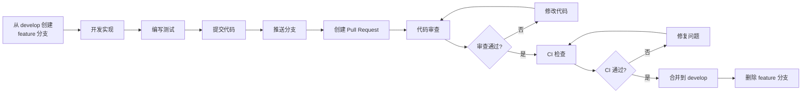

# TOPEMS Git 工作流指南

## 概述

本文档描述 TOPEMS 项目的 Git 工作流、分支管理策略、提交规范、代码审查流程和发布流程，帮助团队成员高效协作和管理代码。

## 目录

- [Git 基础配置](#git-基础配置)
- [分支管理策略](#分支管理策略)
- [提交规范](#提交规范)
- [工作流程](#工作流程)
- [代码审查](#代码审查)
- [发布流程](#发布流程)
- [常见操作](#常见操作)
- [最佳实践](#最佳实践)
- [常见问题](#常见问题)

---

## Git 基础配置

### 全局配置

在开始使用 Git 之前，请先进行全局配置：

```bash
# 设置用户名和邮箱
git config --global user.name "Your Name"
git config --global user.email "your.email@example.com"

# 设置默认分支名
git config --global init.defaultBranch main

# 设置默认编辑器（可选）
git config --global core.editor "vim"  # 或 "code --wait"

# 启用彩色输出
git config --global color.ui auto

# 设置换行符处理
# macOS/Linux
git config --global core.autocrlf input
# Windows
git config --global core.autocrlf true

# 设置拉取策略（推荐 rebase）
git config --global pull.rebase true
git config --global rebase.autoStash true
```

### 项目特定配置

克隆项目后，可以在项目目录中设置特定配置：

```bash
# 进入项目目录
cd TOPEMS

# 查看当前配置
git config --list

# 查看远程仓库
git remote -v

# 添加上游仓库（如果是 Fork）
git remote add upstream https://github.com/topems/TOPEMS.git
```

### Git 别名配置（可选）

配置常用的 Git 别名，提高效率：

```bash
# 查看状态
git config --global alias.st status

# 查看日志（美化）
git config --global alias.lg "log --oneline --graph --all --decorate"

# 查看详细日志
git config --global alias.ll "log --oneline -10"

# 添加所有文件并提交
git config --global alias.ac "!git add -A && git commit"

# 拉取并 rebase
git config --global alias.pr "pull --rebase"

# 强制推送（安全）
git config --global alias.pf "push --force-with-lease"
```

---

## 分支管理策略

### 分支类型

TOPEMS 采用 Git Flow 简化版分支管理策略，包含以下分支类型：

| 分支类型 | 命名规范 | 说明 | 生命周期 |
|---------|---------|------|---------|
| **main** | `main` | 主分支，生产环境代码，始终保持稳定 | 永久 |
| **develop** | `develop` | 开发分支，集成最新功能 | 永久 |
| **feature** | `feat/<功能描述>` | 功能开发分支 | 临时，合并后删除 |
| **bugfix** | `fix/<问题描述>` | Bug 修复分支 | 临时，合并后删除 |
| **hotfix** | `hotfix/<问题描述>` | 生产环境紧急修复 | 临时，合并后删除 |
| **release** | `release/<版本号>` | 发布准备分支 | 临时，发布后删除 |
| **docs** | `docs/<文档描述>` | 文档更新分支 | 临时，合并后删除 |
| **refactor** | `refactor/<描述>` | 代码重构分支 | 临时，合并后删除 |
| **perf** | `perf/<描述>` | 性能优化分支 | 临时，合并后删除 |
| **test** | `test/<描述>` | 测试相关分支 | 临时，合并后删除 |
| **chore** | `chore/<描述>` | 杂项任务分支 | 临时，合并后删除 |

### 分支命名规范

#### 功能分支（feature）

```bash
# 格式
feat/<简短功能描述>

# 示例
feat/user-authentication
feat/order-management
feat/ai-chat-enhancement
feat/dashboard-redesign
```

#### Bug 修复分支（bugfix）

```bash
# 格式
fix/<简短问题描述>

# 示例
fix/login-error
fix/order-calculation-bug
fix/api-timeout
fix/ui-layout-issue
```

#### 紧急修复分支（hotfix）

```bash
# 格式
hotfix/<简短问题描述>

# 示例
hotfix/critical-security-vulnerability
hotfix/production-crash
hotfix/payment-failure
```

#### 发布分支（release）

```bash
# 格式
release/<版本号>

# 示例
release/v1.0.0
release/v1.1.0
release/v2.0.0
```

### 分支保护规则

以下分支受到保护，不能直接推送，必须通过 Pull Request 合并：

- `main` - 主分支，生产环境
- `develop` - 开发分支

保护规则：
- 必须通过 Pull Request 合并
- 至少需要 1 名审查者批准
- 必须通过所有 CI 检查
- 不能强制推送（force push）
- 不能直接删除

---

## 提交规范

### Commit Message 格式

TOPEMS 使用 [Conventional Commits](https://www.conventionalcommits.org/) 规范，Commit Message 格式如下：

```
<type>(<scope>): <subject>

<body>

<footer>
```

### Type 类型

| 类型 | 说明 | 示例 |
|------|------|------|
| `feat` | 新功能 | `feat(auth): 添加用户注册功能` |
| `fix` | 修复 Bug | `fix(api): 修复用户列表查询分页错误` |
| `docs` | 文档更新 | `docs(readme): 更新安装说明` |
| `style` | 代码格式调整（不影响功能） | `style(frontend): 格式化代码` |
| `refactor` | 代码重构（不新增功能，不修复 Bug） | `refactor(backend): 重构用户服务` |
| `perf` | 性能优化 | `perf(api): 优化查询性能` |
| `test` | 测试相关 | `test(auth): 添加登录测试用例` |
| `build` | 构建系统或外部依赖变更 | `build(deps): 更新依赖版本` |
| `ci` | CI/CD 配置变更 | `ci(github): 更新 CI 工作流` |
| `chore` | 其他杂项 | `chore(git): 更新 .gitignore` |
| `revert` | 回滚提交 | `revert: 回滚上一次提交` |

### Scope 范围

Scope 表示变更影响的范围，可选值包括：

- `auth` - 认证授权
- `api` - API 接口
- `backend` - 后端
- `frontend` - 前端
- `database` - 数据库
- `ai` - AI 相关
- `erp` - ERP 模块
- `crm` - CRM 模块
- `hrm` - HRM 模块
- `finance` - 财务模块
- `wms` - 仓储模块
- `docs` - 文档
- `test` - 测试
- `ci` - CI/CD
- `deps` - 依赖
- `config` - 配置
- `security` - 安全
- `performance` - 性能

### Subject 主题

- 简短描述变更内容，不超过 50 个字符
- 使用祈使句（添加、修复、更新等）
- 末尾不加句号
- 首字母小写（除非是专有名词）

### Body 正文（可选）

- 详细描述变更内容，每行不超过 72 个字符
- 说明变更的原因和目的
- 如有必要，说明实现思路
- 与主题之间空一行

### Footer 页脚（可选）

- 关联 Issue：`Closes #123` 或 `Fixes #456`
- 破坏性变更：`BREAKING CHANGE: 描述`
- 致谢：`Co-authored-by: Name <email>`

### 提交示例

#### 简单提交

```bash
git commit -m "feat(auth): 添加用户注册功能"
```

#### 详细提交

```bash
git commit -m "feat(auth): 添加用户注册功能

实现用户注册接口，支持用户名、邮箱和密码注册。
注册时进行密码强度校验，并发送验证邮件。

Closes #123"
```

#### Bug 修复提交

```bash
git commit -m "fix(api): 修复用户列表查询分页错误

修复分页参数计算错误，当 page=1 时 offset 应为 0。
添加分页参数的边界检查。

Fixes #456"
```

#### 文档更新提交

```bash
git commit -m "docs(readme): 更新安装说明

补充 Docker 安装方式，更新依赖版本要求。"
```

### 提交频率和粒度

- **小步提交**：每个逻辑变更单独提交
- **原子提交**：一个提交只做一件事
- **可编译提交**：每个提交都应该能通过编译和测试
- **频繁提交**：不要积攒大量变更后才提交
- **合理拆分**：大的功能拆分成多个小提交

---

## 工作流程

### 功能开发流程



### 详细步骤

#### 1. 同步最新代码

```bash
# 切换到 develop 分支
git checkout develop

# 拉取最新代码
git pull origin develop
```

#### 2. 创建功能分支

```bash
# 创建并切换到功能分支
git checkout -b feat/your-feature-name

# 确认当前分支
git branch
```

#### 3. 开发实现

```bash
# 编写代码
# ...

# 查看变更
git status
git diff
```

#### 4. 编写测试

```bash
# 编写单元测试
# 编写集成测试
# 运行测试确保通过
cargo test          # 后端测试
pnpm run test       # 前端测试
```

#### 5. 提交代码

```bash
# 添加变更的文件
git add .

# 或添加特定文件
git add path/to/file.rs

# 提交代码（遵循提交规范）
git commit -m "feat(module): 简短描述"

# 查看提交历史
git log --oneline -10
```

#### 6. 推送分支

```bash
# 推送分支到远程仓库
git push origin feat/your-feature-name

# 第一次推送时设置上游分支
git push -u origin feat/your-feature-name
```

#### 7. 创建 Pull Request

在 GitHub 上创建 Pull Request：
- 源分支：`feat/your-feature-name`
- 目标分支：`develop`
- 填写 PR 标题和描述
- 关联相关 Issue
- 添加合适的标签（Label）
- 请求代码审查（Reviewer）

#### 8. 代码审查

- 等待审查者审查代码
- 根据审查意见修改代码
- 修改后推送更新，PR 会自动更新
- 审查通过后，等待合并

#### 9. 合并代码

审查通过且 CI 检查通过后：
- 合并方式推荐使用 `Squash and merge`（压缩合并）
- 合并后删除 feature 分支

#### 10. 清理本地分支

```bash
# 切换到 develop
git checkout develop

# 拉取最新代码
git pull origin develop

# 删除本地 feature 分支
git branch -d feat/your-feature-name

# 如果分支未合并，强制删除
git branch -D feat/your-feature-name
```

### Bug 修复流程

Bug 修复流程与功能开发流程类似，但分支命名使用 `fix/` 前缀：

```bash
# 1. 从 develop 创建修复分支
git checkout develop
git pull origin develop
git checkout -b fix/your-bug-description

# 2. 修复 Bug
# ...

# 3. 提交代码
git add .
git commit -m "fix(module): 修复 Bug 描述"

# 4. 推送并创建 PR
git push origin fix/your-bug-description
# 在 GitHub 上创建 PR 到 develop
```

### 紧急修复流程（Hotfix）

生产环境紧急修复需要从 `main` 分支创建：

```bash
# 1. 从 main 创建 hotfix 分支
git checkout main
git pull origin main
git checkout -b hotfix/your-critical-fix

# 2. 修复问题
# ...

# 3. 提交代码
git add .
git commit -m "fix(security): 修复紧急安全漏洞"

# 4. 推送并创建 PR
git push origin hotfix/your-critical-fix
# 创建 PR 到 main（紧急修复可快速审查和合并）

# 5. 合并到 main 后，同步到 develop
git checkout develop
git pull origin develop
git merge main
git push origin develop

# 6. 发布新版本
# 参考发布流程
```

---

## 代码审查

### 审查清单

审查者应检查以下内容：

#### 功能正确性

- [ ] 代码实现了预期的功能
- [ ] 边界条件已处理
- [ ] 错误处理完善
- [ ] 没有明显的逻辑错误

#### 代码质量

- [ ] 代码符合项目规范
- [ ] 命名清晰、有意义
- [ ] 函数/类职责单一
- [ ] 没有重复代码
- [ ] 注释充分且准确
- [ ] 代码简洁，没有冗余

#### 性能

- [ ] 没有明显的性能问题
- [ ] 数据库查询已优化
- [ ] 没有 N+1 查询问题
- [ ] 缓存使用合理
- [ ] 没有内存泄漏风险

#### 安全性

- [ ] 没有 SQL 注入风险
- [ ] 没有 XSS 风险
- [ ] 输入验证完善
- [ ] 敏感数据已加密
- [ ] 权限控制正确
- [ ] 没有硬编码的密钥或密码

#### 测试

- [ ] 测试覆盖了主要功能
- [ ] 测试用例命名清晰
- [ ] 测试可以独立运行
- [ ] 没有 flaky test
- [ ] 新增功能有对应的测试

#### 文档

- [ ] 公共 API 有文档注释
- [ ] 复杂逻辑有说明
- [ ] README 或相关文档已更新
- [ ] 变更日志已更新（如需要）

### 审查意见格式

审查意见应清晰、具体、有建设性：

**好的审查意见：**
```
**问题**：用户密码没有进行强度校验。

**建议**：添加密码强度校验，要求至少 8 个字符，包含大小写字母和数字。

**位置**：backend/src/auth/service.rs:45
```

**不好的审查意见：**
```
这里有问题。
```

### 审查级别

- **Request changes**：必须修改才能合并
- **Comment**：建议修改，可以讨论
- **Approve**：同意合并

### 审查响应

被审查者应：
- 认真阅读每条审查意见
- 对每条意见进行回复（已修改、同意、不同意并说明原因）
- 及时修改代码并推送更新
- 不要因为审查意见而产生负面情绪
- 审查是为了提高代码质量，不是针对个人

---

## 发布流程

### 版本号规范

TOPEMS 使用语义化版本号（Semantic Versioning）：

```
主版本号.次版本号.修订号
```

- **主版本号（Major）**：不兼容的 API 变更
- **次版本号（Minor）**：向下兼容的功能性新增
- **修订号（Patch）**：向下兼容的问题修正

示例：
- `1.0.0` - 首个正式版本
- `1.0.1` - Bug 修复
- `1.1.0` - 新增功能
- `2.0.0` - 重大变更，不兼容

### 发布步骤

#### 1. 准备发布

```bash
# 切换到 develop 分支
git checkout develop
git pull origin develop

# 创建发布分支
git checkout -b release/v1.1.0
```

#### 2. 更新版本号

更新以下文件中的版本号：
- `package.json`（前端）
- `Cargo.toml`（后端）
- `README.md`
- `CHANGELOG.md`

```bash
# 示例：更新 package.json
# "version": "1.0.0" → "version": "1.1.0"
```

#### 3. 更新变更日志

在 `CHANGELOG.md` 中添加新版本的变更记录：

```markdown
## [1.1.0] - 2026-08-28

### 新增
- 用户注册功能
- 密码重置功能
- 新的仪表盘设计

### 修复
- 修复登录页面布局问题
- 修复 API 分页错误

### 性能
- 优化用户列表查询性能
```

#### 4. 提交并推送

```bash
git add .
git commit -m "chore(release): 发布 v1.1.0"
git push origin release/v1.1.0
```

#### 5. 创建 PR 到 main

在 GitHub 上创建 PR：
- 源分支：`release/v1.1.0`
- 目标分支：`main`
- 标题：`Release v1.1.0`
- 描述：包含变更摘要

#### 6. 审查和合并

- 进行最终审查
- 运行完整的测试套件
- 确认所有 CI 检查通过
- 合并到 main

#### 7. 创建发布标签

```bash
# 切换到 main
git checkout main
git pull origin main

# 创建标签
git tag -a v1.1.0 -m "Release v1.1.0"

# 推送标签
git push origin v1.1.0
```

#### 8. 在 GitHub 上创建发布

在 GitHub Releases 页面创建发布：
- 标签：`v1.1.0`
- 标题：`v1.1.0`
- 描述：变更日志内容
- 上传构建产物（如需要）

#### 9. 同步到 develop

```bash
# 切换到 develop
git checkout develop

# 合并 main
git merge main

# 推送
git push origin develop
```

#### 10. 清理发布分支

```bash
# 删除本地发布分支
git branch -d release/v1.1.0

# 删除远程发布分支
git push origin --delete release/v1.1.0
```

### 紧急修复发布（Hotfix）

```bash
# 1. 从 main 创建 hotfix 分支
git checkout main
git pull origin main
git checkout -b hotfix/v1.1.1

# 2. 修复问题并更新版本号
# ...

# 3. 提交
git add .
git commit -m "fix(security): 修复紧急安全漏洞"
git push origin hotfix/v1.1.1

# 4. 创建 PR 到 main，快速审查合并
# ...

# 5. 创建标签并发布
git checkout main
git pull origin main
git tag -a v1.1.1 -m "Hotfix v1.1.1"
git push origin v1.1.1

# 6. 同步到 develop
git checkout develop
git merge main
git push origin develop
```

---

## 常见操作

### 查看状态和历史

```bash
# 查看工作区状态
git status

# 查看提交历史
git log

# 查看美化的提交历史
git log --oneline --graph --all --decorate

# 查看最近 10 条提交
git log --oneline -10

# 查看某个文件的修改历史
git log -- path/to/file

# 查看某次提交的详细信息
git show <commit-hash>

# 查看分支列表
git branch -a

# 查看远程仓库
git remote -v
```

### 撤销和修改

```bash
# 撤销工作区的修改（未暂存）
git checkout -- path/to/file
# 或
git restore path/to/file

# 撤销暂存（已 add 但未 commit）
git reset HEAD path/to/file
# 或
git restore --staged path/to/file

# 修改最近一次提交（未推送）
git commit --amend

# 撤销最近一次提交（保留修改）
git reset --soft HEAD~1

# 撤销最近一次提交（丢弃修改）
git reset --hard HEAD~1

# 回滚到某次提交（创建新提交）
git revert <commit-hash>
```

### 分支操作

```bash
# 创建并切换到新分支
git checkout -b new-branch

# 切换分支
git checkout branch-name

# 重命名分支
git branch -m old-name new-name

# 删除本地分支
git branch -d branch-name

# 强制删除本地分支
git branch -D branch-name

# 删除远程分支
git push origin --delete branch-name

# 合并分支
git merge branch-name

# 使用 rebase 合并
git rebase branch-name

# 中止 rebase
git rebase --abort

# 继续 rebase（解决冲突后）
git rebase --continue
```

### 暂存操作（Stash）

```bash
# 暂存当前修改
git stash

# 暂存并添加描述
git stash save "描述信息"

# 查看暂存列表
git stash list

# 应用最近的暂存
git stash apply

# 应用并删除最近的暂存
git stash pop

# 删除最近的暂存
git stash drop

# 清空所有暂存
git stash clear
```

### 冲突解决

```bash
# 合并时发生冲突
# 1. 查看冲突文件
git status

# 2. 编辑冲突文件，解决冲突
# 冲突标记：
# <<<<<<< HEAD
# 当前分支的内容
# =======
# 合并分支的内容
# >>>>>>> branch-name

# 3. 标记为已解决
git add path/to/conflict-file

# 4. 继续合并
git commit

# 或中止合并
git merge --abort
```

### 同步上游仓库

```bash
# 添加上游仓库（如果是 Fork）
git remote add upstream https://github.com/topems/TOPEMS.git

# 获取上游更新
git fetch upstream

# 合并上游更新到当前分支
git merge upstream/develop

# 或使用 rebase
git rebase upstream/develop

# 推送到自己的仓库
git push origin develop
```

---

## 最佳实践

### 提交最佳实践

1. **小步提交**：每个提交只包含一个逻辑变更
2. **原子提交**：一个提交做一件事，不要混合不相关的变更
3. **可编译提交**：每个提交都应该能通过编译和测试
4. **清晰的提交信息**：使用 Conventional Commits 规范
5. **频繁提交**：不要积攒大量变更
6. **提交前检查**：提交前运行测试和代码检查

### 分支最佳实践

1. **从最新代码创建分支**：创建分支前先同步最新代码
2. **短生命周期分支**：功能分支不要存在太久
3. **定期同步**：定期将 develop 合并到 feature 分支
4. **清晰的分支命名**：使用规范的分支命名
5. **及时删除**：合并后及时删除已合并的分支
6. **保护主分支**：main 和 develop 分支受到保护

### 协作最佳实践

1. **及时沟通**：开始大的变更前先和团队沟通
2. **创建 Issue**：大的功能或 Bug 先创建 Issue 讨论
3. **小 PR**：Pull Request 不要太大，便于审查
4. **及时审查**：及时响应代码审查请求
5. **尊重审查意见**：认真对待审查意见
6. **保持 PR 更新**：定期同步基础分支，避免冲突

### 安全最佳实践

1. **不要提交敏感信息**：不要提交密码、密钥、Token 等
2. **使用 .gitignore**：正确配置 .gitignore 文件
3. **审查敏感信息**：提交前检查是否包含敏感信息
4. **使用环境变量**：敏感配置使用环境变量
5. **密钥轮换**：如果不慎提交了密钥，立即轮换
6. **Git 历史清理**：必要时清理 Git 历史中的敏感信息

---

## 常见问题

### Q1: 如何撤销已经推送的提交？

A: 使用 `git revert` 创建新的回滚提交（推荐），或使用 `git reset --hard` + `git push --force`（危险，仅在自己的分支上使用）。

```bash
# 推荐：创建回滚提交
git revert <commit-hash>
git push origin branch-name

# 危险：强制覆盖（仅在自己的分支上）
git reset --hard HEAD~1
git push --force-with-lease origin branch-name
```

### Q2: 如何修改已经推送的提交信息？

A: 使用 `git commit --amend` 修改，然后强制推送（仅在自己的分支上）。

```bash
git commit --amend
git push --force-with-lease origin branch-name
```

### Q3: 如何合并多个提交为一个？

A: 使用交互式 rebase。

```bash
# 合并最近 3 个提交
git rebase -i HEAD~3

# 在编辑器中，将第一个提交保留为 pick，其他改为 squash
# pick abc123 第一个提交
# squash def456 第二个提交
# squash ghi789 第三个提交

# 保存并退出，编辑合并后的提交信息
# 然后强制推送
git push --force-with-lease origin branch-name
```

### Q4: 如何暂存当前修改去处理其他事情？

A: 使用 `git stash`。

```bash
# 暂存当前修改
git stash save "正在开发的功能"

# 处理其他事情...

# 恢复暂存的修改
git stash pop
```

### Q5: 如何查看某个文件的修改历史？

A: 使用 `git log` 和 `git show`。

```bash
# 查看文件的修改历史
git log -- path/to/file

# 查看某次提交中该文件的变更
git show <commit-hash> -- path/to/file

# 查看文件的每一行是谁最后修改的（逐行追溯）
git blame path/to/file
```

### Q6: 如何解决合并冲突？

A: 按照以下步骤解决冲突。

```bash
# 1. 查看冲突文件
git status

# 2. 编辑冲突文件，找到冲突标记
# <<<<<<< HEAD
# 当前分支的内容
# =======
# 合并分支的内容
# >>>>>>> branch-name

# 3. 手动编辑，保留正确的内容，删除冲突标记

# 4. 标记为已解决
git add path/to/conflict-file

# 5. 完成合并
git commit
```

### Q7: 如何从其他分支获取某个文件？

A: 使用 `git checkout` 或 `git restore`。

```bash
# 从其他分支获取文件
git checkout other-branch -- path/to/file

# 或使用 restore
git restore --source other-branch -- path/to/file
```

### Q8: 如何清理已合并的本地分支？

A: 使用以下命令。

```bash
# 查看已合并的分支
git branch --merged

# 删除已合并的分支（除了 main 和 develop）
git branch --merged | grep -v "\*" | grep -v "main" | grep -v "develop" | xargs -n 1 git branch -d
```

### Q9: 如何配置 Git 记住凭据？

A: 使用凭据存储。

```bash
# 缓存凭据（默认 15 分钟）
git config --global credential.helper cache

# 设置缓存时间（1 小时）
git config --global credential.helper 'cache --timeout=3600'

# 永久存储（明文存储，仅在安全环境使用）
git config --global credential.helper store
```

### Q10: 如何忽略已经跟踪的文件？

A: 使用 `git rm --cached`。

```bash
# 从 Git 跟踪中移除文件，但保留本地文件
git rm --cached path/to/file

# 将文件添加到 .gitignore
echo "path/to/file" >> .gitignore

# 提交
git add .gitignore
git commit -m "chore: 停止跟踪文件"
```

---

## 参考资源

- [Git 官方文档](https://git-scm.com/doc)
- [Pro Git 书籍](https://git-scm.com/book/zh/v2)
- [Conventional Commits](https://www.conventionalcommits.org/)
- [Semantic Versioning](https://semver.org/lang/zh-CN/)
- [GitHub Flow](https://docs.github.com/en/get-started/quickstart/github-flow)
- [Git Flow](https://nvie.com/posts/a-successful-git-branching-model/)

---

*本文档最后更新：2026-08-28*
*Git 工作流会根据团队实践持续优化，请关注最新版本。*
