# TOPEMS 导航系统设计规范 v2.1

> 版本：v2.1.0 · 2026-08
> 适用范围：apps/web（Web 管理端）
> 设计基准：四层导航模型（L1 业务域 → L2 模块 → L3 子组 → L4 页面）
> **唯一真值源**（代码即文档，文档与代码强制一致）：
> - 类型枚举 & 排序字典：[types.ts](../apps/web/src/lib/navigation/types.ts)
> - 导航注册表：[NavigationRegistryV2.ts](../apps/web/src/lib/navigation/NavigationRegistryV2.ts)
> - 侧栏组件：[AppSidebar.tsx](../apps/web/src/components/layout/AppSidebar.tsx)
> - 校验脚本：[analyze_nav_structure.mjs](../scripts/analyze_nav_structure.mjs)

---

## 0. 执行摘要

### 0.1 v2 → v2.1 核心变更（L1/L3 枚举强制落地）

| 项 | v2（设计稿） | v2.1（与代码对齐·强制版） |
|---|---|---|
| **L1 ModuleSuite** | 中文描述 + 全大写 Code（ENTERPRISE 等） | **与 `types.ts` 完全一致**：共 10 个（`enterprise` / `manufacturing` / `quality` / `supply` / `finance` / `hr` / `crm` / `project` / `collaboration` / `platform`） |
| **L3 NavGroup** | 8 个标准：含 `master`，setting 拼写不一 | **与 `types.ts` 完全一致**：仅 8 个枚举（`overview` / `master` / `process` / `business` / `analytics` / `report` / `setting` / `other`），禁止自定义 |
| L1 覆盖率 | 设计稿 100% / 实际 91%（缺 3 模块） | **脚本验证 100%**，0 模块落 `(未分组)` |
| L3 合规率 | 设计稿约 50% / 实际散值 25 个 | **脚本验证 100%**，全部归入 8 个枚举 |

### 0.2 四层结构统计（脚本实时输出真值）

```
node scripts/analyze_nav_structure.mjs
→
L1 业务域 x 10      （≤12，用户一眼扫完）
L2 模块数  x 33     （每个 L1 下 1~8 个，平均 3.3）
L3 子组数  x 118    （每个 L2 下 1~6 个，标准 4 个）
L4 页面入口 x 341   （每个 L3 下 1~8 个，平均 2.8）
```

> 校验：用户最多 4 次点击到达任何 341 个页面（L1→L2→L3→L4），符合米勒定律（7±2 原则）× 4 层友好上限。

---

## 1. 四层模型定义与强制规则（代码级唯一真理由 `types.ts` 提供）

### 1.1 层级定义

```
L1 业务域（Business Domain）  —— ModuleSuite 枚举（10 个，§2 表）
 └ L2 功能模块（Module）      —— ModuleNavConfig.code（全局唯一，33 个）
    └ L3 菜单子组（Group）    —— NavGroup 枚举（8 个，§4 表）OPTIONAL：≤5 页面模块可省略
       └ L4 页面入口（Page）  —— NavItemConfig.code = `{module}-{page}`，全局唯一
```

### 1.2 每层的**强制校验规则**（CI 必跑：`node scripts/analyze_nav_structure.mjs --validate`）

| 层级 | 必填字段 | 唯一性规则 | 命名规范（全部来源于 `types.ts` 注释） |
|---|---|---|---|
| **L1 业务域** | order, emoji, icon | ModuleSuite 枚举 10 个锁死，禁止新增 | code= 小写英文：`enterprise`…`platform`；zhName 2-4 字+emoji；order 间隔 10 |
| **L2 功能模块** | code, name, icon, path, permission, suite, source, order | code 全局唯一（小写蛇形 ≤10 字） | `suite` **必须** 从 10 个 ModuleSuite 枚举取；order 10 间隔 |
| **L3 菜单子组** | group（NavGroup 枚举） | 同一 L2 内 group 唯一 | **仅** 8 个：`overview/master/process/business/analytics/report/setting/other`（自定义会编译报错） |
| **L4 页面入口** | code, label, icon, path, order, permission, group | code = `{module}-{page}` 全局唯一 | `label ≤6 字`；icon ∈ `lib/iconMapping.ts` 的 iconMap；path 必须引用模块内 PATHS 常量 |

**CI 非零退出码情形（拦截提交）：**
1. L2 `suite` 不在 ModuleSuite 10 个枚举之列
2. L3 `group` 不在 NavGroup 8 个枚举之列（或拼写错如 `settings`→`setting`）
3. L4 `code` 重名，或 `icon` 不在 iconMap
4. L4 路由存在硬编码字符串（未引用 PATHS 常量）

---

## 2. L1 业务域 · 标准定义（唯一权威真值 = `types.ts` 的 ModuleSuite 枚举）

> 🚩 **新增模块的第一步**：从下表 10 个 L1 中选一个写入 `suite` 字段。**禁止新建 `(未分组)`**。若确实不属于，先发起 RFC（见 2.2）。

### 2.1 标准 10 个业务域（与 `SUITE_GROUPS` 字典完全对齐）

| Order | Code（ModuleSuite 枚举值） | 展示名 (emoji) | 模块数 | 总页面 | 定位说明（= 该域解决什么角色的什么问题） | 判定规则（新增模块怎么选） |
|---|---|---|---|---|---|---|
| 10 | `enterprise` | 🏢 企业平台 | 7 | 82 | 平台管理员 / IT / 数据分析师：租户、权限、BI 报表、主数据（物料/客户/供应商）、系统市场 | 涉及系统级/租户级配置、跨域主数据、BI/报表、插件市场 |
| 20 | `manufacturing` | 🏭 制造域 | 2 | 39 | 生产主管 / 车间主任 / 安全员：车间执行、设备、工艺、安全环保、应急 | 关键词：**车间、设备、生产工单、EHS、应急** |
| 30 | `quality` | 🔬 质量域 | 2 | 25 | 质量工程师 QE / 实验室主管：来料检/过程检/出货检、8D、SPC、样品、试剂、仪器 | 关键字：**质检、标准、不合格、实验、检测、校准** |
| 40 | `supply` | 📦 供应链域 | 3 | 45 | 采购 / 仓储 / 供应商管理：PR→PO→入库、库位、FIFO、供应商准入/绩效 | 关键字：**采购、寻源、入库、出库、库存、供应商配额** |
| 50 | `finance` | 💰 财务域 | 1 | 40 | 会计 / 财务共享：凭证、应收应付、预算、税务、成本、资金 | 关键字：**会计、分录、税、预算、应付应收、成本中心** |
| 60 | `hr` | 👥 人力域 | 1 | 16 | HRBP / 人事行政：员工档案、考勤、薪酬、招聘、绩效、培训 | 关键字：**员工、招聘、考勤、薪资、绩效、培训、组织架构** |
| 70 | `crm` | 🤝 客户域 | 1 | 12 | 销售 / 售前 / 客户经理：客户 360、销售漏斗、商机跟进、合同 | 关键字：**线索、客户、商机、报价单、合同、回款** |
| 80 | `project` | 🗓️ 项目域 | 2 | 23 | PM/RD 项目经理：WBS、甘特图、研发立项、实验、配方、转产 | 关键字：**项目、任务、甘特图、研发立项、实验记录** |
| 90 | `collaboration` | 🧰 工具与协同域 | 8 | 55 | 全员办公：审批、文档/知识库、通知、工单、IM、资产、移动、OA | 关键字：**工作流、审批、文档、消息、通知、IM、行政资产、移动、OA** |
| 100 | `platform` | ⚙️ 平台能力域 | 6 | 37 | 开发者 / 平台工程师：集成、监控、自动化编排、低代码、AI 助手、GIS | 关键字：**集成 API、监控、告警、自动化、低代码、AI、地图** |

### 2.2 新增/调整 L1 的 RFC 流程（高门槛）

1. 发起 RFC 文档：行业术语调研 + 已有 10 L1 为何不能覆盖 + ≥2 模块迁入 + 3 角色访谈记录
2. 架构组 + 产品组联合评审
3. 更新 `types.ts`：ModuleSuite 枚举 + SUITE_GROUPS 字典 order
4. 更新 `analyze_nav_structure.mjs`：RECOMMEND_L1
5. 更新本 v2.1 文档 Append 版本变更
6. 跑 `node scripts/analyze_nav_structure.mjs --validate` 通过

> 预期 L1 稳态数量上限：**14**。

---

## 3. L1 → L2 完整映射表（脚本校验真值，覆盖率 100%）

> 每个模块的 `suite` 字段必须等于左侧 L1 Code。CI 脚本会校验。

```mermaid
flowchart TD
    subgraph L1["L1 业务域（10）"]
    E["🏢 企业平台 enterprise (7)"]
    M["🏭 制造域 manufacturing (2)"]
    Q["🔬 质量域 quality (2)"]
    SC["📦 供应链域 supply (3)"]
    F["💰 财务域 finance (1)"]
    H["👥 人力域 hr (1)"]
    C["🤝 客户域 crm (1)"]
    P["🗓️ 项目域 project (2)"]
    CO["🧰 工具与协同 collaboration (8)"]
    PL["⚙️ 平台能力 platform (6)"]
    end

    subgraph L2["L2 模块（33，括号内=页面数）"]
    E --> admin["统一身份 admin·18"]
    E --> iam["身份与权限 iam·4"]
    E --> report["报表中心 report·8"]
    E --> bi["商业智能 bi·11"]
    E --> pdm["产品数据 pdm·16"]
    E --> plugin["插件市场 plugin·2"]
    E --> erp["企业资源计划 erp·23"]

    M --> mes["生产执行 mes·25"]
    M --> ehs["安全环保 ehs·14"]

    Q --> qms["质量管理 qms·11"]
    Q --> lims["实验室管理 lims·14"]

    SC --> scm["供应链管理 scm·15"]
    SC --> wms["仓储管理 wms·16"]
    SC --> srm["供应商关系 srm·14"]

    F --> finance["财务管理 finance·17"]

    H --> hrm["人力资源 hrm·16"]

    C --> crm["客户关系 crm·12"]

    P --> pm["项目管理 pm·6"]
    P --> rd["研发管理 rd·17"]

    CO --> workflow["工作流 workflow·10"]
    CO --> doc["文档中心 doc·6"]
    CO --> notification["通知中心 notification·7"]
    CO --> ticket["工单中心 ticket·1"]
    CO --> oa["办公自动化 oa·4"]
    CO --> im["即时通讯 im·1"]
    CO --> asset["资产管理 asset·4"]
    CO --> mobile["移动端 mobile·12"]

    PL --> integration["集成平台 integration·9"]
    PL --> monitor["系统监控 monitor·7"]
    PL --> automation["自动化 automation·5"]
    PL --> lowcode["低代码平台 lowcode·4"]
    PL --> ai["智能助手 ai·8"]
    PL --> gis["地理信息 gis·4"]
    end
```



### L1 → L2 覆盖核对（与脚本输出对齐）

| Order | L1（10） | L2 模块（按 order 排，括号内=页面数） | 合计 |
|---|---|---|---|
| 10 | 🏢 `enterprise` | admin(18) → iam(4) → report(8) → bi(11) → erp(23) → pdm(16) → plugin(2) | 7 ✅ |
| 20 | 🏭 `manufacturing` | mes(25) → ehs(14) | 2 ✅ |
| 30 | 🔬 `quality` | qms(11) → lims(14) | 2 ✅ |
| 40 | 📦 `supply` | scm(15) → wms(16) → srm(14) | 3 ✅ |
| 50 | 💰 `finance` | finance(17) | 1 ✅ |
| 60 | 👥 `hr` | hrm(16) | 1 ✅ |
| 70 | 🤝 `crm` | crm(12) | 1 ✅ |
| 80 | 🗓️ `project` | pm(6) → rd(17) | 2 ✅ |
| 90 | 🧰 `collaboration` | workflow(10) → doc(6) → notification(7) → ticket(1) → oa(4) → im(1) → asset(4) → mobile(12) | 8 ✅ |
| 100 | ⚙️ `platform` | integration(9) → monitor(7) → automation(5) → lowcode(4) → ai(8) → gis(4) | 6 ✅ |
| — | **合计** | — | **33 模块 / 341 页** |

✅ **CI 脚本验证：0 模块落在未分组。L1→L2 覆盖率 100%**

---

## 4. L3 菜单子组（NavGroup 枚举 = 8 个锁死）

### 4.1 强制枚举（来源于 `types.ts` 的 NavGroup 类型定义，自定义编译报错）

```typescript
// apps/web/src/lib/navigation/types.ts
export type NavGroup =
  | 'overview'   // (order 0)  概览仪表盘   每个模块至少 1 个
  | 'master'     // (order 10) 基础主数据   物料/设备/客户/员工/组织等档案
  | 'process'    // (order 20) 核心业务流程 流程执行/操作流转/过程类页面
  | 'business'   // (order 30) 业务单据管理 订单/工单/单据类增删改查
  | 'analytics'  // (order 40) 统计分析      看板/统计/SPC/OEE/成本核算等
  | 'report'     // (order 50) 报表与打印    报告/打印模板/导出报表
  | 'setting'    // (order 60) 配置与模板    参数/方案/阈值/模板配置
  | 'other';     // (order 99) 杂项兜底（尽量不用）
```

**顺序锁死 = 操作心智一致**：新员工看到侧栏列表 = 「概览 → 主数据 → 流程 → 单据 → 分析 → 报表 → 设置」，跨模块无学习成本。

### 4.2 每个 L3 的业务语义

| 枚举值 | 中文标签（来源于 `NAV_GROUPS.label`） | 典型内容举例 | 页面数建议 |
|---|---|---|---|
| `overview` | 概览仪表盘 | MES 生产总览看板 / HRM 人力概览 / QMS 质量大盘 | 1-2 页，**每个模块必须至少 1 个** |
| `master` | 基础主数据 | 工艺路线、设备档案、工位、班组、物料主档、客户档案、员工档案 | 2-5 页（小模块可 0） |
| `process` | 核心业务流程 | 生产过程、过程质检、质量追溯、APS 排程、出入库流程、审批流程 | 3-8 页（大模块可 10+） |
| `business` | 业务单据管理 | 生产订单、工单管理、采购订单、员工管理、合同管理、客户管理 | 3-8 页 |
| `analytics` | 统计分析 | 设备 OEE、生产成本核算、能耗、异常预警、SPC、库存周转率 | 2-6 页 |
| `report` | 报表与打印 | 生产记录报告、工作报表、打印模板 | 1-3 页（若 BI 平台统一承接可置 0） |
| `setting` | 配置与模板 | 质检方案、工艺参数、BOM 模板、预警阈值配置、权限配置、系统参数 | 1-4 页 |
| `other` | 其他 | — | 建议为 0 |

> 📝 **L3 省略规则**：模块 ≤ 5 L4 页面时 L3 可省略（渲染层自动隐藏分组标题，所有 item 默认归 `business`）。模块 ≥ 15 L4 页面时 L3 **强制必须**。

---

## 4.3 细化示例（6 个典型大模块 × L3→L4 全量展开 = 后续迭代的分类基准）

> 这是 **后续迭代新增页面的分类参考基准**。新增页面先找对应模块，再按语义映射到 8 个 group 之一。

### 4.3.1 🏭 生产执行 MES（25 页）—— 制造域 L2 标杆

| L3 group (order) | L4 页面（= navItems） | 页面数 | 分类理由 |
|---|---|---|---|
| `overview (0)` | **mes-dashboard** 仪表盘 | 1 | 模块首页必选，生产数据概览 |
| `process (20)` | mes-process-routes 工艺路线 · mes-process-flow 工艺流程 · mes-production-process 生产过程 · mes-production-schedule 生产计划 · mes-wip 在制品 · mes-quality-inspection 过程质检 · mes-traceability 质量追溯 · mes-aps-scheduling APS 高级排程 · mes-quality 质量管理 | 9 | 流程执行类页面，点击启动业务流转 |
| `business (30)` | ⚠️ 分类待优化：mes-equipment 设备管理 / mes-work-stations 工位管理 / mes-teams 班组管理 / 这三项建议迁到 `master`；剩余：mes-production-orders 生产订单 · mes-work-orders 工单管理 · mes-material-requirement 物料需求 · mes-work-order 工单管理(新) | 7（建议 +3 master 迁移后 = 4） | 工单/订单 = 单据；设备/工位/班组 = 基础档案但当前在 business，后续迭代迁 master |
| `analytics (40)` | mes-production-kanban 生产看板 · mes-production-record 生产记录 · mes-work-report 工作报告 · mes-equipment-oee 设备OEE · mes-production-dashboard 生产总览 · mes-production-cost 生产成本核算 · mes-energy-management 能耗管理 · mes-anomaly-detection 异常预警 | 8 | 全是数据展示/KPI/SPC类 |
| `report (50)` | 0 | 0 | 由 BI 平台统一承接，可后续补 `report` group |
| `setting (60)` | 0 —— **缺失，后续迭代补** | 0 | 建议归入：质检方案模板、BOM 版本、APS 参数配置、预警阈值 |

### 4.3.2 👥 人力资源 HRM（16 页）—— 人力域 L2 标杆

| L3 group (order) | L4 页面 | 页数 | 分类理由 |
|---|---|---|---|
| `overview (0)` | hrm-dashboard 仪表盘 | 1 | 概览 |
| `master (10)` | 0 —— **缺失，后续迭代迁** | 0 | hrm-employees / hrm-departments / hrm-organization / hrm-positions / hrm-company / hrm-contracts 共 6 项当前在 business，语义 = 基础主数据，后续迭代迁 master |
| `process (20)` | hrm-attendance 考勤 · hrm-leave 请假 · hrm-payroll 薪资 · hrm-salary-adjustment 调薪 · hrm-recruitment 招聘 · hrm-training 培训 · hrm-performance 绩效 | 7 | 流程/过程操作类 |
| `business (30)` | （= 上面 master 待迁的 6 项）员工管理 / 部门管理 / 组织架构 / 岗位管理 / 合同管理 / 公司信息 | 6 | 当前 = 业务单据，待迁 master 后本 group 可 0 |
| `analytics (40)` | hrm-reports 统计报表 · hrm-overview 数据概览 | 2 | 人力成本、出勤率、流失率等 KPI |
| `setting (60)` | 0 —— 缺失 | 0 | 补：考勤规则、薪资账套、招聘流程模板、培训计划模板 |

### 4.3.3 🔬 质量管理 QMS（11 页） + 实验室 LIMS（14 页）—— 质量域双 L2 对照

#### QMS 11 页：
| L3 | 页面 | 页数 |
|---|---|---|
| overview | qms-dashboard 仪表盘 | 1 |
| process | qms-audit-management 审核 · qms-apqp APQP · qms-fmea FMEA · qms-eightd 8D 报告 | 4 |
| business | qms-inspection 质检任务 · qms-quality-control 质量控制 · qms-nonconformance 不合格品 · qms-standards 质量标准 | 4 |
| analytics | qms-spc SPC 统计 · qms-quality-cost 质量成本 | 2 |
| master / setting | 0 —— 缺失：质量标准库建议迁 master，质检方案建议归 setting | 0 |

#### LIMS 14 页：
| L3 | 页面 | 页数 |
|---|---|---|
| overview | lims-dashboard 仪表盘 | 1 |
| master | 0 —— 缺失：仪器设备/试剂当前在 business，样品/测试方法档案建议迁 master | 0 |
| process | lims-process 检验流程 · lims-sample-receive 样品接收 | 2 |
| business | lims-sample 样品 · lims-task 检验任务 · lims-inspection-task 检验任务列表 · lims-instrument 仪器设备 · lims-instrument-maintenance 仪器维护 · lims-reagent 试剂管理 | 6 |
| analytics | lims-uncertainty 不确定度 · lims-inspection-result 检验结果 · lims-proficiency-testing 能力验证 | 3 |
| setting | lims-test-method 测试方法 · lims-barcode 条码管理 | 2 |
| report | 0 —— 缺失：原始记录打印/检验报告导出模板 | 0 |

### 4.3.4 📦 仓储管理 WMS（16 页）—— 供应链域 L2 标杆

| L3 | 页面 | 页数 | 分类理由 |
|---|---|---|---|
| overview | wms-dashboard 仪表盘 | 1 | |
| master | 0 —— 缺失：wms-warehouses 仓库 / wms-locations 库位 / wms-area 库区 / wms-batches 批次 / wms-serial-number 序列号 / wms-supplier-management 供应商 = 共 6 项当前在 business，建议迁 master | 0 |
| process | wms-inbound 入库 · wms-inbound-order 入库单 · wms-outbound 出库 · wms-outbound-order 出库单 · wms-transfer 调拨 · wms-inventory-check 库存盘点 · wms-replenishment 补货 | 7 | 操作流程类 |
| business | （上述 6 个 master 待迁项） | 6 |
| analytics | wms-items 库存查询 · wms-inventory-report 库存报表 | 2 |
| setting | 0 —— 缺失：库位规则、FIFO 策略、盘点周期配置 | 0 |

### 4.3.5 🗓️ 研发管理 RD（17 页）—— 项目域 L2 标杆

| L3 | 页面 | 页数 | 分类理由 |
|---|---|---|---|
| overview | rd-dashboard 研发概览 · rd-overview 项目总览 | 2 | |
| master | 0 —— 缺失：rd-material 研发物料 / rd-formula 配方（BOM 类基础数据）建议迁 master | 0 |
| process | rd-build 构建 · rd-test 测试 · rd-bug Bug · rd-review 代码评审 · rd-deploy 部署 · rd-release 发布 · rd-milestone 里程碑 | 7 | 研发流程链 |
| business | rd-project 项目列表 · rd-experiment 实验列表 · rd-formula 配方列表 · rd-material 物料 · rd-code 代码管理 · rd-doc 文档管理 | 6 |
| analytics | rd-report 统计报表 | 1 |
| setting | rd-settings 系统设置 | 1 |

### 4.3.6 ⚙️ 智能助手 AI（8 页）—— 平台能力域 L2 标杆（平台类模块分类通用）

| L3 | 页面 | 页数 | 平台类模块的分类规则 |
|---|---|---|---|
| overview | ai-dashboard AI 助手概览 | 1 | |
| process | ai-chat 智能对话 · ai-code 代码助手 · ai-assistant AI 智能助手 | 3 | 交互/运行态页面 = process |
| business | ai-document 文档分析 · ai-knowledge 知识库 | 2 | 内容/条目管理 = business |
| analytics | 0 | 0 | 平台类通常无独立 analytics（由 overview 展示） |
| setting | ai-prompts 提示词库 · ai-settings 模型设置 | 2 | 模板/参数配置 = setting |
| report | 0 | 0 | |

> **平台类模块（integration / monitor / automation / lowcode / ai / gis）统一分类规则**：
> - 连接/连接/数据源/接入 → **master**
> - 运行态/过程交互/监控实时 → **process**
> - 业务单据/工单/告警/任务列表 → **business**
> - 统计图表/指标趋势 → **analytics**
> - 配置/模板/阈值/设计器 → **setting**

---

## 5. L4 页面入口规范（与 4.3 示例对齐）

### 5.1 字段校验规则

```typescript
{
  code:       "hrm-employee-list"     // "{module}-{页面英文}" 全局唯一，CI 查重
  label:      "员工档案"              // ≤6 字中文字，不含"xx 管理"模式化后缀
  icon:       "Users"                 // ∈ iconMapping.ts iconMap 注册表
  path:       HRM_PATHS.employees     // 必须引用模块内 PATHS 常量，禁止硬编码
  permission: "hrm:employee:read"     // "{module}:{page}:{read/write/delete/approve}" 三段式
  order:      10                      // 10 间隔，方便中间插入
  group:      "master"                // ∈ NavGroup 8 个枚举，CI 校验
  badge?:     "Beta" | "New" | number // 角标可选 >99 转 "99+"
}
```

### 5.2 路由 & 标签命名强制规则

- **路由**：详情页等动态路由 `showInSidebar=false`（侧栏不能直接跳 `/:id`）
- **标签黑名单**（禁用 + 推荐改写）：

| 禁用 | 原因 | 正确改写 |
|---|---|---|
| "xx 管理"（所有页面后缀同） | 整个侧栏全是"xx 管理"无辨识度 | 员工档案 / 检验计划 / 入库单据 / 客户 360 |
| "仪表盘"/"看板"（无模块名） | 系统内 ≥ 20 个仪表盘 | MES 生产看板 / HRM 人力概览 / QMS 质量大盘 |
| 未解释英文缩写 | "APQP" 等只有 hover 才懂 | APQP 先期质量策划（首次出现全称，后续可省） |

---

## 6. 图标规范（与 `SUITE_GROUPS.emoji` + `NAV_GROUPS.icon` 对齐）

- **唯一图标库**：`lucide-react`，解析入口 `lib/iconMapping.ts` 的 `iconMap`
- **L1 业务域**：用 emoji（🏢🏭🔬📦💰👥🤝🗓️🧰⚙️）+ Lucide 辅助图标
- **L2 模块**：每个 L1 内 L2 的 Lucide 图标不重复
- **L3 子组标题**：用 `NAV_GROUPS[group].icon`（全局统一，不允许模块自定义）
- **L4 页面入口**：用最贴近操作动作的图标

---

## 7. 权限规范（与导航联动）

### 7.1 三段式权限编码 = `{module}:{page}:{action}`

```
示例：hrm:employee:read    人力资源 / 员工 / 查看
     hrm:employee:write   人力资源 / 员工 / 新增编辑
     hrm:payroll:approve  人力资源 / 薪资 / 审批
```

### 7.2 过滤链（4 级，Registry 内部执行，UI 无需处理）

```
用户 hasPermission(perm)
   ↓ L2 ModuleNavConfig.permission：没权限整个模块不可见
   ↓ L4 NavItem.permission：没权限页面隐藏（所有 L4 没权限时 L2 自动隐藏）
   ↓ L4 showInSidebar / showInTabs：详情页等路由不进侧栏
   ↓ Router loader Guard：最终兜底（防 URL 粘贴）
```

### 7.3 特殊域权限校验（CI 建议检查）
- `enterprise` 域的 admin / iam / integration / monitor / plugin：permission 必含 `admin:read` 或 `system:read`
- `platform` 域的 automation / lowcode：开发者角色才允许 write

---

## 8. 渲染策略（侧栏 UI 行为基准）

| 态 | 宽度 | 展示 | 特殊行为 |
|---|---|---|---|
| 展开态（默认） | 260px | L1 emoji+名 → 展开 L2 → 激活 L2 展开 L3 标题 → L4 高亮 | 搜索框 240px、收藏/最近按钮、面包屑 5 段 |
| 折叠态 | 64px | 仅 L1 emoji + L2 图标（Tooltip 显示 L1 全名） | **悬浮 Popover** 显示该 L2 的 L3→L4 完整子树（类似 macOS Dock），无需先展开 |

其他基准：面包屑 5 段（L0 首页 / L1 / L2 / L3 / L4）均点可回退；Cmd+K 全局搜索范围 = 10 L1 + 33 L2 + 341 L4（排序=收藏×3 / 最近×5 / 完全匹配 / 模糊匹配）。

---

## 9. 首页（L0 Dashboard）导航内容规则

> 🚩 **首页绝对不允许重复放所有模块入口**（卡片/Tabs 都不允许）。首页是信息面板，导航职责由 **侧栏（一级）+ Cmd+K 搜索（二级）** 承担。

### 9.1 首页标准区块

| 区块 | 必选 | 内容 | 标准高度 |
|---|---|---|---|
| ① 欢迎语 + 4 个今日概览指标卡 | ✅ | 待审批数 / 通知数 / 文档数 + 1 个角色动态指标（销售=商机总数，生产=今日工单） | ~180px |
| ② 快捷入口 8 个 | ✅ | 用户收藏 ⭐×3 + 高频访问（后端埋点 Top5）+ 全局 3 个（新建审批/发起工单/上传文档） | ~140px |
| ③ 待办事项 | ✅ | Tabs：待处理 / 已完成；待处理最多 10 条 + 空态占位 + "查看全部" 跳转 Workflow | ~360px |
| ④ 最近活动 10 条 | ✅ | 跨域时间线：谁在什么时候做了什么（审批/创建/质检） | ~280px |
| ⑤ 服务状态监测 | ❌ 默认折叠 | 6 绿/红状态条 + "查看详情"；运维/管理员默认展开 | ~60px |

**合计标准高度 ≈ 1020px（1.5 屏）**，任何角色进首页 1 屏能看到 ①②③ 全量。

### 9.2 首页绝对禁止项
- ❌ 27 模块网格卡片（×3 冗余 / 占 2-3 屏 / 压垮最近活动与服务状态）
- ❌ 业务域介绍性长文说明（1 次性看过永不再读，浪费像素）
- ❌ 固定底部横幅 / 广告 / 营销位（企业系统不需要）

---

## 10. 未来细化扩展规则（给后续迭代的接口 = 分类基准）

### 10.1 L4 下新增 L5（详情/子页）—— 页面内垂直 Tabs，不是导航树

```
✅ 推荐：员工详情顶部 垂直 Tabs = 基本资料 / 任职信息 / 考勤档案 / 薪酬档案 / 绩效档案
❌ 不推荐：把这些塞到侧栏做 L5（侧栏最多 4 层，太深心智模型差）
```

### 10.2 模块合并 / 拆分触发条件（未来可能调整）

| 动作 | 触发条件 | 例 |
|---|---|---|
| 拆分 L2（一分为二） | L4 页面 > 35 且有 2 个独立 owner 部门 | ERP 财务部分 / ERP 供应链部分 建议拆分为两个 L2 |
| 合并 L2（二合一） | 两个 L2 共享 ≥ 60% 主数据且 owner 相同 | Ticket + Workflow 未来可合并为「流程与工单」 |
| 提升到 L1 | ≥ 3 个 L2 一起搬家 + RFC 通过 | 暂无计划 |

### 10.3 新增模块 Checklist（复制到 PR 模板，**任何一项不打勾 CI 拦截**）

```markdown
- [ ] L1 归属：从 10 个 ModuleSuite 枚举选 suite 字段（不许 `(未分组)`）
- [ ] L2 module code 全局唯一（小写蛇形 ≤10 字）
- [ ] L4 NavItems 全部标注了 group（∈ 8 个 NavGroup 枚举）
- [ ] L4 code = `{module}-{page}` 全局唯一（CI 查重）
- [ ] icon 在 iconMap + dashboardAdapter 双注册
- [ ] permission 为 `{module}:{page}:{read/write/delete/approve}` 三段式
- [ ] path 全部引用 PATHS 常量，无硬编码字符串
- [ ] CI 通过：`node scripts/analyze_nav_structure.mjs --validate`
```

---

## 12. 全域导航元素分类标准（Global Navigation Taxonomy）

> 🚩 **导航 ≠ 侧栏菜单。** 导航包含「用户可以主动跳转、返回、切换、搜索、发起操作」的一切 UI 元素。本标准将 TOPEMS 全域导航元素划分为 **12 大类 × 每类 5 项强制标准（位置/触发/目标/图标/禁用场景）**，任何新模块新页面都必须遵守。

### 12.1 12 大类导航元素总览

| # | 类别 | 代表元素 | 代码载体（现有） | 导航职责 |
|---|---|---|---|---|
| 01 | **品牌与域归位** | 企业 LOGO / 产品标题 | [AppHeader.tsx#L240-L280](file:///Users/air/TOPEMS/apps/web/src/components/layout/AppHeader.tsx#L240-L280) | 一键回到 L0 首页（跨域兜底锚点） |
| 02 | **四层主菜单** | L1 业务域 / L2 模块 / L3 子组 / L4 页面 | [AppSidebar.tsx](file:///Users/air/TOPEMS/apps/web/src/components/layout/AppSidebar.tsx) | 确定性路径导航（文档 §1-§4） |
| 03 | **全局搜索条（Cmd+K）** | 顶栏输入框 / 快捷键唤起面板 | [GlobalSearchBar](file:///Users/air/TOPEMS/apps/web/src/components/GlobalSearchBar/index.tsx) + [CommandPalette.tsx](file:///Users/air/TOPEMS/apps/web/src/components/ui/CommandPalette.tsx) | 模糊/不确定路径搜索（排序 = 收藏×3 / 最近×5 / 完全匹配 / 模糊） |
| 04 | **面包屑 & 路径标签** | 顶栏下方 / 页头的可点层级链 | [AppHeader.tsx#L838-L920](file:///Users/air/TOPEMS/apps/web/src/components/layout/AppHeader.tsx#L838-L920) + [PageHeader.tsx#L245-L273](file:///Users/air/TOPEMS/apps/web/src/components/templates/PageHeader.tsx#L245-L273)（pathTabs） | 5 段式可回退路径链（L0→L1→L2→L3→L4），最后一段支持 detailItemName 替换为实体名 |
| 05 | **中央快捷 Tab** | 首页 / 模块概览 / 数据仪表盘 | [AppHeader.tsx#L185-L353](file:///Users/air/TOPEMS/apps/web/src/components/layout/AppHeader.tsx#L185-L353) | 3 个全局最高频页面水平直跳（非业务域 Tab） |
| 06 | **AI 辅助快捷入口** | 顶栏 Sparkles 按钮 / 悬浮 Copilot / 页内上下文 | [AppHeader.tsx#L381-L395](file:///Users/air/TOPEMS/apps/web/src/components/layout/AppHeader.tsx#L381-L395) + [v55-copilot-panel.tsx](file:///Users/air/TOPEMS/apps/web/src/ai/copilot/v55-copilot-panel.tsx) | 触发 AI 助手；带当前 URL / 模块 / 选中文字上下文 |
| 07 | **通知 & 待办** | 顶栏 Bell 徽章 / 悬浮通知中心 | [AppHeader.tsx#L411-L589](file:///Users/air/TOPEMS/apps/web/src/components/layout/AppHeader.tsx#L411-L589) | 非预期类跳转：从通知 → 对应待审批/告警/工单页 |
| 08 | **主题 & 显示工具** | 切换亮暗模式 / 主色 / 密度 / 字号 / 布局 | [AppHeader.tsx#L590](file:///Users/air/TOPEMS/apps/web/src/components/layout/AppHeader.tsx#L590) + [theme-manager.tsx](file:///Users/air/TOPEMS/apps/web/src/design-system/theme-manager.tsx) | 纯显示偏好切换（非业务跳转），但可影响视觉导航容量 |
| 09 | **用户菜单 & 个人域** | 头像下拉：个人中心 / 我的收藏 / 退出登录 | [AppHeader.tsx#L591-L824](file:///Users/air/TOPEMS/apps/web/src/components/layout/AppHeader.tsx#L591-L824) | 个人域入口 + 会话终止（退出需二次确认 Dialog） |
| 10 | **多标签 Tabs 栏** | 页头下方：首页 + 访问过的页面 | [ModuleTabs.tsx](file:///Users/air/TOPEMS/apps/web/src/components/layout/ModuleTabs.tsx) | 近期工作上下文切换（首页不可关） |
| 11 | **页面级返回 & 操作** | 返回上一级 / 返回列表 / 刷新 / 保存 / 关闭 | [BackButton.tsx](file:///Users/air/TOPEMS/apps/web/src/components/common/BackButton.tsx) / @topems/shared-components + [PageHeader.tsx#L524-L529](file:///Users/air/TOPEMS/apps/web/src/components/templates/PageHeader.tsx#L524-L529) | 页面内微观导航（下一章详细） |
| 12 | **悬浮辅助（FAB / 浮动工具）** | 首页快速入口 + DevTools 悬浮 | [DashboardQuickActions.tsx](file:///Users/air/TOPEMS/apps/web/src/components/dashboard/DashboardQuickActions.tsx) + [MicroFrontendDevTools.tsx](file:///Users/air/TOPEMS/apps/web/src/dev-tools/MicroFrontendDevTools.tsx) | 角色高频动作一键触发；未来包含：一键创建、语音输入、帮助气泡、AI 摘要、AI 生单 |

### 12.2 每类元素的 5 项强制标准（违反 = PR 不通过）

| # | 类别 | 位置（强制） | 触发方式 | 跳转目标（强制） | 图标（统一 lucide-react） | 禁用/隐藏场景（强制） |
|---|---|---|---|---|---|---|
| 01 | LOGO / 归位 | 顶栏左上角，`sticky top:0, z-index: 1100` | 单击 / ⌘+↑ 全局快捷键 | 永远 `/dashboard`（L0 首页），不许改 | 品牌字标 T；侧栏折叠时保留 36×36 Logo | 登录/注册/错误页（401/404/500）可隐藏 Logo 导航 |
| 02 | 四层主菜单 | 左侧 `<768px 折叠`，≥768px 展开 260/64px | 单击 / ⌘+1-9 打开前 9 L2 / 折叠态悬浮 Popover | 对应 L4 path；路径必须命中 NavigationRegistry（无 path=空项） | 统一从 `renderIcon()` 注册表取，重复图标 CI 告警 | 无权限 L2→整组 disabled+灰；临时模块 beta→右上角加 Beta Chip |
| 03 | Cmd+K 搜索 | 顶栏中间（桌面 480px）/ 右上角图标（移动） | 单击输入框 / ⌘K（Mac）/ Ctrl+K（Win）/ `/` 焦点输入 | 命中项 → navigate(path)；非命中→"在 AI 中搜索"兜底 | `Search`（左）+ `⌘K` Chip（右，浅色）；命中分类 Chip 同 §12.1 代号 | 当前为全屏视频 / 全屏编辑模式 → 禁用全局快捷键 |
| 04 | 面包屑 / 路径标签 | 顶栏下方 1px 分隔线（AppHeader 内嵌）+ PageHeader 顶部 pathTabs | 点击任意非末端节点；末端为当前页不可点 | 各段对应 L0-L3 的 path；`Home` 永远指向 `/dashboard` | 段间 `ChevronRight` 14px；首段图标 Home；末端加粗不可点 | 首页 / 模块概览 / 数据仪表盘 三个平台级页面隐藏（无上下文需展示） |
| 05 | 中央快捷 Tab | 顶栏水平居中（`justify-content: center`） | 点击 / ⌘+H 首页 / ⌘+M 模块 / ⌘+D 仪表盘 | `首页→/`，`模块概览→/modules`，`数据仪表盘→/dashboard`（与 breadcrumb 首页一致无重复跳转） | `Home` / `Grid3X3` / `BarChart3` × 16px 统一小 1 号 | 移动端 < 768px 彻底隐藏；窄屏（< 1280px）让位于搜索框 → 自动隐藏 |
| 06 | AI 辅助 | 顶栏工具栏左数第一 Icon（通知前）+ 页面内 FloatingActionButton（右下角 24px × 浮层 320×420） | 点击 / ⌘+␣（Ctrl+Space）/ 文本选中后 AI 气泡 Popover | `AI_PATHS.root`（跳转全功能）或 浮层内对话（不离开当前页）；两者都必须带入 `location.pathname` + 当前选中文本作为上下文 | `Sparkles` 18px；**color: primary.main**（AI 品牌色，其他按钮禁用 primary，避免混淆） | 无 AI 权限 / 游客用户 / 正在填写未保存表单（Popover 提醒继续对话将丢失草稿） |
| 07 | 通知 & 待办 | 顶栏工具栏：AI 后 / 主题前；Badge 覆盖右上 2px | 点击图标打开 Menu（宽 360 / 高 ≤480）；单条点击跳转 | `navigate(notification.targetPath)`；"查看全部" 跳 `/notification/list`；未读用 `unreadCount` Badge，max=99 | `Bell` 18px；Badge `color: error`；未读背景 `action.hover` | 无通知权限角色 → 隐藏整个 Bell；移动端 < 768px 合并到用户菜单分组 |
| 08 | 主题切换 | 顶栏工具栏：通知后 / 头像前，`ThemeSelector showMenu` | 点击展开子菜单：亮/暗/跟随系统 + 主色板（6 色）+ 密度（紧凑/正常/舒适） | **不改变 URL，只改 localStorage `v51-design-system-theme`**；刷新后保留；模式切换必须带 200ms 过渡 | 图标根据当前模式自动切（Sun 亮模式 / Moon 暗模式 / Monitor 跟随系统）；`size: 36×36` 同工具栏 | 打印预览模式 / PDF 导出 → 强制使用 light+normal；导出的截图 / PDF 隐藏所有主题色自定义 |
| 09 | 用户菜单 | 顶栏最右；Avatar 线性渐变 `primary→secondary`，size 34 | 点击头像；支持用户信息头 + 2-3 分组（个人域 / 收藏 / 终止会话） | 个人中心→`/dashboard/profile`；我的收藏→`/dashboard/favorites`；**退出登录必须弹 `确认退出登录？` Dialog，红色警告**，不可立即调用 logout() | Avatar 取 `full_name[0].toUpperCase()`；分组用 `User` / `Star` / `LogOut`；退出用 `error.main` 高亮 + 二次确认 👈 | 未登录态 → 隐藏整个下拉；锁屏模式（未来）仅允许退出项可点 |
| 10 | 多标签 Tabs | 顶栏下方/面包屑上方，sticky，overflow-x 可横滑 | 单击切页；右键菜单 → 关闭当前 / 关闭其他 / 关闭右侧 / 固定 Pin；拖动重排（legacy 模式） | 首页 `/dashboard` 常显不可关；其他页各带 × 按钮；Pin 后移到首页右侧固定 | Tab 左图标取对应 NavItem.icon（不可自定义 emoji）；激活条 `2px radius top 999` `primary.main` | 单页模式 SettingPageTemplate + WizardPageTemplate 可关闭 Tabs（`showTabs: false`），避免流程被打断 |
| 11 | 页面返回/操作 | PageHeader 标题左侧（BackButton）+ 右侧 actions 数组 | 返回按钮点击（优先 onBack()，否则 `window.history.back()`，否则回上一级 pathTabs 倒数第二项）；actions 按 contained/outlined/text 主次排序 | 列表 → 详情：backHref=列表页 path；详情 → 编辑：onClose=返回详情；刷新 = 重新触发 useQuery invalidateQueries | 返回用 `ArrowLeft`；刷新用 `RefreshCw`；主操作用 `contained + primary`（仅 1 个）；次操作用 `outlined`；危险操作用 `outlined + error`（删除/停用/作废），**必须二次确认** | 首页/概览类页面 → backButton.visible = false；移动端 actions 只显示前 2 个 + `MoreHorizontal` 剩余收进 Popover |
| 12 | FAB / 浮动工具 | 桌面端右下 `position: fixed bottom:24 right:24`，移动端 bottom: 16 | 单击展开子菜单（最多 6 项）；长按/右键弹出配置面板（自定义 FAB 条目） | 与当前模块/页面强相关：如"新建采购单"（在 WMS 页面）、"发起审批"（在任何页）、"AI 总结本页"（任何页） | FAB 主按钮 = 圆形 56px；展开子按钮 = 圆形 40px；AI 专属 FAB 用 `Sparkles` 蓝色渐变；动作类 FAB 用 `Plus` 主色 | 当前处于表单编辑且有未保存内容 → FAB 禁用"跳走型"动作（留本地保存可用）；全屏视频 / 看板全屏视图 → 全部收起 FAB |

---

## 13. 页面级导航操作标准（按模板类型）

> 每个页面 `PageHeader.props.backButton`、`actions`、`tabs`、`detailItemName` 都必须遵守本模板。组件实现见 [PageHeader.tsx](file:///Users/air/TOPEMS/apps/web/src/components/templates/PageHeader.tsx) + [DetailPageTemplate.tsx](file:///Users/air/TOPEMS/apps/web/src/components/templates/DetailPageTemplate.tsx)。

### 13.1 6 大页面模板的导航操作矩阵

| 模板类型 | backButton 可见 | breadcrumb / pathTabs | actions 主/次 | tabs（页内 L5） | 特殊导航元素 |
|---|---|---|---|---|---|
| **① ListPage 列表页** | ❌ false（列表是 L4 起点） | ✅ L0→L1→L2→L3→「列表」= 当前激活末端 | 主：1 个 `创建 xxx`（contained + primary + `Plus` 图标）；次：`导入` / `导出` / `筛选保存`（outlined）；危险：`批量删除`（error） | ❌ 无（Tabs 留给子页） | ListSearchBar（页面内搜索，≠ Cmd+K）；Table Column 配置（齿轮） |
| **② DetailPage 详情页** | ✅ true，`backHref=列表页 path`；`backButton.onClick` 失败回退 = `navigate(backHref)` | ✅ 末端自动替换为 `detailItemName`（如 "张三 / 员工编号 E00123"，而非通用 "员工详情"） | 主：`编辑`（contained + primary）；次：`分享` / `打印` / `下载` / `更多…`（MoreHorizontal → 复制链接/跳转父单/查看历史）；危险：`删除`（二次确认） | ✅ 垂直 Tabs（L5，最多 8 个，> 8 用"更多设置"）：如 基本信息 / 任职 / 考勤 / 薪酬 / 绩效 / 附件 / 操作日志 | 右下固定 FAB = `AI 总结本员工档案`；顶部 infoCard 显示头像/标签/状态 |
| **③ FormPage 表单页（新建/编辑）** | ✅ true，离开时拦截：`有未保存修改 → onBack 弹 Dialog` | ✅ 末端 = （新建/编辑）xxx，括号标注模式 | 固定顺序，右对齐：`取消`（text，onClick=确认丢弃）/ `保存草稿`（outlined，非审批类可选）/ **`保存并关闭`**（contained + primary，唯一主按钮） | ❌ 禁用（表单为单步，多步走 WizardTemplate） | 顶部 sticky `保存状态 Chip`：未保存 / 自动保存 14:23 / 有 3 处校验失败 |
| **④ WizardPage 向导页（>4 步流程）** | ✅ true（第一步不可点；>第一步时 Back = 返回上一步；第一步 onBack = 放弃 + 二次确认） | ✅ 面包屑下方额外一条 **Wizard 步骤条**（Stepper 横向 1-2-3-4-5），`activeStep` 高亮，完成步骤打勾，未来灰 | 底部固定 sticky Footer：`上一步`（outlined，第一步禁用）/ **`下一步`**（contained + primary，校验未过 disabled）/ `完成`（最后一步替换下一步）+ `跳过此步`（text，允许跳过的步骤） | ✅ 步骤条即导航，可点已完成步骤回退修改；**不许用 Tabs 与 Stepper 并存**（避免两种进度感冲突） | 右上角显示 `已完成 2/5 · 预计剩余 8 分钟` 进度文案；每步有独立"帮助说明"侧滑面板 |
| **⑤ SettingsPage 设置页** | ✅ true（非平台级设置；平台级 admin/iam 设置页隐藏） | ✅ 末端 = 具体设置分组（如"安全设置 / 密码策略"） | 顶部固定：`重置为默认`（outlined + warning）/ **`保存配置`**（contained + primary，脏数据才 enabled） | ✅ 左侧垂直分组 Tabs（L5：基本 / 权限 / 集成 / 通知 / 外观 / 高级）；每组内部可再嵌套 section | 底部 sticky：`未保存 3 项变更` 蓝条；设置保存后 3s Toast 显示"已保存，将对下一次登录生效"如涉及后端异步配置生效 |
| **⑥ KanbanBoard 看板/甘特图页** | ❌ false（视图级，back 返回无意义） | ✅ 面包屑末端 = 当前视图，右侧加 `视图切换 Chip`（看板 / 甘特 / 日历 / 时间线） | 主：`+ 新建卡片`（悬浮在视图左上角，非页头）；次：`筛选` / `分组` / `导出图片` / `全屏`（Enter Fullscreen，ESC 退出 + 顶栏/Tabs/FAB 全部隐藏） | ✅ 顶部 `泳道分组` Tabs（按成员 / 按状态 / 按优先级 / 按模块）；Kanban 卡片内单独导航：点击卡片 → 抽屉 Drawer（480px 宽）打开 DetailPage 的精简版 | 全屏模式：自动隐藏 12 大类导航元素中的 **1/2/3/4/5/7/8/9/10**（保留 6AI/11页面操作/12FAB 以支持 AI 与保存）；右下角加 `退出全屏` 按钮 |

### 13.2 页面微观导航的三条铁律

1. **"返回"永远是返回上一级页面，不是浏览器 history**。详情页 → 返回 = 回到列表页（带原筛选参数），不是浏览器上一页（可能是别的域跳转过来的）。实现优先：`backButton.href` > `backButton.onClick` > `pathTabs[-2].href` > 最后兜底 `history.back()`。
2. **唯一主按钮原则**。任何页面的 PageHeader.actions 只能有 1 个 `contained + primary` 主操作按钮，其他都是 outlined/text。删除/作废等危险操作必须是 `outlined + error` 且带 Dialog 二次确认（见 DetailPageTemplate onDelete）。
3. **移动端 actions 溢出策略**。任何 actions ≥ 3 项时，移动端自动取前 2 个 + 其余收进 `MoreHorizontal → PopoverMenu`；危险操作永远不在"前 2 个优先显示"里，统一放在溢出 Popover 末尾（防误触）。

---

## 14. AI × 工具 × 导航的联动规范

> 你补充的 **AI 辅助** 和 **工具** 是导航体验的放大器——AI 不只是一个独立模块的 8 个 L4 页面，它必须**作为每一页的导航"副驾驶"**存在，工具面板也不只是 DevTools 的调试开关。

### 14.1 AI 导航的四层呈现（不只顶栏一个 Sparkles 按钮）

| 层级 | 名称 | 位置 / 触发 | 给导航体系的增强 |
|---|---|---|---|
| L1（全局直跳） | AI 助手独立页 | 顶栏 Sparkles Icon（`AI_PATHS.root`）+ 中央快捷 Tab 未来可加入第 4 个 | 全功能 AI 聊天 / 代码生成 / 文档问答 / 知识库管理 |
| L2（页内不出走） | 右下角悬浮 Copilot FAB | 所有非视频全屏页可见；`⌘+␣` 快捷键展开 320×420 浮层 | **带入当前页面完整上下文自动注入**：① 当前 URL & 面包屑层级 ② 选中的表格行/文本 ③ 当前用户角色 & 权限 ④ 最近 3 次操作（埋点）→ AI 直接给出"当前页可用操作"（如"帮我创建一个采购单 A-001 的退货单"）→ 完成后刷新当前页数据 |
| L3（选中文本即 AI） | 选中文字后的气泡 Popover | 任何可选中的文本字段（列表页单元格 / 详情页字段 / 表单输入框） | 最小 4 项：`🔍 去搜索`（Cmd+K 打开并填入关键词）/ `🔗 去关联`（跳关联员工/客户/商品详情）/ `🧠 解释这是什么`（AI Tooltip）/ `✨ 用 AI 优化`（翻译/清洗格式/提取日期金额） |
| L4（导航个性化） | AI 推荐入口 | 首页快捷入口（§9.1②）/ 侧栏收藏自动补充建议 / Cmd+K 搜索排序加分项 | 埋点 → AI 模型 → 个性化菜单 Top 推荐（如"销售主管的 AI 建议把 CRM-商机 / ERP-回款 / BI-销售漏斗 置顶"）+ 一键确认采纳或"永不推荐" |

**必须遵守的铁律**：
- 🚩 AI 浮层/气泡不阻塞当前表单：有未保存草稿时，AI "执行"类动作前必须弹"执行会先自动保存当前草稿，是否继续？"
- 🚩 AI 触发的跳转（如"去看看最近的采购单"）必须走统一 `navigate(path)` 并自动写入「最近访问」队列，让 ModuleTabs / 面包屑同步生效——**不能跳成一个脱离导航上下文的孤岛页**。

### 14.2 工具类导航（面向开发者 + 高级用户 + 低代码作者）

工具类导航分 **用户可见** / **运维可见** / **开发者可见** 三级开关，不可混淆：

| 工具 | 面向对象 | 入口（导航位置） | 与导航体系的联动 |
|---|---|---|---|
| **主题与设计系统面板** | 所有用户 + 管理员 | 顶栏 ThemeSelector（模式/主色/密度/字号）+ 管理员额外 `DesignSystemPanel`（全 Token 编辑） | 调整密度 `compact→normal→comfortable` 直接影响侧栏 4 层容量（紧凑模式每行 28px ≈ 可多显示 10 个 L4） |
| **DevTools 微前端开发工具** | 开发者（开发环境+开发者权限） | 右下角 FAB / `⌘+⇧+D` 快捷键展开浮层 | 提供当前页面 "✎ 编辑路由 → 跳转 config.ts" / "✎ 补充 NavItem.group → 跳转 module config.ts" / "✎ 新增 Module → 脚手架" 的开发者快捷入口（点击直接打开 IDE，减少导航开发成本） |
| **低代码应用生成器** | 低代码作者（suite: platform/lowcode 权限） | 平台域 → 低代码模块 → L4 应用管理 / 表单设计 / 页面设计 / 流程配置 | **发布低代码应用后自动注册到导航**（调用 `navigationRegistryV2.registerModule(config)`），直接出现在对应业务域侧栏 + Cmd+K 可搜 + Tabs 可开（见文档前一节回答的低代码×导航打通目标） |
| **帮助中心 & 操作指南** | 所有用户 | 用户菜单尾项（`HelpCircle` Icon）/ 任意页 `Fn+F1` / 详情页底部"文档帮助气泡" | 打开内嵌 HelpCenter（320×480 右滑 Drawer），**自动定位到当前模块的文档章节**（= 基于当前 pathname 匹配 doc 锚点），并提供"读不懂？让 AI 用口语解释本节"按钮 |
| **集成网关入口** | 集成管理员 | 平台域 → 集成模块 → L4 连接管理 / 事件订阅 / MES↔ERP 总览 → 具体连接配置详情 | **配置完成的集成如果产出了"业务入口"，自动调用 registerModule 在对应域生成新的 L4 NavItem**（如 "SAP 采购单查询" 进供应链域 / "钉钉待办同步" 进工具与协同域） |

---

## 15. 全域导航一致性 CI 校验清单

> 任何涉及导航 / 页面模板 / AppHeader / PageHeader 的 PR，必须同时满足以下清单（可由 CI 脚本自动扫描）。前 6 项已在 `analyze_nav_structure.mjs` 覆盖，12.1-12.4 项后续加入脚本。

### 15.1 结构一致性（已有）

- [ ] L1×10 + L2×33 覆盖率 100%（CI 拦截未分配 suite / 自定义 suite）
- [ ] L3 group ∈ 8 NavGroup 枚举（CI 拦截自定义 group 字符串）
- [ ] L4 code 唯一 = `{module}-{page}`，查重不通过
- [ ] icon 在 iconMap + dashboardAdapter 双注册，缺失报错
- [ ] permission 三段式正则校验
- [ ] path 全量引用 PATHS 常量（grep 硬编码字符串）

### 15.2 全域元素一致性（加入下一版 CI）

- [ ] **AppHeader 工具栏顺序固定**：从左到右必须是 `Logo → 中央Tab → 搜索 → [AI Sparkles(primary)] → [插件市场] → [通知Bell] → [主题切换] → [用户Avatar]`。任何新按钮不得插队到 Bell 之前（避免 AI 失去"第一可触达"位置）→ 脚本实现：读 AppHeader.tsx `rightActions` JSX 子元素顺序
- [ ] **唯一主按钮检查**：每个 PageHeader / DetailPage / FormPage 模板的 `actions` 数组中 `variant: contained` 且 `color: primary` 的数量 ≤ 1；`color: error` 必须配套有 `onClick` 内 Dialog 确认（grep 关键词 `确认|丢弃|删除|作废|停用` ）
- [ ] **移动端溢出检查**：PageHeader.actions 长度 > 2 时，在 isMobile 分支必须取 slice(0, 2) + MoreHorizontal 溢出；`color: error` 项不得出现在 slice(0, 2) 前 2 位
- [ ] **AI 上下文注入**：任何调用 `navigate(AI_PATHS.root)` 的地方，必须调用前写入 localStorage `ai-copilot-context` 含 `{pathname, moduleCode, selectedText?, breadcrumbs[]}`（grep 缺失告警）
- [ ] **返回按钮兜底**：所有 DetailPageTemplate / FormPageTemplate 调用 backButton 时，必须显式传 `backHref`（不允许只靠 history.back() 作为唯一来源，防止从外部域跳进来后返回系统外部）
- [ ] **面包屑末端替换**：所有 detail 页面，PageHeader 必须传 `detailItemName`（grep `detailItemName` 为空的详情页模板调用）

### 15.3 行为铁律测试（E2E，Playwright 必跑）

- [ ] 退出登录：点击用户菜单退出 → 弹确认 Dialog → 点"取消"未退出 → 点"确认退出"跳 login 页 + localStorage 清空
- [ ] LOGO 归位：在任意页面（最深 L4）点击 Logo → 跳 `/dashboard`，5 段面包屑仅留首段
- [ ] Cmd+K 搜索：打开 → 输入一个现存 NavItem label → 首项回车后 path 匹配；输入不存在字符串 → 显示"在 AI 中搜索 X"兜底项
- [ ] 主题切换：点亮/暗/跟随系统 → localStorage 正确写回 → 刷新后保留
- [ ] 详情返回：列表页→筛选项→进详情→点 Back Button → 返回列表页且筛选参数保留（≠ 简单 history.back 回到空列表）
- [ ] ⌘+␣ 唤起 Copilot：传入 URL 与面包屑，浮层显示"当前页面：xxx · xxx 模块 · xxx 子组"

---

## 18. UI 视觉体系统一标准（美观 · 紧凑 · 直观）

> 🚩 **"美观、紧凑、直观"** 三原则贯穿所有 UI 决策。本章定义 **3 档密度 × 6 色主辅语义 × 4 级间距 × 4 档圆角 × 5 级阴影 × 3 组字体层级 × Design Token 命名规范**，所有页面模板、组件、图表、弹窗必须从以下取值中选用，禁止自定义裸数值。

### 18.1 三档密度切换（用户可随时切换，默认 compact 紧凑——ERP 场景高效为上）

所有组件**必须**声明三套尺寸，通过 `body.density-compact | density-normal | density-comfortable` CSS 类切换（theme-manager 统一注入）。

| 属性 | 🟤 Compact 紧凑（默认，ERP 表格密度） | ⚪ Normal 正常（SaaS 标准） | 🟢 Comfortable 舒适（大屏/看板/培训演示） |
|---|---|---|---|
| 全局基础行高 | 28px（表格可多显示 30-40% 行） | 36px | 44px |
| 侧栏 1/2/3/4 级菜单项高 | 28 / 28 / 26 / 24 | 36 / 36 / 32 / 28 | 44 / 44 / 38 / 32 |
| 顶栏 (AppHeader) 总高 | 48px + 面包屑 32px + Tabs 36px = **116px** | 56 + 36 + 40 = **132px** | 64 + 40 + 44 = **148px** |
| PageHeader 标题字号 + 高度 | 18px/600 × 56px（紧凑，仅标题+面包屑） | 20px/600 × 68px（标题+描述） | 22px/600 × 80px（标题+描述+meta） |
| Button 高度 xs/sm/md/lg | 20 / 24 / 28 / 32 | 24 / 28 / 32 / 40 | 28 / 32 / 40 / 48 |
| Input / Select / DatePicker 高 | 24 / 28 / 32 | 28 / 32 / 36 | 32 / 36 / 44 |
| 表格单元格 paddingY / 行高 | 4px / 28px | 8px / 36px | 12px / 44px |
| Chip / Badge 尺寸 | 16px 高（小 tag 密集） | 20px 高 | 24px 高 |
| Card 内边距 padding | 12px（Dashboard 卡片最多内容） | 16px | 20px |
| 应用场景 | 列表页/表格页/日常高频操作（默认） | 详情页/表单页/大多数模板 | 看板页/大屏/欢迎页/客户演示 |

**🚫 绝对禁止事项**：在代码中硬编码 `px` 行高/间距（如 `style={{ height: 50 }}`）。**必须**通过主题 Token：`--density-button-height` / `--density-row-height` / `--density-card-padding` 等随密度切换。

### 18.2 6 色主辅语义体系（全局统一色彩角色，每个模块不许私自定义 "主色"）

所有颜色通过 Design Token 引用，名字 = **语义**（primary/info），**不是** 色值描述（blue/green）。色值由主题管理面板允许用户改主色（brand），**但语义角色永远不变**。

| 语义 Token 名 | 默认 Light（色值 HSL） | 默认 Dark | 使用场景清单（🔴 严禁跨用） |
|---|---|---|---|
| **🟣 `--color-brand-primary`** | HSL 252 60% 52%（蓝紫主品牌色） | HSL 252 72% 62% | ① 唯一主按钮 `variant="contained"` ② 激活态（侧栏 active/Tabs active underline/CmdK 首项）③ AI Sparkles 按钮（全局唯一用 primary 色 Icon）④ Chart 首条数据序列主色 |
| **🔵 `--color-info`** | HSL 207 89% 48%（天蓝） | HSL 207 89% 58% | ① Tooltip / InfoChip ② 说明类提示 ③ "查看详情"/"更多信息" outlined 按钮 ④ Chart 第二条数据序列 |
| **🟢 `--color-success`** | HSL 150 70% 40%（墨绿） | HSL 150 70% 50% | ① "状态=完成/通过/已上架" Badge ② "保存成功/发布成功" Toast ③ 审批结果 "同意" 按钮 ④ Chart 第三条数据 |
| **🟡 `--color-warning`** | HSL 42 96% 48%（琥珀黄） | HSL 42 96% 58% | ① "状态=待审核/草稿/预警" Badge ② "有冲突/即将过期" Banner ③ "重置/撤销" outlined 按钮 ④ Chart 第四条数据 |
| **🔴 `--color-error`** | HSL 354 90% 54%（朱砂红） | HSL 354 90% 64% | ① 退出按钮 / 删除按钮 / 作废按钮 （**永远配 Dialog 二次确认**）② "状态=失败/拒绝/过期/严重" Badge ③ Bell 通知未读计数 Badge ④ 表单校验错误文字 ⑤ Toast 错误提示 |
| **⚪ `--color-neutral-{50,100,...,900}`** | 50=白灰背景/900=近黑正文 | 50=近黑背景/900=白灰正文 | ① 正文 neutral.900/700（主/次文案） ② 边框 neutral.200 ③ 分隔线 neutral.100 ④ 卡片背景 white → Card surface 1dp 阴影 |
| **🟧 `--color-{domain}-tint`**（L1 业务域专属 10 色） | `enterprise`→252/`manufacturing`→18/`quality`→150/`supply`→180/`finance`→42/`hr`→330/`crm`→354/`project`→240/`collaboration`→140/`platform`→210 全部 `xx% 96%` | 同色号 `xx% 22%` | ① Dashboard L1 卡片顶部 3px 色带 + L1 Icon 背景色（tint）② 面包屑 L1 段 chip 背景 ③ "切换业务域"下拉每一项左侧小色条 |

**视觉层次铁律**：
- 一页内 primary 主按钮 **最多 1 个**（§13 铁律）+ 激活态 UI（最多 2-3 处，通常：Tabs + 侧栏 active + 面包屑末端加粗）。其余全部 neutral.700 + outlined。
- **不要用颜色表达非语义信息**：比如把"产品 A 按钮涂成紫""产品 B 按钮涂成橙"——颜色只传达语义（主操作/信息/成功/警告/危险/中性）。

### 18.3 4 级间距 × 4 档圆角 × 5 级阴影

全部用 `4px 栅格`（8 的倍数，偶数）。**禁止出现奇数像素的 padding/margin/border-radius/shadow-blur**（视觉上无法对齐 4px 网格，会显"脏"）。

| 间距 Spacing Token（单位 px，全是 4 的倍数） | 值 | 典型使用 |
|---|---|---|
| `--spacing-xs` | 4 | 表格单元格内部 / Chip 内元素 gap / Icon + Text 间距 |
| `--spacing-sm` | 8 | Card 子元素 gap / Form item 垂直间距 / Tabs 与内容间距 |
| `--spacing-md` | 16 | 标准 Card padding / PageSection 之间 gap / 弹窗内容 padding |
| `--spacing-lg` | 24 | Dashboard 卡片网格 gap / PageHeader 两侧边距 / 大节 section 间距 |
| `--spacing-xl` | 32+ | 首页区块之间 / 大屏欢迎页 / 页面两侧安全边距 (paddingX 16 lg / 24 xl) |

| 圆角 Radius Token（全偶数，≤4px 算"方"，≥8 算"圆"，≥16 算"胶囊/圆形"） | 值 | 典型使用 |
|---|---|---|
| `--radius-xs` | 2 | Checkbox/Radio/Switch track 方形组件 |
| `--radius-sm` | 4 | Button/Input/Select/Tab 所有日常交互组件（默认，方形为主不油腻） |
| `--radius-md` | 8 | Card/Dialog/Drawer 容器类（轻微圆角，美观但不花哨） |
| `--radius-lg` | 12 | Banner/NotificationBell Popover 高信息密度容器 |
| `--radius-circle` | 9999 | Avatar / Badge / FAB 主按钮（56px 圆形） |

| 阴影 Elevation（阴影深度与 UI 层级严格对应，**亮色模式也用阴影体现层级**，不要全平无层级） | 值 | 对应 UI 层级 |
|---|---|---|
| `--shadow-1dp` | 0 1px 2px rgba(0,0,0,0.06), 0 1px 1px rgba(0,0,0,0.04) | 基础 Card / Input（未聚焦）/ Chip |
| `--shadow-2dp` | 0 2px 8px rgba(0,0,0,0.08), 0 2px 3px rgba(0,0,0,0.06) | 悬停 Hover 态 Card（+ 1dp → 2dp 过渡动画 150ms）/ 下拉 Menu |
| `--shadow-4dp` | 0 4px 16px rgba(0,0,0,0.10), 0 4px 6px rgba(0,0,0,0.06) | Popover / Tooltip / Dropdown / Tabs 悬停面板 |
| `--shadow-8dp` | 0 8px 32px rgba(0,0,0,0.12), 0 6px 10px rgba(0,0,0,0.08) | Dialog（Modal 弹窗 500+）/ CommandPalette Cmd+K 全局面板 |
| `--shadow-16dp` | 0 16px 64px rgba(0,0,0,0.18), 0 12px 20px rgba(0,0,0,0.12) | Drawer 大抽屉 / FAB 展开菜单 / 全屏叠加浮层 |

**🚫 绝对禁止**：`box-shadow` 写死色值 / blur 为奇数 / 多层阴影同时超过 8dp。视觉上必须让用户**一眼看出 UI 层级**（Card 1dp < Popover 4dp < Dialog 8dp < Drawer 16dp），这就是"直观"。

### 18.4 字体层级与信息密度

| 字体层级 Token | 字号/字重/行高（compact / normal / comfortable） | 典型用途 |
|---|---|---|
| `--font-display-1` | 36-700 / 40-700 / 44-700 | 欢迎页大标题（首页 L0 仅 1 处） |
| `--font-display-2` | 24-700 / 28-700 / 32-700 | Dashboard 模块 Section 标题 + 欢迎页副标题 |
| `--font-page-title` | 18-600 / 20-600 / 22-600 | **PageHeader 页面标题**（每页唯一，L4 名称） |
| `--font-section-title` | 16-600 | Card 标题 / Section 内部小标题（详情页基本信息/任职信息等分组） |
| `--font-body-1` | 14-500 line-height 22px | 正文主文字/表格主列/表单标签 |
| `--font-body-2` | 13-400 line-height 20px | 正文次级文字/表格次列/描述辅助文字 |
| `--font-caption` | 12-400 line-height 18px | Badge / Caption / HelperText / 次要提示 / 表格序号小列 |
| `--font-overline` | 11-500 line-height 16px + uppercase letter-spacing 0.5px | 分组分组 Overline（极少用，用于报表分类） |

**字体栈**：
```css
/* 中文字体优先，系统级回退（保证"美观"） */
font-family: -apple-system, BlinkMacSystemFont, "SF Pro SC", "PingFang SC",
  "HarmonyOS Sans SC", "Microsoft YaHei UI", "Segoe UI Variable", "Segoe UI",
  Roboto, Inter, "Helvetica Neue", Arial, sans-serif;
/* 等宽字体（数字/代码/工单号，保证"紧凑直观"） */
font-family: "SF Mono", ui-monospace, Menlo, Consolas, "JetBrains Mono",
  "Liberation Mono", "Courier New", monospace;
```

**数字对齐强制要求**（"直观"关键）：所有表格的金额/数量/工时/比例列 + 工单号/订单号/单据号（等宽字符）统一使用 `font-variant-numeric: tabular-nums lining-nums;`，让数字按列对齐不跳动。

### 18.5 Design Token 命名规范（单一真相源）

所有 Token = `--{命名空间}-{类别}-{语义}-{变体?}`，统一写在 `apps/web/src/design-system/tokens.css`，未来迁移 tailwind.config 直接映射。

```
/* ✅ 命名正确：语义化 */
--color-brand-primary         (主色)
--density-button-height-md    (密度md按钮高度)
--shadow-2dp                  (2dp阴影)
--radius-md                   (8px圆角)
--spacing-sm                  (8px间距)
--font-page-title             (页面标题字体)

/* 🚫 命名错误（硬编码颜色/尺寸） */
--color-blue-500              (颜色会改，语义丢失)
--card-padding-12px           (12px会随密度变，尺寸丢失)
```

---

## 19. 页面视觉骨架（Skeleton）统一

### 19.1 四层容器 + 12 栅格算法

```
┌─────────────────────────────────────────────────────────────────────┐
│  GLOBAL LAYOUT (min-width 320px max-width 1920px 居中, overflow:auto)│
│ ┌─────────────────────────────────────────────────────────────────┐ │
│ │  AppHeader sticky top:0, z-index:1100                           │ │
│ │  [Logo][中央快捷 Tab]   [搜索 Cmd+K]  [AI][通知][主题][头像]    │ │
│ │  ───────────────── Breadcrumb + pathTabs ─────────────────      │ │
│ │  ───────────────── Module Tabs ────────────────────────────×    │ │
│ └─────────────────────────────────────────────────────────────────┘ │
│ ┌──────────┬──────────────────────────────────────────────────────┐ │
│ │ 侧栏 260 │  PAGE CONTAINER (max-width 1600px  pagePaddingX=24)  │ │
│ │ (64px折) │  ┌────────────────────────────────────────────────┐  │ │
│ │ L1/L2/L3│  │  PageHeader (back+title+breadcrumb+actions)     │  │ │
│ │ /L4 菜单 │  └────────────────────────────────────────────────┘  │ │
│ │          │  ┌────────────────────────────────────────────────┐  │ │
│ │          │  │  PAGE CONTENT GRID 12 栏 (col-span 12 默认)    │  │ │
│ │          │  │  - 列表：col-span 12 (表格满宽)                 │  │ │
│ │          │  │  - 详情：col-span 8 (内容) + col-span 4 (侧栏) │  │ │
│ │          │  │  - 看板：col-span 12 (横向 3-6 泳道)           │  │ │
│ │          │  └────────────────────────────────────────────────┘  │ │
│ └──────────┴──────────────────────────────────────────────────────┘ │
│ ┌─────────────────────────────────────────────────────────────────┐ │
│ │  FOOTER (可选, 仅欢迎页/登录页显示产品版本号+版权)              │ │
│ └─────────────────────────────────────────────────────────────────┘ │
│                                                                     │
│  ── FAB fixed bottom:24 right:24 (右下角圆形)                       │
│  ── GlobalSnackbar fixed top:+100 (AppHeader之下Toast队列)         │
│  ── Drawer from right (0→480px遮罩, 详情页常用)                     │
└─────────────────────────────────────────────────────────────────────┘
```

### 19.2 栅格与留白算法（直观、不拥挤）

页面内容区使用 **12 栏栅格 + `gap: 16px` (sm) / 24px (md) / 32px (xl)**：

| 页面类型 | 栅格分配 | 区块之间垂直间距 | 顶部安全距离（PageHeader 与内容区） |
|---|---|---|---|
| 列表页 | 12/12 整栏（`col-span-12`） | 过滤器 Card → 表格 Card：`--spacing-md 16px` | PageHeader 底到内容：`--spacing-md 16px` |
| 详情页 | **主 8 + 侧 4**（左侧基本信息大卡占 8/12，右侧关联记录卡、操作日志卡占 4/12） | 两张卡之间：`--spacing-md`；同一卡内部 Section：`--spacing-sm 8px` + `1px border-bottom neutral.100` 分隔 | 同上 |
| 表单页（简单） | 8/12 居中（左右各 2 栏留白 + 8 栏表单） | Form.Item 垂直间距 `--spacing-sm 8px`；分组间分隔 `--spacing-md 16px` + Overline 分组标题 | PageHeader 下 + 顶部 `--spacing-sm 8px` padding（避免 breadcrumb 和第一个输入框太挤） |
| 向导页 | 10/12 居中 | Stepper 与内容 `--spacing-md 16px`；底部 Sticky Footer 高 64px + shadow-2dp | Wizard Stepper 高度固定 72px |
| 设置页 | **左 3 + 右 9**（左侧垂直设置分组导航 Tabs 宽 220-240px；右侧设置表单满宽） | 同 Section 内 Item 间距 `--spacing-sm 8px`；不同 Section `--spacing-md 16px` + section 标题 `--font-section-title` 16-600 + 下划线 | 同表单 |
| 看板/甘特图 | 12/12 全屏可滚动（内部 overflow auto） | 泳道之间 gap = `--spacing-sm 8px` | 顶部加筛选器 Tabs `--spacing-sm 8px` |

### 19.3 卡片（Card）与图表视觉规范

**Dashboard 卡片（首页模块卡片）**：严格遵守 16:9 或 4:3（美观标准）卡片比例：
- 最小宽 260px，最小高 160px；最大根据 Grid 栅格按比例撑满
- 统一视觉结构：`顶部 L1 业务域专属 3px tint 色带` + `12px padding` + `左上图标 32×32 + 右上状态 Chip` + `中部数值 32-700 + 同比环比 ± 12-400 红绿` + `底部 迷你趋势图（40px 高 sparkline）`
- hover 态：`translateY(-1px) + shadow-2dp` + `150ms ease-out`（卡片可点击=要有"浮起来"的视觉反馈，直观告诉用户"可以点"）

**普通内容 Card（列表/详情容器）**：
- 结构：`Card Header（--font-section-title 16-600 + 右 actions（最多2个outlined））` + `1px border-bottom neutral.100` + `Card Content（padding 随密度 12/16/20）` + `可选 Card Footer（分页/合计行，通常 sticky bottom）`
- 颜色：永远用"白底 shadow-1dp neutral.100 border"，不要给 Card 涂灰色背景——灰色背景留给"页面级 Section"承载卡片组，卡片本身要"亮"才层次分明。

**图表（统一 ECharts theme）**：
- 配色序列 = `[primary, info, success, warning, neutral.500, domain-quality, domain-supply, ...]` 前 6 色固定，绝不私自定义任意"红橙黄绿青蓝紫"彩色序列
- Y 轴数字 `tabular-nums` 右对齐；Tooltip 标题 14-600 + 数值 12-500 + 单位；不超过 4 条 Y 主标线（≤4，符合米勒定律）
- 导出图片/打印时强制 light-mode + 主色自动降级为蓝紫打印色（避免彩色打印成本）

---

## 20. 模板化组件 UI 规范（所有 341 个 L4 页面统一）

### 20.1 6 大模板组件的 UI 细节规则

| 模板 | 关键 UI 强制（美观紧凑直观） | 反例（🚫 禁止） |
|---|---|---|
| **① ListPageTemplate 列表** | ① 顶部 FilterCard：1 行 4-6 字段（grid auto-cols minmax(220px,1fr)），超出 6 项 → 默认折叠"展开高级筛选"；② 筛选下方 ActionBar：左 `[+ 创建 xxx]（primary）` + 批量选择 Chip + `导入/导出（outlined）` + 右 `列配置齿轮 / 刷新 / 全屏`；③ Table 首列 Checkbox，次列 工单号等宽 mono 字体链接（hover underline + primary 色），末列 操作（最多 3 个 IconButton：`查看/编辑/删除`，更多进 Popover）；④ 分页 Pagination 右下，默认 pageSize=20（紧凑密度）/10 normal/6 comfortable | 筛选项 10+ 全展开 → 视觉污染；ActionBar 放 5 个 primary 按钮；操作列写一堆文字按钮（"查看详情 | 编辑 | 作废 | 复制"）→ 改为 IconButton+Tooltip |
| **② DetailPageTemplate 详情**（规范文件见 [DetailPageTemplate.tsx](file:///Users/air/TOPEMS/apps/web/src/components/templates/DetailPageTemplate.tsx)） | ① 顶部 InfoCard：左 Avatar/Logo 64×64 + 中间 2 行（首行 = 标题 + Status Chip + LastSync Chip，次行 = 工单号等宽 mono + 所属分组 + 创建时间）+ 右 PageHeader actions（编辑/分享/打印/下载/更多…/删除 error）；② 8+4 栅格：主 8 栏按 Section 分组（基本信息 / 任职信息 / 薪酬…），每个 Section 内部用 `2 栏标签：值 grid`（紧凑模式可 3 栏），label 右对齐 neutral.600 + value 左对齐 neutral.900-500；③ 侧 4 栏 2 张卡：关联记录卡（最新 5 条链接）+ 操作日志卡（最近 8 条 timeline） | 详情页一整屏只有"20 行字段从上往下堆叠"无分组；8+4 比例乱搞（6+6 浪费空间；9+3 侧栏放不下） |
| **③ FormPageTemplate 表单** | ① 顶 sticky 保存状态条：`未保存/自动保存 14:23/3 处校验失败` Chip；② 表单 2 栏 grid（标签：输入框 = 160px：flex-1，标签右对齐；移动端切换为 1 栏 + 标签在输入框上方）；③ 必填 `*` 号放在标签左侧而非输入框内；④ 校验失败输入框 = 3px error 色左边框（非整圈难看红边框） + 12px caption 红色 HelperText 下方提示；⑤ 底部 sticky footer 同 §13.1 ③：取消 / 存草稿 / 保存并关闭（唯一 primary） | 整个表单从上往下单栏纵向铺到底；必填 * 放输入框右下角看不清楚；校验失败只 Toast 不标字段 |
| **④ WizardPageTemplate 向导** | ① Stepper = 图标圆形（完成=success+勾 / 进行=primary+step序号 / 未来=neutral.300+灰图标）+ 横线连接（完成段 success / 进行段 primary / 未来段 neutral.200）+ step名称（14-500）；② 每步内容上方必须有 "帮助说明侧边 Drawer 开关（`HelpCircle` iconbutton）"，抽屉宽 320px，展示当前步骤的业务规则；③ 底部 sticky：上一步 / 下一步（校验通过才能点）/ 完成 / 跳过（text 灰）；④ 进度文字右上：`已完成 2/5 · 预计剩余 8 分钟`（AI 估算或配置） | Stepper 用数字列表（"1. 基本信息 2. 详细配置 3. …"）无视觉进度感；下一步按钮永远 enabled 不管校验 |
| **⑤ SettingsPageTemplate 设置** | ① 左垂直 Tabs 宽 220-240px，2 级 Overline 分组（基本 / 权限 / 集成 / 通知 / 外观 / 高级 / 危险区），"危险区"底部+红色 Chip + Section 间 1px divider；② 右表单区：每个设置项 Card 独立（一个设置页 ≈ 多张 Card 垂直堆叠），每个 Card 底部"保存本组配置"按钮 + "重置本组为默认"（outlined-warning）；③ 顶部固定："未保存 3 项变更"蓝色 Banner（脏数据才能看见）+ "保存全部"（primary）；④ 保存后 Toast："已保存，将在下一次登录后生效"如果是全局设置 | 所有设置项挤在一张表里；危险操作（"删除所有数据"）和"修改品牌色"混在一起没有视觉警示 |
| **⑥ KanbanBoardTemplate 看板** | ① 顶 Toolbar：左 `[+ 新卡片] primary FAB-like contained` + 分组切换（按状态/成员/优先级）；② 泳道固定宽 320px（卡片 280px），泳道头 = 标题 14-600 + 卡片计数 Badge + `三点→排序/导出/清空泳道`；③ 卡片：shadow-1dp hover 2dp，顶部状态标签 tint 条 + 标题 14-500 + 正文 1 行 12-400 + Bottom row 4 个信息：Assignee Avatar 24 + Priority dot + 截止日期（过期 error/今天 warning/未来 neutral）+ CommentIcon+N；④ 全屏模式：AppHeader/Tabs/侧栏全部隐藏，右下角退出全屏按钮（`Minimize2` icon） | 卡片内容密密麻麻；泳道宽度 < 280px 导致文字折行 4 次以上不美观 |

### 20.2 统一反馈体系（美观 + 直观：三种反馈层级）

| 反馈类型 | UI 实现 | 持续时长 / 关闭方式 | 典型场景 |
|---|---|---|---|
| 🟢 **Inline 就地反馈**（最轻、最直观） | 输入框右边 ✅ 图标 / 校验失败 HelperText 直接在字段下方 / 保存按钮文字变为 `保存中…` 后 ✓ Saved 1.2s 再恢复 | 自动消失 1200ms | 单个字段校验通过；按钮点击loading |
| 🟡 **Toast 全局 Snackbar**（中等级） | `top: AppHeader.height + 8px，centerX`，320-420px 宽，左 4px 色带（success/info/warning/error）+ icon + title + 关闭按钮；队列堆叠（最多 3 条） | 自动 3000ms（error 5000ms）+ 可手动关闭 | 保存成功、导入完成、权限不足、通用信息 |
| 🔴 **Banner / Alert 卡**（需要用户看） | 卡片顶部或页面顶部满宽，sticky；InfoBanner（info）/ WarningBanner（warning）/ CriticalErrorBanner（error，**不自动关闭**） | 必须手动关闭或用户完成操作后消失 | 30 天后试用到期、租户配置缺失、即将过期数据 50 条需要处理 |
| 💬 **Dialog 弹窗**（需要决策，最高级别） | shadow-8dp + 遮罩 rgba(0,0,0,50%) 500ms 渐现；最大宽 = 表单弹窗 720px / 确认警告 480px；按钮永远 = 左 `取消（text）` / 右 `确定/删除（contained primary 或 error）` | 必须点按钮或遮罩（根据 `persistent=true/false` 决定遮罩可关） | 二次确认（退出登录、删除、作废）、向导完成确认、复杂小表单输入 |

---

## 21. 全局响应式断点策略（移动 / 平板 / 桌面三档）

### 21.1 三档断点 & 组件降级表

| 断点 | 名称 | 典型设备 | 顶栏（AppHeader） | 侧栏（Sidebar） | PageHeader actions | Tabs | Cmd+K / AI Copilot |
|---|---|---|---|---|---|---|---|
| `≥ 1440px` | **XL 桌面**（最佳体验） | 27"/32" 大屏 | **全部显示**：Logo + 3 中央Tab + 480px 搜索框 + 4 IconToolbar | 260px 展开，可折叠 64px Popover | actions 全部平铺显示（≤6个也放得下） | 水平 Tabs 不溢出，不用滚动 | CmdK 480px 大浮层；Copilot 320×420 |
| `1024 - 1439px` | **LG 标准桌面**（最常用） | 13-16" 笔记本 | Logo + 中央Tab（若 ≤1280px 隐藏） + 360px 搜索 + 4 IconToolbar | 同上 | ≤4 平铺；5+ 末位 Popover（MoreHorizontal） | 可横滑 + 左右箭头按钮 | CmdK 360px；Copilot 300×380 |
| `768 - 1023px` | **MD 平板** | iPad / Surface Go | Logo + 320px 搜索（居中） + `2 Icon`（AI + Avatar）；通知/主题塞进用户菜单 | 默认折叠成 64px；hover/点击展开 Drawer 260px（遮罩） | ≤2 平铺；其余全部 Popover；backButton 文字去掉，只剩 ← 图标 | Tabs 横滑；溢出末尾显示"更多 N"Popover | CmdK 全屏 90vw×80vh；Copilot 全屏浮层（非浮窗） |
| `360 - 767px` | **SM 移动**（手机） | iPhone / Android | 左 Logo（≤36px） + 中 36px 搜索按钮 + 右 AI + Avatar 30px | **彻底隐藏**，用底部 Tab Bar 5 个替代：首页 / 模块 / 搜索 / 通知 / 我的 | backButton 只留图标；actions 显示主按钮 1 个 + 其他全部 Popover；title 字号降 16-600 | ModuleTabs 隐藏；所有近期页面进"我的→最近访问"列表 | CmdK / Copilot 都是全屏 Panel，顶部有关闭按钮 |
| `< 360px` | **XS 超小屏** | 小屏安卓老年机 | 仅显示 Logo + 菜单按钮 + Avatar | 同上，汉堡菜单 Drawer | 仅主按钮（文字删短："保存"）+ 菜单 | 同 SM | 同上 |

### 21.2 移动端底部 Tab Bar 规范（< 768px 必须显示，侧栏隐藏）

移动优先 5 个固定 Tab（全局，与业务域无关）：

| 位置 | Tab 名称 | 图标 | 目标路径 | 徽标（Badge） |
|---|---|---|---|---|
| 1 | 首页 | Home | `/dashboard` | 无 |
| 2 | 模块 | Grid3X3 | `/modules` | 无（33 L2 模块按域分组展示） |
| 3 | 搜索（中央） | 圆形+Search 主色 FAB | 唤起 CmdK 全屏 | 无 |
| 4 | 通知 | Bell | `/notification/list` | 未读数 Badge，error 色 |
| 5 | 我的 | User | `/dashboard/profile` | 无 |

**移动端 Tab 铁律**：
- 中间"搜索"Tab 必须是圆形 FAB 主色突出（直观=最常用的入口）
- 不允许超过 5 个底部 Tab（米勒定律 7±2 取保守 5）
- 不允许自定义底部 Tab 顺序（除非走 Rename/Rebrand 管理员级配置）

### 21.3 图片/图表响应式

- 首页 Dashboard 卡片：Grid auto-fit `minmax(260px,1fr)`，自动从 XL 6 列 → L 4 列 → M 3 列 → S 2 列 → XS 1 列
- ECharts：`<ChartContainer height={{ xs: 240, sm: 280, md: 320, lg: 360 }}>`，resize 自动重绘
- 详情页 8+4：≥1024px 保持 8+4；768-1023px 8+4 变成 12（侧栏 4 栏**移到主内容下方**）；<768px 所有栅格都是单栏 12/12（从上往下堆叠）

---

## 22. 附录：变更历史（RFC 日志）

| 版本 | 日期 | 变更内容 | 发起人 |
|---|---|---|---|
| **v2.3.0** | 2026-08-08 | 同步 git pull 最新 270 文件（ProfilePage/AutomationDesigner/DocumentsPage/WorkflowApprovalDetail 多文件重构架构对齐 + 零冲突）；补全全域 UI 视觉体系：新增 §18 UI 视觉标准（3档密度/6色语义/4级间距/4档圆角/5级阴影/字体层级/Token命名，共7类）；§19 页面视觉骨架（4层容器/12栅格算法/卡片+图表规范）；§20 模板化组件 UI 规范（6大模板细节×4级反馈体系）；§21 全局响应式策略（5档断点+移动端底部TabBar+栅格/图表响应式）；RFC序号重排（原 §16/§17 → §22/§23） | TOPEMS 架构组 |
| **v2.2.0** | 2026-08-08 | 补充全域导航框架：新增 §12 全域导航 12 大类分类标准（品牌/菜单/搜索CmdK/面包屑/中央Tab/AI/通知/主题/用户菜单/Tabs/页面返回/FAB，每类5项强制规则）；§13 6大页面模板的页面级导航操作铁律；§14 AI×工具×导航四层联动（全局/页内FAB/选中文本气泡/个性化推荐）+ 低代码/集成/帮助中心 自动注册规范；§15 全域一致性 CI 清单 6×3×6=18 条；统一章节序号 | TOPEMS 架构组 |
| **v2.1.0** | 2026-08-08 | 代码级对齐：types.ts ModuleSuite 10 枚举 + NavGroup 8 枚举锁死；修复 13 模块 suite 缺失/错误（+collaboration/platform 两域，im/gis 迁移）；批量替换 156+13 处非标准 group 值补全 12 项 navItems.group；L1→L2 覆盖率 100%，L3 合规率 100%；补充 6 大模块 L3→L4 细化示例作为迭代分类基准 | TOPEMS 架构组 |
| **v2.0.0** | 2026-08-08 | 四层导航模型首次发布：10 标准 L1、33 L2、L3 枚举、L4 命名规则、首页标准区块 | TOPEMS 架构组 |

---

## 23. 参考资料

- 米勒定律（7±2 原则）：https://en.wikipedia.org/wiki/The_Magical_Number_Seven,_Plus_or_Minus_Two
- Fitts 定律：目标越近越大，点击越快 → 侧栏常用功能置顶
- Nielsen 十大可用性启发式：系统状态可见、匹配真实世界、用户控制自由、一致性标准、防错、识别而非回忆、灵活高效、美学极简、帮助诊断错误、帮助文档
- 行业 SaaS 导航参考：Salesforce App Launcher / Workday 域树 / SAP 业务角色菜单
- AI 导航设计参考：Notion AI 选中文本四操作气泡 / Linear AI 侧边栏 Summary / Glean 企业搜索上下文注入
- 页面微观导航模式参考：Apple HIG · Navigation Bars / Material 3 · Top app bar & 页面内 actions 规范
- UI 设计系统参考：Ant Design 5 设计价值观（自然/确定性/意义感/生长性）/ Material 3 Tokens 体系 / Atlassian Design System 间距/圆角/阴影规范 / Figma 8px 栅格系统指南
- 响应式/密度：Apple Human Interface Guidelines · Layout / Material 3 · Adaptive layout / TailwindCSS 3 断点体系
- 信息密度与可读性研究：Tufte 《The Visual Display of Quantitative Information》数据-墨水比原则
